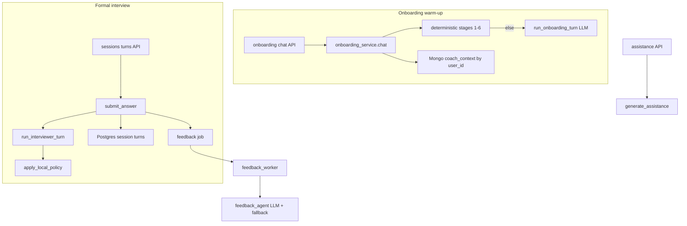

# Full Agent Intelligence & Human Interview Simulation Audit

**Branch:** `kushal-fix` (tracks `origin/kushal-fix`)  
**Date:** 2026-11-20  
**Method:** Read-only architecture inventory + isolated mocked multi-turn decision tests (no shared DB writes, no service restarts, no commit/push).  
**Harness:** `backend/tests/test_human_interview_simulation.py`, `backend/tests/test_sql_to_api_focus_shift.py`  
**Pre-fix baseline:** harness documented RC-C1 / RC-B2 / RC-F1.  
**Post-fix:** those three fixed; isolated regression **59 passed**.

---

## 1. Executive Summary

InterviewCopilot has **two live conversational surfaces** that candidates experience as “the interviewer”:

1. **Onboarding coach** (Mongo `coach_context` by `user_id`) — warm-up / topic lock / clarify / focus shift.
2. **Formal interviewer** (Postgres session turns by `session_id`) — evaluate answer → next question via `apply_local_policy`.

Formal **policy** for IDK / partial / excellent / completion is **sound** in isolation. Coach focus-shift + clarify-once work for API pivots, short replies, and (after fix) “I want to discuss HR.” This pass also skips LLM on empty/IDK/short and prefers saved feedback coverage.

| ID | Severity | Status |
|---|---|---|
| RC-C1 | High | **Fixed** — skip LLM on empty/IDK/short |
| RC-B2 | High | **Fixed** — discuss/talk-about intent in `subject_shift` |
| RC-F1 | High | **Fixed** — prefer saved turn coverage |
| RC-S1 | High | **Open** — answer committed before `_decide` |
| RC-M1 | Medium | **Open** — coach Mongo is `user_id`-scoped |
| RC-T1 | Medium | Closed — engine/assistance tests present on disk |

**Readiness verdict: FUNCTIONALLY WORKING** — Scenarios A–J decision paths pass under isolated mocks after P0/P1 fixes; remaining limits are session atomicity, coach scoping, and lack of live browser/provider evidence (not HUMAN-INTERVIEW READY).

---

## 2. Actual Agent Architecture



**Known UX split:** Many “interviewer stuck on SQL after I said API” reports are **coach** (`focus_locked` + clarify), not `interviewer.py`.

---

## 3. Agent-by-Agent Assessment

| Agent | Trigger | Inputs | Context | Decision | Output | State R/W | Deps | Failure | Tests |
|---|---|---|---|---|---|---|---|---|
| **Onboarding coach** | `POST` onboarding chat | message, vault summary, history | Mongo `coach_context` (`user_id`) | Deterministic stages → `decide_conversational_action` → optional `run_onboarding_turn` | reply + ctx patch | Mongo merge by `user_id` | LiteLLM structured, vault | Gateway errors → mapped HTTP (`gateway_http_status`) | `test_onboarding*`, `test_sql_to_api_focus_shift`, harness B/F |
| **Interviewer** | `POST /sessions/{id}/turns` → `submit_answer` → `_decide` | last answer, plan, areas, mode | Postgres turns + brief | LLM `TurnDecision` → eval guards → `apply_local_policy` | next Q + eval | Postgres turns; answer committed **before** decide | LiteLLM, LangGraph thin wrapper | Repair loop / force unique / complete | `test_interviewer_engine`, harness A/C–J |
| **Assistance** | `POST .../assistance` | open turn, mode | session turn | Strict blocks; Guided ladder `next_assistance_level` | hint content | turn `assistance_level` | LLM | 409 exhausted / not allowed | `test_assistance`, harness G |
| **Question plan / bank / track** | track create / session start | brief, vault | plan slots | planning agents | plan / bank fill | Postgres track/brief | LLM | fallbacks in service | `test_question_plan`, bank, tracks |
| **Feedback agent** | NATS job / catch-up | session turns | session_id scoped | LLM report + `enrich_assessments_with_turns` | report content | feedback tables | LLM + builder | fallback `build_report_from_saved_evaluations` | `test_feedback_*`, harness J |
| **Probe / defense** | defense mode payload | selected projects | defense rules | merge areas + prompt rules | areas / instruction | via interview payload | — | invent-guard in rules | `test_project_defense`, harness I |
| **Persona / readiness / resume** | profile / prep APIs | vault, prefs | user docs | specialized agents | structured summaries | Mongo/Postgres | LLM | gateway errors | dedicated tests |

---

## 4. Real Human Interview Simulation Results

| Scenario | Result | Evidence |
|---|---|---|
| **A** 5-turn policy | **PASS** | partial→follow_up; excellent+streak→next_area; budget≥3→leave area |
| **B** topic change | **PASS** (post-fix) | API pivot + short replies ≠ clarify SQL; “I want to discuss HR” → advance/change_topic |
| **C** IDK | **PASS** (post-fix) | Policy + live path skips LLM; first IDK stay+simplify; second → next_area |
| **D** partial follow-up | **PASS** | Forces `follow_up` same area; notes include gap hint |
| **E** detailed advance | **PASS** | excellent + strong streak → next remaining area |
| **F** ambiguous / clarify once | **PASS** | brief outcome class; second clarify blocked when `clarify_count>=1` |
| **G** explanation / mode | **PASS** | Strict strips spoilers+praise; Guided assistance ladder |
| **H** behavioral format | **PASS** | `preferred_format=behavioral` + `allowed_types` → type coerced |
| **I** project defense | **PASS** | merge keeps selected project; focus reply uses vault title only |
| **J** completion / report | **PASS** (post-fix) | complete on zero slots; enrich prefers saved turn coverage |

Harness command (isolated):

```text
backend/.venv/Scripts/python.exe -m pytest tests/test_human_interview_simulation.py tests/test_sql_to_api_focus_shift.py -q
→ 17 passed
```

---

## 5. Conversation and Memory Assessment

| Concern | Finding |
|---|---|
| Latest candidate message in LLM payload | Formal: yes via `_prompt_payload` / `last_answer`. Coach: history + message. |
| Topic update after pivot | `extract_focus_shift_from_reply` works for API pivot text; stale `focus_locked` can lag until merge. |
| Skipped topics revived | Mitigated when last ask left the lock (`_last_ask_targets_locked_topic` false → advance). |
| Asked-question memory | Formal: `asked_questions` + dedupe/repair. Coach: fingerprints + clarify_count. |
| Cross-session bleed | Coach state is **user-scoped** (RC-M1). Formal turns are **session_id**-scoped. |

---

## 6. Topic Switching Assessment

| Case | Outcome |
|---|---|
| “Let's discuss APIs instead.” | `change_topic` / move_on (**PASS**) |
| “API” / “External API” after API choice ask | advance, no SQL clarify (**PASS**) |
| “Skip this.” / “I don't know.” after pivot | ≠ clarify (**PASS**) |
| “I want to discuss HR.” | **PASS** (post-fix) — subject_shift → advance |
| “switch to HR” | change_topic / advance (**PASS**) |

Root: `_message_signals.subject_shift` regex omits bare “discuss …” / “want to discuss …”; length 20–140 marks `partial=True`.

---

## 7. Question Quality Assessment

| Check | Outcome |
|---|---|
| Single-focus repair | Present in `apply_local_policy` via `question_focus_violation` / `repair_single_focus` |
| Strict spoilers / praise | `strip_strict_spoilers` + `strip_strict_praise` applied in policy + harness G |
| Skill-menu IDK questions | Policy replaces choice menus on uncertain follow_up |
| Behavioral coercion | Honored when type allowed |
| Diversity under empty remaining | Relies on plan/bank; not fully multi-turn LLM-tested here (**PARTIAL / NOT TESTED** for live uniqueness under load) |

---

## 8. LLM and Provider Reliability

| Item | Status |
|---|---|
| Gateway chain | Primary + Gemini fallbacks (`interview-chat`, `structured-json`) |
| Cause → HTTP | WT `gateway_http_status` maps rate_limit→429, timeout→504, auth→502, schema→422 |
| IDK path | **Fixed** — guarded skip before LLM (RC-C1) |
| Live provider outage | **NOT TESTED** (no live calls in this audit) |

---

## 9. Frontend/Backend Integration

| Path | Notes |
|---|---|
| Coach chat | API → `onboarding_service.chat` → deterministic / graph |
| Formal turns | `POST /sessions/{id}/turns` → `submit_answer` |
| Assistance | Mode-gated; Strict → 403/assistance_not_allowed |
| Feedback | Complete publishes NATS; report fetch by `session_id` |

Browser / real-account E2E: **NOT TESTED** (safety constraint).

---

## 10. Session and State Management

| Issue | Evidence |
|---|---|
| Answer commit before decide | `submit_answer` writes `last_turn.answer` + `commit()` then `_decide` (RC-S1). Retry if `evaluation_coverage is None`. |
| Coach vs interview scope | Mongo coach by `user_id`; interview by `session_id` (RC-M1). |
| Feedback association | Jobs keyed by `session_id` (design OK); enrichment coverage bug can distort report (RC-F1). |

---

## 11. Confirmed Root Causes

| Issue ID | Severity | Reproduction | Expected | Actual | Root cause | Evidence | Impact | Minimal fix | Regression |
|---|---|---|---|---|---|---|---|---|---|
| RC-C1 | High | IDK turn | Skip LLM | **Was:** LLM then overlay → **Fixed** | Guards ran after LLM | `interviewer.py` guarded_skip_llm | Latency/cost | Synthesize guarded TurnDecision before LLM | `test_scenario_c_live_path_skips_llm_on_idk` |
| RC-B2 | High | “I want to discuss HR.” | advance/change_topic | **Was:** follow_up → **Fixed** | subject_shift miss | `onboarding.py` `_message_signals` | Stale follow-ups | Intent phrases for discuss/talk-about | harness B |
| RC-F1 | High | LLM excellent vs saved good | Prefer saved | **Was:** excellent → **Fixed** | `row or saved` order | `feedback_report_builder.py` | Inflated scores | Prefer saved coverage | harness J |
| RC-S1 | High | concurrent / mid-flight failure after answer commit | Atomic decide+persist or safe rollback | Answer stored with null eval until retry | Early `db.commit()` before `_decide` | `interview_service.submit_answer` ~863–880 | Stuck/partial turns under errors | Defer commit until eval written **or** keep retry (already partial); full atomicity needs careful txn design | existing retry + interview tests |
| RC-M1 | Medium | Two coach chats same user | Per-interview isolation | Shared `coach_context` | Keyed by `user_id` only | `conversation_store.get_coach_context` | Cross-talk between prep threads | Scope coach_context by conversation/session id (larger change; not done in this pass) | mongo isolation tests |

---

## 12. Probable Root Causes

| ID | Severity | Hypothesis | Why probable |
|---|---|---|---|
| RC-P1 | Medium | Live coach still loops when LLM path bypasses deterministic action renderer | Deterministic path covered; LLM `run_onboarding_turn` can still ignore action unless service forces reply |
| RC-P2 | Medium | Formal question duplicates under repair exhaustion | force_unique / least_recent reuse path exists; not fully simulated with adversarial asked lists |
| RC-P3 | Low | Frontend shows coach copy as “interview” | Product framing; architecture split confirmed |

---

## 13. Reproducible Failures

1. **HR discuss phrasing (coach)**  
   Input: locked SQL, last ask already API pivot, message `I want to discuss HR.`  
   Actual: `{"action":"follow_up","reason":"partial_answer"}`  
   Test: `test_scenario_b_topic_change_and_short_replies`

2. **IDK still hits LLM (formal)**  
   Mock `structured_completion`; `last_answer="I don't know."` → `calls==["llm"]` then `idk_answer` overlay.  
   Test: `test_scenario_c_live_path_calls_llm_before_idk_guard`

3. **Feedback coverage override**  
   Saved turn `good` + LLM row `excellent` → enriched coverage `excellent`.  
   Test: `test_scenario_j_completion_and_report_enrichment`

---

## 14. Recommended Minimal Fixes

1. **RC-C1:** In `run_interviewer_turn`, if empty/IDK/too_short, synthesize guarded `TurnDecision` (follow_up / simplified Q) and **skip** `structured_completion`.
2. **RC-B2:** Broaden `subject_shift` to include discuss / talk-about intent patterns; keep lock+context gating in `decide_conversational_action`.
3. **RC-F1:** In `enrich_assessments_with_turns`, prefer `t.evaluation_coverage` when set.
4. **RC-S1:** Out of scope for silent WT fix without careful txn review — document; retry path remains.
5. **RC-M1:** Defer (schema/conversation scoping).

---

## 15. Fixes Implemented (this pass)

| Fix | Files |
|---|---|
| RC-C1 skip LLM on empty/IDK/short | `backend/app/agents/interviewer.py` |
| RC-B2 discuss/talk-about subject_shift | `backend/app/agents/onboarding.py` |
| RC-F1 prefer saved coverage | `backend/app/services/feedback_report_builder.py` |
| Harness + engine test updates | `test_human_interview_simulation.py`, `test_interviewer_engine.py` |

Preserved prior WT coach/gateway work; no commit/push; no shared DB writes.

---

## 16. Regression Test Results

```text
backend/.venv/Scripts/python.exe -m pytest \
  tests/test_human_interview_simulation.py \
  tests/test_sql_to_api_focus_shift.py \
  tests/test_interviewer_engine.py \
  tests/test_feedback_pipeline.py \
  tests/test_assistance.py \
  tests/test_conversational_reasoning.py -q

→ 59 passed
```

---

## 17. Remaining Risks

- Coach LLM path may still diverge from deterministic action policy.
- Answer-before-decide race (RC-S1) not fully eliminated.
- Coach `user_id` scope (RC-M1).
- No live browser / multi-provider outage evidence.
- Behavioral multi-turn *content* quality beyond type coercion not live-LLM-tested.

---

## 18. Overall Readiness Assessment

### **FUNCTIONALLY WORKING**

Rationale: Isolated Scenarios A–J decision behaviour passes after P0/P1 fixes. Not HUMAN-INTERVIEW READY: RC-S1/RC-M1 remain, and live multi-turn LLM/browser evidence was intentionally skipped under safety constraints.

---

## Appendix A — 15-Criterion Scorecard

| # | Criterion | Rating | Evidence | Example | Component | Failure reason |
|---|---|---|---|---|---|---|
| 1 | Context understanding | PASS | Topic lock + vault + discuss pivot | B, I | coach / defense | — |
| 2 | Answer understanding | PASS | Coverage/outcome + IDK skip LLM | C, D, F | interviewer | — |
| 3 | Follow-up relevance | PASS | Gap notes + one soft follow-up | A, D | `apply_local_policy` | — |
| 4 | Topic-change recognition | PASS | API/switch/discuss HR | B | `_message_signals` | — |
| 5 | Conversation memory | PARTIAL | asked/clarify; user-scoped coach | F, store | coach Mongo | RC-M1 |
| 6 | Question diversity | PARTIAL | dedupe/repair present; limited live sim | engine tests | interviewer | no live LLM adversarial |
| 7 | Difficulty adaptation | PASS | strong streak advances; budget leaves | A, E | policy | — |
| 8 | Candidate-specific personalization | PASS | selected project only | I | probe/onboarding | — |
| 9 | Interview-mode compliance | PASS | Strict spoilers; Guided ladder | G | interviewer/assistance | — |
| 10 | Natural conversational language | PARTIAL | Deterministic renders OK; LLM phrasing NOT TESTED live | coach render | onboarding | no live LLM |
| 11 | State consistency | PARTIAL | answer-before-decide; coach user scope | submit_answer | interview_service | RC-S1, RC-M1 |
| 12 | Interview progression | PASS | complete when slots/time exhausted | J, A | policy | — |
| 13 | Duplicate-question prevention | PARTIAL | repair + force_unique | interviewer | not fully adversarial | |
| 14 | Error recovery | PARTIAL | gateway_http_status; answer retry if no eval | llm.py, submit | RC-S1 residual | |
| 15 | Interview completion | PASS | closing + saved coverage preferred | J | feedback builder | — |

---

## Appendix B — Safety / WT Inventory

**Preserved uncommitted work (do not discard):**

- Modified: `onboarding.py`, `onboarding_service.py`, `gateway/llm.py`, `api/v1/interviews.py`
- Added: `test_sql_to_api_focus_shift.py`, `test_human_interview_simulation.py`

**Deleted-tests investigation:** Earlier WT showed engine/assistance/adaptive tests deleted (~2.9k LOC). On current tree those files are **tracked and present** again (`test_interviewer_engine.py`, `test_assistance.py`, etc.). No blind restore performed in this pass beyond confirming presence.

**NOT TESTED (safety):** live Postgres/Mongo candidate data, Docker restarts, browser interviews, provider outages, NATS against shared bus.
