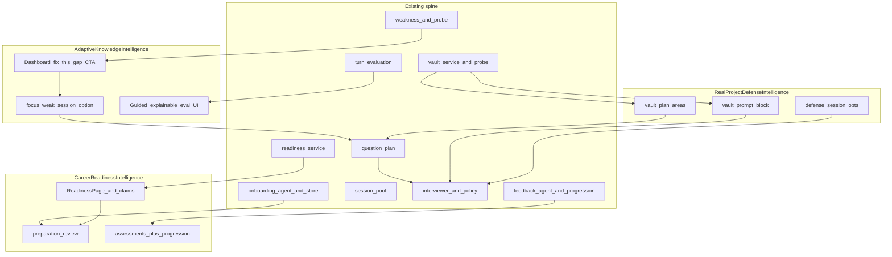

# InterviewCopilot — Post-Audit Implementation Roadmap

**Date:** 2026-11-16  
**Basis:** [`docs/INTERVIEWCOPILOT_COMPLETE_PRODUCT_AUDIT.md`](INTERVIEWCOPILOT_COMPLETE_PRODUCT_AUDIT.md)  
**Nature:** Planning and architecture only. This document does **not** claim live verification of untested paths. No application code, database, NATS, or volume changes accompany this file.

### Evidence discipline

| Label | Meaning |
|-------|---------|
| Audit-verified | Confirmed in the audit via tests and/or code+test alignment |
| Audit-inspected | Static finding from the audit; not live-proven |
| Planned | Work described here; not yet implemented |

---

## 0. Executive order of work

Implement in this sequence. Later phases assume earlier gates are green.

| Step | Priority | Workstream | Rationale |
|------|----------|------------|-----------|
| 1 | P0 | Discipline-safe question fallback | Stops wrong-subject DSA leakage under LLM fallback |
| 2 | P0 | Honest `/readyz` (Mongo + S3) | Prevents traffic to a half-down stack |
| 3 | P1 | Mongo client lifecycle via `app.state` | Connection churn / loop safety |
| 4 | P1 | Frontend error handling | User-visible resilience on fetch failure |
| 5 | P1 | Orphan API wire / intentional keep | Completes or closes dead product surface |
| 6 | P2 | Question dedupe test signature fix | Restores CI signal for duplicate rejection |
| 7 | P2 | Universal multi-discipline planning | Profile-aware pool, vault areas, less regex bias |
| 8 | Later | Differentiation features | Adaptive Knowledge, Project Defense, Career Readiness |

**Hard constraints for all future implementation passes:** no seed/dummy data into shared DBs; no purge of NATS/volumes; no destructive resets; no secret exposure; preserve existing agent/service boundaries unless evidence justifies a change.

---

## 1. P0 — Discipline-safe question fallback

### Current implementation and problem

When the interviewer cannot accept an LLM decision (duplicate / policy violation), `_fallback_unique_question` builds candidates without another model call. After preferring unused bank questions, it currently does:

```text
if "array" in area_l or not remaining:
    append all _ARRAY_CONCEPT_BANK DSA stems
```

**Problem (audit J1):** On non-CS tracks, when `remaining_areas` is empty, DSA array questions can be injected. That violates multi-discipline correctness even if `domain_profile` is correct elsewhere.

### Files and modules

| Path | Role |
|------|------|
| [`backend/app/agents/interviewer.py`](../backend/app/agents/interviewer.py) | `_ARRAY_CONCEPT_BANK`, `_FALLBACK_STEMS`, `_fallback_unique_question` |
| [`backend/app/agents/question_quality.py`](../backend/app/agents/question_quality.py) | `active_profile`, `is_programming_brief`, `fallback_profile` |
| [`backend/app/services/interview_service.py`](../backend/app/services/interview_service.py) | Builds turn payload including `domain_profile`, `remaining_areas`, `programming_track` |
| Tests: `backend/tests/test_interviewer_engine.py`, `test_question_dedupe.py`, `test_session_variety.py`, `test_domain_profile.py` | Regression |

### Root cause

The DSA bank was introduced as a local anti-paraphrase aid for Arrays/DSA tracks, then gated with `or not remaining`, which treats “plan exhausted” as “use array bank” for **every** discipline.

### Recommended solution

1. Gate `_ARRAY_CONCEPT_BANK` strictly:
   - Include only when area text clearly indicates arrays/DSA **or**
   - `payload.programming_track` / `domain_profile.category == "programming"` **and** area/topic suggests arrays — never solely because `remaining` is empty.
2. When `remaining` is empty on non-programming (or non-array) tracks: use `_FALLBACK_STEMS` formatted with the last covered / preferred area / track subject only; optionally rotate covered areas; never invent CS algorithms.
3. Prefer unused `question_bank` / pool rows first (already present) before any concept bank.
4. Pass through `domain_profile` / `allowed_types` into fallback selection so stems stay type-appropriate (conceptual/mcq vs coding).

### Dependencies

None (can ship before readiness/Mongo work). Soft dependency: clearer `domain_profile` on briefs (P2) improves gate accuracy but is not required for the safety fix.

### Risks and regressions

| Risk | Mitigation |
|------|------------|
| Arrays tracks lose variety after many turns | Keep bank when area or programming+array signals match |
| Fallback becomes repetitive generic stems | Rotate stems + covered area labels; bank-first still applies |
| Tests assume DSA fallback on empty remaining | Update unit tests to assert **non**-injection for science/business fixtures |

### Tests required

- Unit: non-programming payload + empty `remaining_areas` → no `_ARRAY_CONCEPT_BANK` string substrings in chosen question.
- Unit: area containing “array” / programming arrays track → bank still available.
- Existing interviewer engine / session variety suites still pass offline.
- No shared-DB mutation tests required for this change.

### Acceptance criteria

- [ ] Empty `remaining_areas` on a non-programming brief never yields DSA array-bank questions.
- [ ] Programming/array tracks retain concept-bank diversity under duplicate pressure.
- [ ] Bank and generic stems still produce a non-duplicate question when LLM repair fails.
- [ ] Documented as Planned→implemented only after tests pass offline.

### Priority and order

**P0 / Step 1** — first code change after roadmap approval.

---

## 2. P0 — Honest dependency readiness

### Current implementation and problem

[`backend/app/main.py`](../backend/app/main.py) `/readyz` checks Postgres (`SELECT 1`), NATS connected flag, and LiteLLM liveliness. It does **not** check Mongo or object storage (S3/Seaweed).

**Problem (audit J2):** Orchestrators can mark the API ready while onboarding conversations, LLM logs, readiness cache, or resume upload paths are down.

### Files and modules

| Path | Role |
|------|------|
| [`backend/app/main.py`](../backend/app/main.py) | `/readyz` |
| [`backend/app/db/mongo.py`](../backend/app/db/mongo.py) | Motor client helpers |
| [`backend/app/db/s3.py`](../backend/app/db/s3.py) | `get_s3_client` |
| [`backend/app/core/config.py`](../backend/app/core/config.py) | `mongo_url`, `mongo_db`, `s3_*` |
| [`backend/tests/test_healthz.py`](../backend/tests/test_healthz.py) | Health coverage (extend for readyz) |

### Root cause

Readiness was scoped to the original M1 probe set; Mongo/S3 became critical later without updating the probe.

### Recommended solution

1. **Mongo (required for ready):** Use lifespan `app.state.mongo_client` / `app.state.mongo_db` — `ping` command (`await mongo_db.command("ping")`). On failure set `checks["mongo"] = "error: …"` and overall not ready.
2. **S3 (required for ready when resume/storage is enabled in this env):** Lightweight probe via existing client (e.g. `head_bucket` or equivalent against configured bucket). On failure set `checks["s3"]`. If product ever supports “no storage” mode, gate with an explicit settings flag — default for InterviewCopilot local/compose is **include S3**.
3. Keep status shape: `{ status, checks }` with HTTP 200 only when all required checks are `"ok"`, else 503.
4. Do **not** call live LLM chat in `/readyz` (liveliness only, as today).

### Dependencies

Prefers lifespan Mongo client (aligns with Step 3). Can land with a careful use of `app.state` inside the route even before Depends refactor.

### Risks and regressions

| Risk | Mitigation |
|------|------------|
| Local dev without Seaweed fails ready | Document compose dependency; fail closed is intentional |
| Slow S3 probe blocks k8s | Short timeout (e.g. 2–3s); parallelize checks |
| False negatives on bucket name misconfig | Surface clear check error class names only (no secrets) |

### Tests required

- Unit/ASGI: monkeypatch mongo ping + s3 head success → 200 `ready`.
- Unit: mongo fail → 503 `degraded`, `checks.mongo` not ok.
- Unit: s3 fail → 503.
- Existing `/healthz` remains 200 without deps.

### Acceptance criteria

- [ ] `/readyz` includes `mongo` and `s3` in `checks`.
- [ ] Missing Mongo or S3 ⇒ not ready (503).
- [ ] No credentials or connection strings in response bodies/logs from the probe.
- [ ] Compose healthchecks documented against the new contract.

### Priority and order

**P0 / Step 2** — immediately after fallback safety (or parallel if different owners; both before product traffic claims).

---

## 3. P1 — MongoDB client lifecycle

### Current implementation and problem

- Lifespan creates one `AsyncIOMotorClient` on `app.state.mongo_client` / `app.state.mongo_db` and closes it on shutdown ([`main.py`](../backend/app/main.py)).
- Most feature routes correctly pass `request.app.state.mongo_db`.
- [`get_mongo_db()`](../backend/app/db/mongo.py) builds a **new** client per call; [`admin.py`](../backend/app/api/v1/admin.py) injects it via `Depends(get_mongo_db)`.

**Problem (audit J3):** Per-request clients cause connection churn and event-loop binding hazards (the module comment already warns about loop binding).

### Files and modules

| Path | Role |
|------|------|
| [`backend/app/db/mongo.py`](../backend/app/db/mongo.py) | `get_mongo_client`, `get_mongo_db` |
| [`backend/app/api/v1/admin.py`](../backend/app/api/v1/admin.py) | Depends on `get_mongo_db` |
| [`backend/app/api/deps.py`](../backend/app/api/deps.py) | Natural home for `get_mongo_from_app` |
| Tests: `test_admin.py` and any fixtures creating Motor clients | Align with shared client |

### Root cause

A FastAPI Depends helper was added that reuses the “fresh client for tests” pattern instead of the process lifespan client used by product routes.

### Recommended solution

1. Add `get_request_mongo(request: Request) -> AsyncIOMotorDatabase` that returns `request.app.state.mongo_db` (fail 503 if missing).
2. Switch admin routes (and any remaining Depends callers) to that helper.
3. Keep `get_mongo_client()` for **lifespan and isolated unit tests** that intentionally own a client; stop using it inside request Depends.
4. Optionally create Mongo indexes for `llm_call_logs` / `readiness_cache` in lifespan (P3 from audit J11) — not blocking this P1, but same touchpoint.

### Dependencies

None beyond FastAPI app lifespan already creating `app.state.mongo_db`. Complements Step 2 readiness probes.

### Risks and regressions

| Risk | Mitigation |
|------|------------|
| Tests that never run lifespan | Fixtures set `app.state.mongo_db` or override Depends |
| Double-close of clients | Only lifespan closes the process client |

### Tests required

- Admin route tests with app lifespan or dependency override.
- Assert Depends path does not call `AsyncIOMotorClient` constructor per request (mock/spy in unit test).

### Acceptance criteria

- [ ] No request-path `Depends` creates a new Motor client.
- [ ] Admin and feature routes share lifespan DB handle.
- [ ] Lifespan still closes the client once on shutdown.

### Priority and order

**P1 / Step 3**.

---

## 4. P1 — Frontend error handling

### Current implementation and problem

- [`InterviewPage.tsx`](../frontend/src/pages/InterviewPage.tsx): handles `session.isLoading` but **not** `session.isError` (audit J4). A failed `GET /sessions/{id}` can leave a blank or stuck shell.
- [`DashboardPage.tsx`](../frontend/src/pages/DashboardPage.tsx): loads `/me/open-sessions` and `/me/assessments` without dedicated `isError` UI (audit J5). Failures can look like empty success states.

Submit/finish errors already have some UI; this step targets **query** failures.

### Files and modules

| Path | Role |
|------|------|
| [`frontend/src/pages/InterviewPage.tsx`](../frontend/src/pages/InterviewPage.tsx) | Session query |
| [`frontend/src/pages/DashboardPage.tsx`](../frontend/src/pages/DashboardPage.tsx) | Open sessions + assessments queries |
| [`frontend/src/lib/api.ts`](../frontend/src/lib/api.ts) | `ApiError` |
| E2E: extend mocked specs under `frontend/e2e/` | Error-path coverage |

### Root cause

Happy-path React Query usage without error branches for critical lists/session bootstrap.

### Recommended solution

1. **InterviewPage:** If `session.isError`, show a clear panel: message from `ApiError` when available, **Retry** (`refetch`), **Back to track**. Do not render the answer dock as if a turn exists.
2. **DashboardPage:** Separate error affordances for `openSessions.isError` and `assessments.isError` (inline alert + retry). Do not conflate with “you have zero sessions.”
3. Match existing visual language (no new design system); keep accessibility (role/alert).

### Dependencies

None on backend. Can ship in parallel with Step 3.

### Risks and regressions

| Risk | Mitigation |
|------|------------|
| Layout shift on dashboard | Reuse existing empty-state spacing |
| E2E flakes | Mock 500 once; assert retry button |

### Tests required

- Playwright mocked: session GET 500 → error UI + retry recovers.
- Playwright or component-level: dashboard assessments/open-sessions error banners.
- Existing smoke / viewport / finishExit still pass.

### Acceptance criteria

- [ ] Failed session fetch never looks like an in-progress interview.
- [ ] Dashboard distinguishes load error vs empty data for open sessions and assessments.
- [ ] Retry triggers refetch without full page reload.

### Priority and order

**P1 / Step 4**.

---

## 5. P1 — Orphan API integration decisions

Decisions are **locked** (no open product forks). `GET /tracks/{id}/brief` and `POST /dev/llm-check` stay without FE callers by design.

### 5.1 Wire — `POST /sessions/{id}/abort`

| | |
|--|--|
| **Current** | Backend [`abort_session`](../backend/app/services/interview_service.py) exists; FE leave flow only resumes later or completes for scoring ([`LeaveInterviewModal.tsx`](../frontend/src/components/LeaveInterviewModal.tsx)). |
| **Problem** | Users cannot discard an interview without scoring; empty/junk sessions clutter open-session lists. |
| **Solution** | Add “Discard without scoring” that calls abort; confirm copy explains no report. Optionally use abort for empty sessions in [`StartInterviewModal.tsx`](../frontend/src/components/StartInterviewModal.tsx) where complete-for-cleanup is misleading. |
| **Files** | `LeaveInterviewModal.tsx`, `InterviewPage.tsx` / leave guard, `StartInterviewModal.tsx`, `api` call sites; backend already done. |
| **Tests** | Mocked e2e: discard → navigates away; session not shown as resumable. Backend abort ownership tests if not already covered. |
| **Acceptance** | Abort reachable from leave UX; ownership 404/403 unchanged. |

### 5.2 Wire — `POST /onboarding/goals/confirm`

| | |
|--|--|
| **Current** | [`confirm_goals`](../backend/app/services/onboarding_service.py) + route exist; `complete` may confirm implicitly; GoalDiscovery does not call confirm explicitly. |
| **Problem** | Goals confirmation semantics are opaque; orphan route drifts. |
| **Solution** | Explicit Confirm in [`GoalDiscovery.tsx`](../frontend/src/components/GoalDiscovery.tsx) / onboarding flow → `POST /onboarding/goals/confirm`, then refresh state. |
| **Tests** | Onboarding unit/e2e mock: confirm updates state flags. |
| **Acceptance** | Confirm is user-visible and idempotent. |

### 5.3 Wire — `POST /onboarding/review/refresh`

| | |
|--|--|
| **Current** | Backend refresh exists; Dashboard review uses GET/PATCH only. |
| **Problem** | Users cannot regenerate stale review without re-onboarding. |
| **Solution** | Refresh control on [`PreparationReviewPanel.tsx`](../frontend/src/components/PreparationReviewPanel.tsx) → `POST /onboarding/review/refresh`, invalidate review query. |
| **Risks** | LLM cost / rate limits — disable button while in flight; surface 429/503. |
| **Acceptance** | Refresh replaces review payload in UI on success. |

### 5.4 Intentional backend-only — `GET /tracks/{id}/brief`

FE [`TrackDetailPage`](../frontend/src/pages/TrackDetailPage.tsx) already uses `GET /tracks/{id}` which returns track + brief. Keep brief route for workers/admin/debug; **no FE work**.

### 5.5 Wire — `POST /vault/items`

| | |
|--|--|
| **Current** | Create API + `vault_service.create_items`; sidebar PATCH/DELETE only; items often arrive via resume extract / onboarding state. |
| **Problem** | Cannot manually add a skill/project without resume re-upload. |
| **Solution** | Add-item form in [`VaultSidebar.tsx`](../frontend/src/components/VaultSidebar.tsx) → `POST /vault/items`; invalidate `onboarding-state` / `vault-items`. |
| **Acceptance** | Created item appears in sidebar without full page reload. |

### 5.6 Keep unused — `POST /dev/llm-check`

Local-only smoke (`app_env == local`); must not appear in product UI. Document in ops runbook only.

### Shared for Step 5

- **Dependencies:** FE error handling (Step 4) for refresh/abort failure UX.
- **Risks:** Accidental abort vs complete; copy must distinguish. Refresh burns LLM quota.
- **Priority:** **P1 / Step 5** after or with Step 4.

---

## 6. P2 — Question deduplication test fixes

### Current implementation and problem

Production [`run_interviewer_turn`](../backend/app/agents/interviewer.py) calls:

```python
await structured_completion(system=..., user_payload=..., schema=..., ...)
```

(omitting positional `client`; gateway defaults `client=None`).

Two tests in [`backend/tests/test_question_dedupe.py`](../backend/tests/test_question_dedupe.py) monkeypatch mocks as `async def always_dup(client, *, system, ...)` **without** a default for `client`, causing `TypeError` (audit J7). This is **test drift**, not proof that production dedupe is broken.

### Files and modules

| Path | Role |
|------|------|
| `backend/tests/test_question_dedupe.py` | Failing mocks |
| `backend/app/gateway/structured.py` | Signature source of truth |
| `backend/app/agents/interviewer.py` | Call sites |
| `backend/app/agents/question_dedupe.py` | Dedup helpers under test indirectly |

### Root cause

Mocks required a positional `client` after `structured_completion` gained an optional first argument; call sites never pass it positionally.

### Recommended solution

1. Change mocks to `async def always_dup(client=None, *, system, user_payload, schema, **_k)` (or `*args, **kwargs` + validate schema).
2. Re-assert fallback / paraphrase rejection behavior.
3. Do not change production signatures solely to please tests.

### Dependencies

Ideally after Step 1 if fallback behavior assertions overlap; otherwise independent.

### Risks

Over-narrow assertions on exact fallback strings — prefer duplicate-rejection and “not equal to prior question” checks.

### Tests required

- Fix and run the two previously failing tests offline.
- Keep `test_structured` / `test_gateway` green.

### Acceptance criteria

- [ ] Those two tests pass without Postgres.
- [ ] Mocks match `structured_completion`’s optional client.

### Priority and order

**P2 / Step 6**.

---

## 7. P2 — Universal multi-discipline question planning

### Current implementation and problem

Multi-discipline is **partial** (audit §E, J8–J10):

| Mechanism | Issue |
|-----------|--------|
| `domain_profile` | Good when present; missing → regex `is_programming_brief` / weak “other” |
| Pool pick `_best` | Exact `area == planned` string match ([`session_pool.py`](../backend/app/agents/session_pool.py)) |
| Vault plan areas | Merged only when `use_resume` ([`interview_service.py`](../backend/app/services/interview_service.py) + [`probe.vault_plan_areas`](../backend/app/services/probe.py)) |
| FE `questionKind.ts` | Coding workspace heuristics still CS-leaning |
| Dedupe examples | CS-flavored fixtures dominate |

### Files and modules

| Path | Role |
|------|------|
| `backend/app/agents/question_plan.py` | Duration-aware plan topics |
| `backend/app/agents/question_quality.py` | Profile sanitize / format mix |
| `backend/app/agents/track_creator.py` | Authors `domain_profile` on briefs |
| `backend/app/agents/session_pool.py` | Pool selection |
| `backend/app/agents/interviewer.py` | Policy + fallback (after Step 1) |
| `backend/app/services/interview_service.py` | Plan merge, payload assembly |
| `backend/app/services/probe.py` | `vault_plan_areas` |
| `frontend/src/lib/questionKind.ts` | Workspace kind |

### Root cause

CS/DSA paths were hardened first; profile-aware behavior is incomplete at pool match, vault merge gating, and fallback banks.

### Recommended solution

1. **Pool matching:** Soft-normalize area/topic (casefold, trim, light alias / containment) before exact equality; fall back to full pool if no soft match (preserve shuffle seed behavior).
2. **Vault areas:** Allow vault-derived plan topics when vault items exist **and** session opts request personalization — not only the `use_resume` flag name. Prefer: `use_resume OR explicit include_vault_topics` (FE checkbox can keep label “Use my resume and projects” but backend should treat vault presence consistently). Do **not** invent domains; keep `vault_plan_areas` “no invented domains” contract.
3. **Profile-first format mix:** Prefer `active_profile` everywhere `is_programming_brief` currently short-circuits; regex only as `fallback_profile` input.
4. **Fallback banks:** Profile-keyed or category-keyed generic stems (after Step 1); no global DSA default.
5. **FE kind:** Drive coding workspace from brief `domain_profile.uses_code` / allowed types when session payload exposes them; keep heuristics as last resort.
6. **Tests:** Add non-CS fixtures (e.g. biology / product / finance topic strings) for plan + pool + fallback — offline unit only; no shared DB seeds.

### Dependencies

Step 1 (safe fallback) mandatory first. Step 6 helps lock interviewer behavior.

### Risks and regressions

| Risk | Mitigation |
|------|------------|
| Soft pool match over-includes | Prefer exact, then normalized equality, then containment; never cross-track |
| Vault topics dilute JD tracks | Cap merge size (existing `[:12]`); prioritize brief areas |
| Regex removal breaks old briefs without profile | Keep `fallback_profile` |

### Tests required

- `test_domain_profile`, `test_question_plan`, new pool soft-match units, interviewer non-CS fallback.
- Optional mocked e2e: non-coding track does not open coding workspace.

### Acceptance criteria

- [ ] Non-programming tracks do not receive DSA bank questions under fallback.
- [ ] Pool selection can hit planned topics despite trivial casing/spacing differences.
- [ ] Vault skills/projects can influence plan when user opts into personalization, without inventing subjects.
- [ ] Briefs with valid `domain_profile` drive type mix over raw regex.

### Priority and order

**P2 / Step 7**.

---

## 8. Unique product features — technical architecture

Build **after** Steps 1–7. Reuse existing agents and services. **Do not** add new agent packages unless a thin function in an existing service is proven insufficient.



### 8.1 Adaptive Knowledge Intelligence

**Intent:** Continuously steer practice toward demonstrated weak concepts without a parallel tutor agent.

**Reuse**

- `GET /tracks/{id}/weaknesses` + `weakness_service` / probe summaries  
- Session option `focus_weak` already threaded in `interview_service`  
- `question_plan` + `apply_local_policy` subject progression  
- Turn `evaluation` (coverage / strengths / gaps / evaluator_checks) already returned to FE  

**Architecture**

1. **Dashboard CTA:** “Practice this gap” on weak concepts → open `StartInterviewModal` with `focus_weak=true` (and track id).  
2. **Plan bias:** Existing weak-name injection when `focus_weak` remains source of truth; ensure remaining_areas prioritize weak concepts (inspect/adjust `interview_service` merge only).  
3. **Explainable eval (Guided MVP):** Render existing evaluation payload in [`EvaluationFeedback.tsx`](../frontend/src/components/EvaluationFeedback.tsx) — why coverage was partial/none; no new LLM call.  
4. **History:** Session/turn history in Postgres already feeds weaknesses; do not duplicate into Mongo.

**Non-goals:** New “adaptive agent” graph; separate weakness DB.

**Acceptance (when built):** One-click weak practice starts a session with focus flag set; Guided mode shows gap reasons from server evaluation without extra provider calls.

---

### 8.2 Real Project Defense Intelligence

**Intent:** Interview the candidate’s **actual** vault projects (architecture, trade-offs, ownership) rather than generic subject drills.

**Reuse**

- Vault items (project category) + `probe.vault_plan_areas` / `vault_prompt_block`  
- `use_resume` personalization path in session create + interviewer payload  
- Track brief `question_areas` merge logic in `interview_service`  
- Interviewer prompts that already accept vault/resume context  

**Architecture**

1. **Defense mode flag** on session create (can map to `use_resume=true` + UI label “Defend my projects,” or a dedicated opts key consumed only by plan merge / system prompt — prefer extending opts in place, not a new agent).  
2. **Plan:** Prefer project titles/guidance from `vault_plan_areas` (projects first in probe order already). Cap mix with track subject areas so JD tracks stay coherent.  
3. **Questions:** Pool/bank entries tagged to project areas when authored; fallback stems must use project topic strings (Step 1/7).  
4. **Eval:** Existing coverage/gaps against project-focused questions; feedback worker unchanged.  
5. **Gate:** If no project vault items, disable defense CTA and explain “add a project in Vault.”

**Non-goals:** Scraping GitHub; inventing projects; new Mongo collections.

**Acceptance (when built):** With ≥1 project in vault, defense start produces plan topics derived from vault titles; without projects, CTA disabled.

---

### 8.3 Career Readiness Intelligence

**Intent:** Single narrative from vault claims → practice tips → interview outcomes → next actions.

**Reuse**

- [`readiness_service`](../backend/app/services/readiness.py) (`POST /vault/readiness`, claim status, template questions/tips, cache)  
- Preparation review (`/onboarding/review*`)  
- `/me/assessments`, `/tracks/{id}/progression`, feedback reports  
- Coach context in Mongo only as onboarding continuity — not a second readiness score  

**Architecture**

1. **Readiness hub UX:** [`ReadinessPage.tsx`](../frontend/src/pages/ReadinessPage.tsx) remains the claim/tip surface; link each actionable tip to start interview (`focus_weak` or subject from claim category) or vault edit.  
2. **Bridge review ↔ readiness:** Preparation review refresh (Step 5.3) + readiness hash cache already avoid redundant LLM; document orchestration in service layer, not a new agent.  
3. **Outcome loop:** After report ready, surface 1–3 next actions from weaknesses + readiness denied/weak claims (FE composition of existing APIs).  
4. **Scoring:** Do **not** invent a second composite score engine; if a summary meter is needed, derive only from existing readiness statuses + latest assessment fields.

**Non-goals:** External ATS integrations; new feedback_agent; storing fabricated claims.

**Acceptance (when built):** User can go Readiness → practice → report → back to readiness/next actions using existing endpoints only.

---

## 9. Phased timeline (implementation sequencing)

| Phase | Steps | Exit gate |
|-------|-------|-----------|
| **A — Safety & ops** | 1, 2 | Offline unit tests for fallback + readyz; no DSA leak; mongo/s3 in checks |
| **B — Platform hygiene** | 3, 4, 5 | Admin uses lifespan mongo; FE error UIs; orphan routes wired or documented intentional |
| **C — Quality & discipline** | 6, 7 | Dedupe tests green; non-CS plan/pool/fallback coverage |
| **D — Differentiation MVP** | 8.1 → 8.2 → 8.3 | Adaptive CTA + explainable eval; project defense gate; readiness hub links — each behind its own approval |

Phase D requires separate product approval after A–C land.

---

## 10. Cross-cutting test strategy

| Layer | Use for |
|-------|---------|
| Offline pytest (no shared DB) | Fallback, domain profile, pool match, structured mocks, readyz monkeypatches |
| Pytest + `interviewcopilot_test` on :5433 | Ownership, abort, vault create, admin mongo Depends — **only** isolated test DB |
| Playwright mocked e2e | FE error UI, abort discard, review refresh, vault add item |
| Live shared DB / production | **Out of scope** unless explicitly approved; never seed or purge |

Do not treat ConnectionRefused on missing local infra as product failure (per audit appendix).

---

## 11. Out of scope / non-goals for this roadmap document

- Implementing any of the above in application source (await explicit implementation approval).
- Populating question banks or sample candidates in databases.
- Live provider load tests or inventing latency/pass-rate numbers.
- New agent packages for Adaptive / Defense / Readiness.
- Changing auth/cookie security model (unless a future audit finding requires it).
- Removing `GET …/brief` or `dev/llm-check` without a separate deprecation plan.

---

## 12. Approval gate

This roadmap is **documentation only**.  

**Next step after your approval of an implementation phase:** execute Phase A (Steps 1–2) in a dedicated engineering pass with tests, without modifying this planning document’s intent unless findings change.

Until then: **stop** — no product code or data changes from this roadmap file alone.
