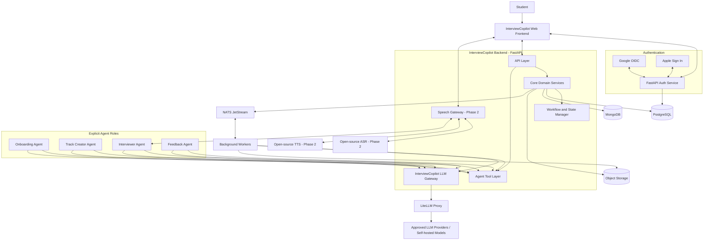
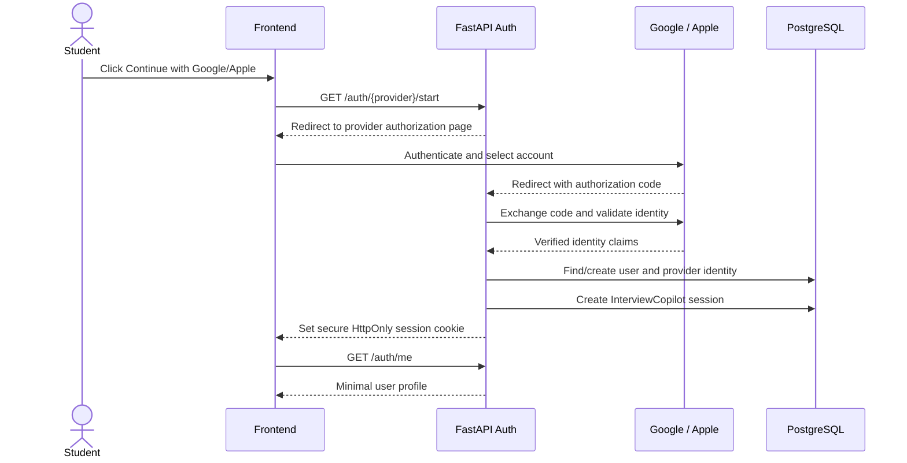
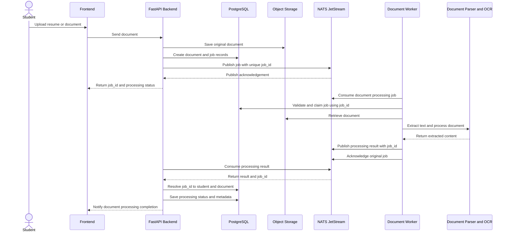
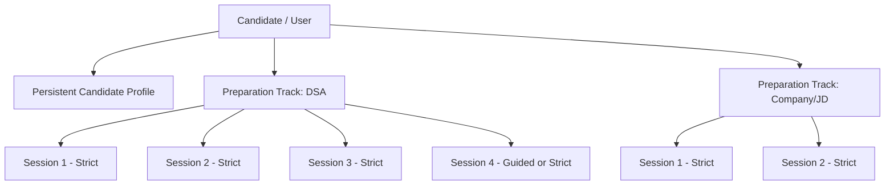
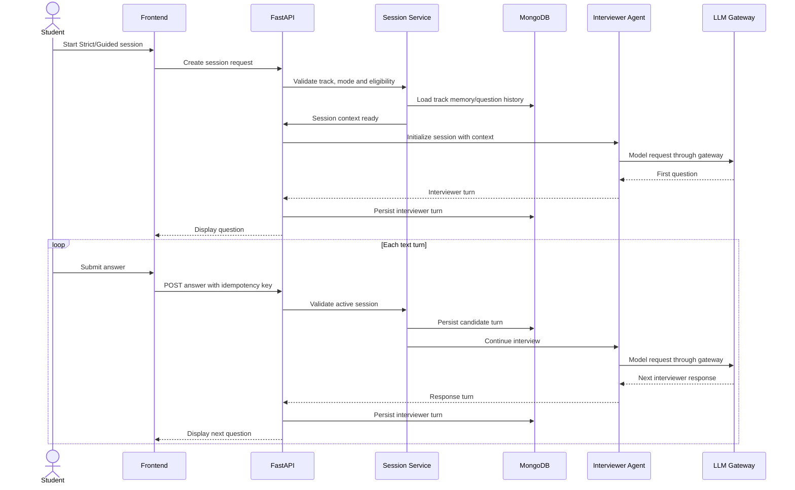
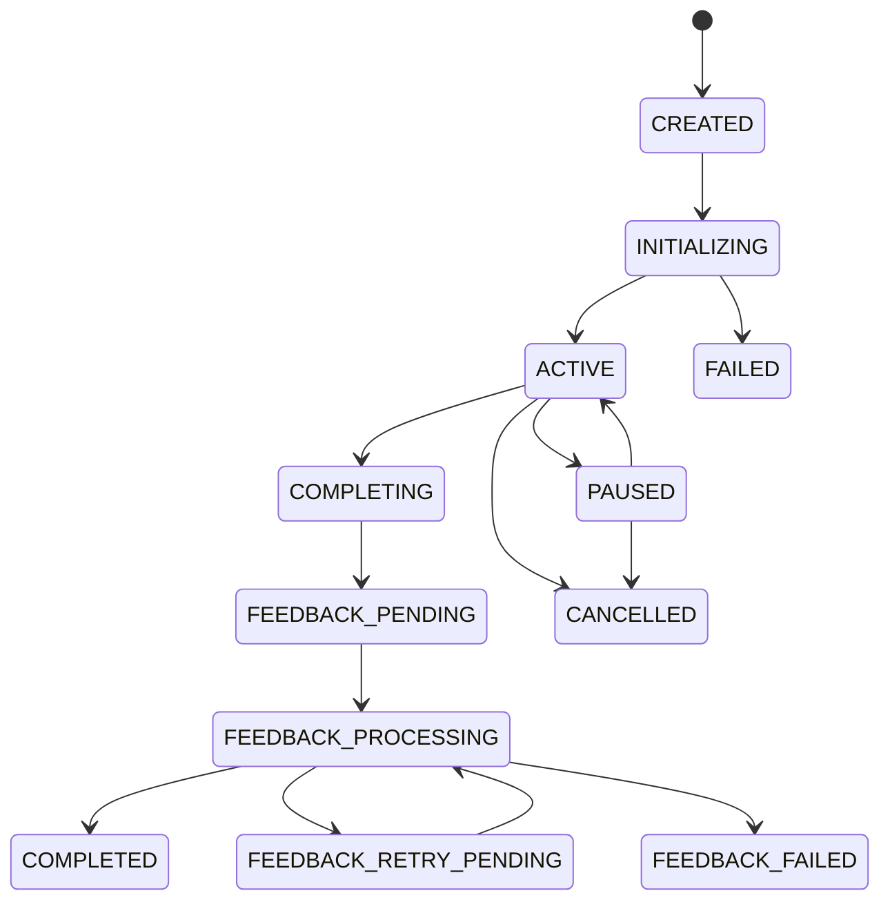
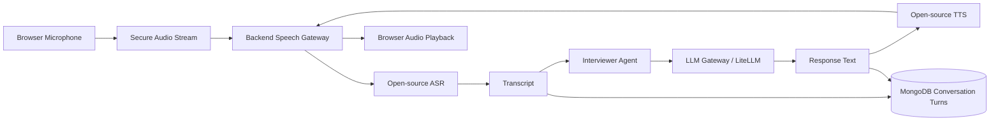
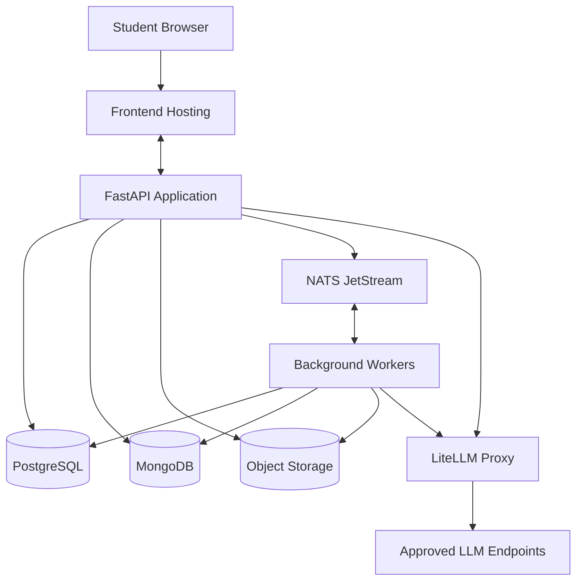

# InterviewCopilot — High-Level Design (HLD)

**Document version:** 0.2**Date:** 31 October 2026**Status:** Architecture proposal for iteration**Product:** InterviewCopilot — AI-powered Interview Intelligence & Readiness Platform

> **Design principle:** The student interacts only with the InterviewCopilot frontend. The backend owns identity, application data, workflow state, persistence, policy enforcement and integrations. Four explicit agent roles are part of the product design, but the underlying agentic orchestration framework is **not selected** and remains replaceable.

---

## 1. Purpose and scope

InterviewCopilot helps students prepare for interviews through three entry paths:

1. **Topic-based:** DSA, system design, DBMS, electronics subjects, and other domains.
2. **Role-based:** A general interview for a target role, such as Software Engineer or Embedded Engineer.
3. **Company/JD-based:** Preparation for a company and role using a supplied job description and relevant public research.

The platform builds a persistent candidate context, creates independent preparation tracks, runs interview sessions, evaluates each completed session, and helps students improve over time.

### In scope for this HLD

- Web-first frontend and FastAPI backend.
- Google and Apple sign-in, with the backend creating the InterviewCopilot session.
- PostgreSQL for application records and authoritative state.
- MongoDB for conversations, track memory, question history and LLM usage analytics.
- Object storage for uploaded documents and optional future audio artifacts.
- NATS JetStream for asynchronous background jobs and events.
- Central LLM Gateway built around LiteLLM.
- Four explicit agent responsibilities and a controlled Agent Tool Layer.
- Guardrails, state management, session lifecycle and data flows.
- Phase 1 text interviews; Phase 2 server-side streaming voice.

### Out of scope for this HLD

- Internal agent orchestration framework and agent graph design.
- Final LLM provider/model selection and prompts.
- Final ASR/TTS model selection.
- Detailed database DDL, complete API schemas and deployment sizing.
- Coding execution sandbox and video interview implementation.

---

## 2. Product and architecture principles

- **Candidate-context-driven:** A resume is a starting point, not the complete candidate profile.
- **Track isolation:** Each preparation objective maintains its own sessions, question history, memory and Strict/Guided eligibility.
- **Session continuity:** New sessions reuse valid track preparation and relevant history; they do not repeat full track creation unnecessarily.
- **Strict-first:** New tracks start with Strict Interviews. Guided Interview becomes available after three completed Strict attempts only when performance is consistently insufficient.
- **Guided means coaching:** It remains a normal interview experience with optional hints and explanations, not a separate validation exam.
- **Evidence-based assessment:** Scores and conclusions must be grounded in the exact session's questions and responses. Unassessed topics are not scored as failures.
- **Backend-owned state:** Agents may request operations through tools, but backend services enforce permissions, lifecycle transitions and business rules.
- **Centralized model access:** Every LLM call goes through the InterviewCopilot LLM Gateway and LiteLLM proxy.
- **Replaceable agent framework:** Agent roles and tool contracts are explicit; the underlying orchestration technology is undecided.
- **Start simple:** No Redis, Nginx or separate vector database in Phase 1.

---

## 3. High-level system architecture



**Boundary rule:** Agents do not connect directly to PostgreSQL, MongoDB, object storage, external model providers or other students' data. They use authorized tools exposed by the backend. All LLM calls go through the LLM Gateway. The agentic framework that executes the four roles is not selected.

---

## 4. Backend components

| Component                       | Responsibility                                                                                   |
| ------------------------------- | ------------------------------------------------------------------------------------------------ |
| Authentication Service          | Google/Apple OIDC validation, user creation/lookup, application session creation and revocation. |
| Candidate Profile Service       | Stores academic context, skills, projects, internships, experience and profile versions.         |
| Document Service                | Upload metadata, storage references, processing status and extracted-document results.           |
| Track Management                | Creates and maintains independent topic, role and company/JD preparation tracks.                 |
| Track Preparation               | Coordinates research, candidate context, Interview Brief creation and refresh.                   |
| Interview Session Service       | Creates sessions, validates mode, manages turns and session lifecycle.                           |
| Track Memory / Question History | Retrieves summaries, prior questions, topic coverage and memory for future sessions.             |
| Feedback / Assessment Service   | Requests session evaluation, validates and stores the report, updates track progression.         |
| Progression Policy Service      | Enforces the three-Strict-session Guided unlock policy.                                          |
| Agent Tool Layer                | Exposes narrowly scoped, validated operations to the four agents.                                |
| LLM Gateway                     | Central model access, routing, guardrails, token/cost metadata and analytics.                    |
| Speech Gateway (Phase 2)        | Server-side audio streaming, ASR and TTS integration.                                            |
| Background Worker               | Consumes NATS jobs and executes document/preparation/feedback work.                              |

Start as a **modular monolith** in FastAPI, with separate worker and model/speech processes where needed. Do not split every agent into a separate microservice in the first release.

---

## 5. Authentication and user onboarding

### 5.1 Login experience

The desired experience is direct provider sign-in: when a student clicks Google or Apple, the browser is redirected to that provider's own authentication page, without an intermediate branded identity-provider login page.

**Proposed Phase 1:** FastAPI + Authlib with OpenID Connect Authorization Code flow, PKCE, state and nonce validation.



### 5.2 Minimum signup information

- Name: required or collected from provider when available; editable by the student.
- Email: required for account contact, subject to provider verification/relay behavior.
- Profile image: optional.
- No resume or lengthy profile form required to create an account.

After registration, the optional Onboarding Agent can gather academic details, skills, internships, projects, achievements and other context conversationally. Students can skip onboarding, return later and edit all profile context in Settings.

### 5.3 Authentication data

PostgreSQL stores:

- `users`: internal user ID and basic account state.
- `auth_identities`: provider, stable provider subject, provider email and verification status.
- `app_sessions`: hashed opaque session token, expiry, revocation and activity metadata.

Use `(provider, provider_subject)` as the identity key. Do not rely on email alone for provider identity matching or automatic account linking. Keep provider secrets on the backend. Use secure, HttpOnly, SameSite cookies and appropriate CSRF protection.

Basic Google sign-in does **not** grant Google Drive or Gmail access. Drive import is a separate, optional future integration requiring additional consent.

---

## 6. Data storage responsibilities

### 6.1 PostgreSQL — application source of truth

PostgreSQL owns structured application records and authoritative state:

- Users, auth identities and application sessions.
- Candidate profiles, profile versions and structured profile items.
- Document metadata and processing/job status.
- Preparation tracks and track configuration.
- Job descriptions and Interview Brief metadata/version references.
- Interview session metadata and status.
- Strict/Guided eligibility and progression state.
- Structured assessment summaries and competency outcomes.
- Learning plan metadata and progress.

Use relational tables for important entities and JSONB for flexible, versioned structures such as extracted context, track configuration and report summaries.

### 6.2 MongoDB — conversation and analytical records

Use fixed collections shared across all users and tracks. Do **not** create a collection per subject or per track.

| Collection                   | Contents                                                                       |
| ---------------------------- | ------------------------------------------------------------------------------ |
| `conversation_turns`       | One document per interviewer or candidate turn.                                |
| `session_summaries`        | Compact summary of each completed interview.                                   |
| `track_memories`           | Current accumulated memory for each preparation track.                         |
| `track_question_history`   | Questions asked, question fingerprints, topic/competency and outcomes.         |
| `profile_conversations`    | Optional detailed onboarding conversation history.                             |
| `session_feedback_reports` | Detailed feedback, evidence links and recommendations for an exact session.    |
| `llm_usage_events`         | One usage record per LLM call, with user/track/session attribution.            |
| `llm_usage_rollups`        | Aggregated token and cost data by user, track, session, model and time period. |

**Conversation storage rule:** Store each turn as its own MongoDB document, linked by `user_id`, `track_id`, `session_id` and `sequence_number`. Avoid unbounded arrays containing every session and turn in one document. MongoDB has a 16 MiB BSON document size limit. [MongoDB limits](https://www.mongodb.com/docs/manual/reference/limits/)

### 6.3 Object storage

Store original resumes, project reports, supporting documents and (only if later enabled with consent) audio artifacts. Databases store metadata and object keys, not the file binaries.

### 6.4 Data ownership summary

| Information                                 | Primary location |
| ------------------------------------------- | ---------------- |
| User and auth session                       | PostgreSQL       |
| Candidate profile and versions              | PostgreSQL       |
| Original documents                          | Object storage   |
| Document metadata/job mapping               | PostgreSQL       |
| Preparation track                           | PostgreSQL       |
| Interview Brief and version metadata        | PostgreSQL       |
| Session metadata/status/mode                | PostgreSQL       |
| Full conversation turns                     | MongoDB          |
| Session summary and track memory            | MongoDB          |
| Question history ledger                     | MongoDB          |
| Detailed feedback report                    | MongoDB          |
| Assessment summary and progression decision | PostgreSQL       |
| Per-call token/cost events                  | MongoDB          |

---

## 7. NATS JetStream — asynchronous job processing

**Decision:** Use NATS with JetStream persistence for background jobs. The broker transports messages; it does not validate user IDs, track IDs or session ownership. Those checks belong to the worker/backend using the authoritative job record.

JetStream provides persisted streams, durable consumers, acknowledgements and redelivery. Use explicit acknowledgements and design workers for at-least-once delivery; do not assume exactly-once business execution. [NATS JetStream](https://docs.nats.io/concepts/jetstream) · [Consumer acknowledgement](https://docs.nats.io/nats-concepts/jetstream/consumers)

### 7.1 Initial job types

- `document.process.requested`
- `profile.enrichment.requested`
- `track.preparation.requested`
- `company.research.requested`
- `session.feedback.requested`
- `track.memory.update.requested`

### 7.2 Document processing flow and unique tag

The backend creates a job record and a unique opaque `job_id`/correlation tag before publishing a message. It maps that tag to the student, document and intended operation in PostgreSQL.



**Unique-tag rule:** The `job_id` is a correlation handle, not an authorization credential. The backend uses its own PostgreSQL mapping to identify the user and document. The worker must not trust a user ID supplied only in a message. It looks up the job record and checks that the job is valid, pending/claimable and idempotent before processing.

### 7.3 Job envelope example

```json
{
  "job_id": "opaque-job-uuid",
  "job_type": "DOCUMENT_PROCESSING",
  "schema_version": "1.0",
  "document_id": "document-uuid",
  "storage_key": "private/user/document-key",
  "correlation_id": "request-correlation-id",
  "created_at": "2026-10-31T00:00:00Z"
}
```

The broker transports the message without interpreting its identifiers. The worker/backend validate the job against PostgreSQL.

### 7.4 Reliability rules

- Use JetStream streams and durable pull consumers for worker queues.
- Use explicit acknowledgements.
- Set bounded delivery attempts/backoff and route exhausted jobs to a dead-letter subject/stream.
- Make every worker idempotent using `job_id` and a unique processing record.
- Acknowledge only after the result is durably published/persisted according to the workflow.
- Keep large documents and large OCR output out of NATS messages; pass object-storage keys or compact results.
- Record job status in PostgreSQL: `QUEUED`, `PROCESSING`, `SUCCEEDED`, `RETRY_PENDING`, `FAILED`, `DEAD_LETTERED`.

**Do not put every live interviewer turn onto NATS.** Text interview turns are request/response interactions through FastAPI. NATS is for asynchronous document, preparation, feedback and memory-update jobs.

---

## 8. Four explicit agents and Agent Tool Layer

The product will have four logical agent roles. The **agentic framework/orchestration technology remains undecided**. We are defining responsibilities and boundaries only; we are not choosing LangGraph, CrewAI, AutoGen or another framework in this HLD.

### 8.1 Onboarding Agent — optional

Purpose: Build and enrich the student's Candidate Profile through a conversation and optional documents.

Allowed tools (examples):

- `get_candidate_profile`
- `save_basic_profile_info`
- `add_academic_context`
- `add_skill`
- `add_project`
- `add_internship`
- `add_experience`
- `request_document_processing`
- `get_profile_completion_status`

The agent can be skipped. Its outputs are reviewable, editable and saved to PostgreSQL through backend tools. The backend—not the LLM—derives the authenticated user ID.

### 8.2 Track Creator Agent

Purpose: Create or refresh a preparation track from a topic, role, company and/or JD.

Inputs: candidate context snapshot, selected objective, topics, JD, company context and previous track context when refreshing.

Outputs: structured preparation plan, competency coverage, research references and versioned Interview Brief.

Allowed tools (examples):

- `get_candidate_context`
- `create_preparation_track`
- `get_job_description`
- `save_research_sources`
- `save_interview_brief`
- `get_previous_track_context`
- `mark_track_ready`

**Invocation rule:** Run for a new track or a material track refresh. Do not rerun full track creation every time a student starts another session in an already-prepared track. Existing valid tracks reuse their Interview Brief and memory.

### 8.3 Interviewer Agent

Purpose: Conduct the actual interactive interview.

Inputs: active track, current Interview Brief, candidate context snapshot, track memory, question history, active session, mode and session constraints.

Modes:

- **Strict Interview:** normal interview behavior; no hints or teaching during the interview.
- **Guided Interview:** normal interview flow with optional hints, progressive explanations and examples when requested.

Allowed tools (examples):

- `get_active_session_context`
- `get_track_memory`
- `get_question_history`
- `save_interview_turn`
- `request_guided_hint`
- `request_concept_explanation`

The backend checks Guided eligibility before session creation. The Interviewer Agent cannot unlock Guided mode or alter track eligibility.

### 8.4 Feedback Agent

Purpose: Evaluate one exact completed interview session.

Inputs: transcript/turns for that session, session metadata, mode, candidate snapshot, Interview Brief version and submitted artifacts.

Outputs: detailed feedback report, question-level evidence, competency observations, strengths, weaknesses, unassessed areas, confidence and improvement recommendations.

Allowed tools (examples):

- `get_completed_session`
- `get_session_transcript`
- `get_candidate_snapshot`
- `get_interview_brief`
- `get_session_artifacts`
- `save_feedback_report`

The detailed report is stored in MongoDB; structured assessment summaries and progression outcomes are saved in PostgreSQL by backend services. Guided-session help is learning evidence, not independent proof of mastery.

### 8.5 Agent Tool Layer

All agent writes and sensitive reads pass through controlled backend tools.

- No direct SQL, MongoDB or object-storage credentials for agents.
- Tool allowlists are specific to each agent role.
- User identity is derived from trusted backend execution context.
- Every tool call checks ownership, scope, schema and allowed state transition.
- Tool arguments and outputs are validated.
- High-impact operations are idempotent and auditable.

---

## 9. LLM Gateway and usage analytics

**Decision:** Build an InterviewCopilot-owned LLM Gateway using LiteLLM Proxy underneath. LiteLLM is selected for standardized provider routing and usage/spend visibility; InterviewCopilot retains its own policy, attribution and analytics layer.

All LLM calls from all four agents and backend AI operations must pass through this gateway. No agent should call a model provider directly.

### 9.1 Gateway responsibilities

- Agent/service authentication.
- Model alias and provider routing.
- Approved model allowlist by operation.
- Central request/response guardrails.
- Timeouts, retry and controlled fallback policies.
- Token usage capture.
- Cost estimation and pricing-version capture.
- Latency, success/failure and model-call logging.
- Correlation across user, track, session, agent and job.

LiteLLM documents per-request usage/spend tracking, custom metadata/tags and individual spend logs. It also documents that prompt/response content is not stored by default in its UI logs, which is a useful privacy baseline. [LiteLLM spend tracking](https://docs.litellm.ai/docs/proxy/cost_tracking) · [LiteLLM logs](https://docs.litellm.ai/docs/proxy/ui_logs) · [LiteLLM logging](https://docs.litellm.ai/docs/proxy/logging)

### 9.2 Required metadata for every model call

| Field                | Purpose                                                   |
| -------------------- | --------------------------------------------------------- |
| `llm_call_id`      | Unique call identifier                                    |
| `user_id`          | Student attribution                                       |
| `track_id`         | Preparation-track attribution; nullable for onboarding    |
| `session_id`       | Session attribution; nullable outside interviews          |
| `agent_name`       | Onboarding / Track Creator / Interviewer / Feedback       |
| `operation`        | Profile extraction, question generation, assessment, etc. |
| `provider`         | Actual provider/deployment                                |
| `model_alias`      | InterviewCopilot logical model name                       |
| `actual_model`     | Resolved model identifier                                 |
| `input_tokens`     | Input tokens reported by provider                         |
| `output_tokens`    | Output tokens reported by provider                        |
| `cached_tokens`    | Cached input tokens when reported                         |
| `reasoning_tokens` | Reasoning tokens when reported                            |
| `total_tokens`     | Total reported usage                                      |
| `latency_ms`       | End-to-end model-call latency                             |
| `estimated_cost`   | Calculated cost                                           |
| `pricing_version`  | Pricing data/version used in estimate                     |
| `status`           | Success, error, timeout, rejected, etc.                   |
| `correlation_id`   | Trace across application and gateway                      |

Do not assume every provider reports every token category. Store unavailable values as `null`, not as zero.

### 9.3 MongoDB usage collections

`llm_usage_events`: one document per model call. This is the detailed source for product-level attribution.

`llm_usage_rollups`: periodic aggregates by:

- User.
- Preparation track.
- Interview session.
- Agent and operation.
- Model/provider.
- Day or billing period.

Example event:

```json
{
  "llm_call_id": "llm-call-uuid",
  "user_id": "user-uuid",
  "track_id": "track-uuid",
  "session_id": "session-uuid",
  "agent_name": "INTERVIEWER",
  "operation": "GENERATE_FOLLOW_UP",
  "provider": "provider-name",
  "model_alias": "interview-model",
  "actual_model": "resolved-model-name",
  "input_tokens": 2400,
  "output_tokens": 320,
  "cached_tokens": null,
  "reasoning_tokens": null,
  "total_tokens": 2720,
  "latency_ms": 1450,
  "estimated_cost": 0.0042,
  "currency": "USD",
  "pricing_version": "2026-10-31",
  "status": "SUCCESS",
  "created_at": "2026-10-31T00:00:00Z"
}
```

Never store full prompts/responses in analytics by default. They may contain resumes, personal information and proprietary project details. If diagnostic traces are needed, use restricted access, redaction, retention limits and explicit configuration.

### 9.4 Analytics requirements

The platform should report:

- Total calls, tokens and estimated cost per student.
- Total calls, tokens and cost per preparation track.
- Total calls, tokens and cost per interview session.
- Cost by agent, operation, model and provider.
- Input/output/cached/reasoning token breakdown when available.
- Average and percentile latency.
- Error, timeout, retry and fallback rates.
- Cost of a complete preparation track and interview cycle.

For externally billed models, estimated cost should be reconciled against provider invoices where possible. For self-hosted models, record tokens, inference duration and infrastructure allocation; there is no per-token provider invoice.

LiteLLM's own spend database can also be used for gateway-level audit and reporting. MongoDB stores InterviewCopilot's user/track/session attribution and product analytics view. Avoid double-counting by defining one canonical event ID and reconciliation process.

---

## 10. Guardrails and security controls

Guardrails are a high-priority platform requirement. They must not rely only on instructions embedded in an agent prompt.

### 10.1 Defense in depth

1. **Input checks:** Detect prompt injection, requests to reveal hidden instructions, data-exfiltration attempts and unrelated task redirection.
2. **Role policies:** Each agent has a fixed purpose, allowed topics and allowed tools.
3. **Untrusted-content handling:** Resumes, JDs, project reports and retrieved web content are data, not instructions.
4. **Tool authorization:** Backend validates user ownership, track/session scope, argument schema and current state.
5. **Output validation:** Validate JSON/schema, reject unauthorized tool requests and check for sensitive data leakage.
6. **Model/network controls:** Agent services can reach approved LLM Gateway endpoints, not provider APIs directly.
7. **Audit and monitoring:** Record security events separately from interview competency scores.

### 10.2 Agent boundaries

| Agent         | Allowed scope                                | Must not do                                                                    |
| ------------- | -------------------------------------------- | ------------------------------------------------------------------------------ |
| Onboarding    | Collect and structure current user's profile | Access another user's data or change auth identity                             |
| Track Creator | Prepare/refresh the requested track          | Modify unrelated tracks or grant Guided access                                 |
| Interviewer   | Conduct the active interview                 | Reveal hidden instructions, access unrelated data or change assessment records |
| Feedback      | Evaluate the exact completed session         | Rewrite evidence or alter scores because the user requests it                  |

### 10.3 Prompt-injection behavior

If a student asks an interviewer to reveal its hidden instructions or abandon the interview, the agent should decline briefly and return to the interview objective. Flag suspicious attempts using a separate security event category such as `PROMPT_INJECTION_ATTEMPT`.

A security flag is not automatically an academic misconduct finding or a low competency score. Guardrails reduce risk but cannot guarantee that every attack will be detected; use adversarial testing and defense in depth.

---

## 11. Track, session and question-history design

### 11.1 Core hierarchy



A candidate can have multiple tracks. Each track has multiple sessions. Guided eligibility is independent per track.

### 11.2 Track memory

For each track, maintain:

- Topics assessed and not yet assessed.
- Competencies demonstrated, partially demonstrated and weakly demonstrated.
- Previous session summaries.
- Question history and fingerprints.
- Current learning priorities.
- Current Interview Brief version.

When starting a new session, the backend provides a compact context package: candidate snapshot, current brief, track memory, recent session summaries, relevant question history and session policy. Do not send every historical transcript by default. Retrieve individual old turns only when relevant.

### 11.3 Avoiding repeated questions

- Avoid exact repeats in Strict Interview by default.
- Revisit the same concept with a different problem or wording when assessment is useful.
- Guided Interview may deliberately revisit questions/concepts for teaching.
- Allow revision sessions to repeat content intentionally.
- Store exact normalized fingerprints and topic/competency metadata.
- Semantic duplicate detection can be improved later; no separate vector database is required for Phase 1.

### 11.4 New track versus new session

| Action                                          | Track Creator Agent                                                          |
| ----------------------------------------------- | ---------------------------------------------------------------------------- |
| Create a new topic/role/company track           | Invoke                                                                       |
| Start another session in a valid existing track | Do not invoke; reuse brief and memory                                        |
| JD or target role changes materially            | Refresh/reprepare                                                            |
| Selected topics change materially               | Refresh/reprepare                                                            |
| Relevant candidate profile change               | Mark track as potentially needing refresh; do not silently rewrite old brief |
| Company research becomes stale                  | Refresh relevant research when required                                      |

Each interview session records the candidate profile version/snapshot and Interview Brief version used, so old assessments remain interpretable after profile edits.

---

## 12. Interview and feedback workflows

### 12.1 Phase 1: Text interview

Text interviews use synchronous FastAPI request/response interactions. Do not route every live turn through NATS.



Persist the candidate's answer before requesting the next AI response. Use unique turn IDs and sequence numbers to make retries idempotent.

### 12.2 Session feedback

When the student finishes:

1. Backend moves the session to `COMPLETING` and stops accepting new answers.
2. Persist/verify the complete transcript in MongoDB.
3. Create a feedback job record in PostgreSQL.
4. Publish `session.feedback.requested` to NATS JetStream.
5. Feedback worker retrieves only that session's transcript, metadata, candidate snapshot and Interview Brief version.
6. Feedback Agent produces a structured report through the LLM Gateway.
7. Store detailed report/evidence in MongoDB.
8. Store structured assessment summary in PostgreSQL.
9. Update track memory and question history in MongoDB.
10. Evaluate Strict/Guided eligibility in the backend.
11. Mark session `COMPLETED` and notify the frontend.

### 12.3 Cross-database consistency

PostgreSQL and MongoDB do not share a single transaction. Use stable IDs, idempotent writes, retryable processing and reconciliation.

- PostgreSQL owns session/job lifecycle state.
- MongoDB owns conversation and detailed report documents.
- A session is not reported as fully completed until required transcript and feedback records are persisted.
- Do not claim success to the browser before durable persistence is confirmed.

---

## 13. State management

All important workflow states must be persisted by backend services. Do not rely on an agent's chat memory as the source of application state.

### 13.1 Document/job state

`CREATED → QUEUED → PROCESSING → SUCCEEDED`

Failure path: `PROCESSING → RETRY_PENDING → QUEUED`, then `FAILED` or `DEAD_LETTERED` after policy limits.

### 13.2 Track state

`DRAFT → PREPARING → READY → ACTIVE`

Other states: `PREPARATION_FAILED`, `NEEDS_REFRESH`, `PAUSED`, `ARCHIVED`.

### 13.3 Interview session state



### 13.4 Strict/Guided eligibility

- New track starts with Guided mode locked.
- Count completed Strict sessions for that track only.
- After three initial completed Strict sessions, evaluate aggregate evidence.
- Unlock Guided only when performance is consistently insufficient under a configurable policy.
- If evidence is insufficient, do not label the student as weak; collect more evidence or leave the decision pending.
- Once unlocked, Guided remains available for that track; Strict remains available too.
- Guided sessions do not count toward the initial three-Strict baseline.

The exact competency thresholds and calibration method remain to be defined and tested.

---

## 14. LLM Gateway analytics and token usage in MongoDB

The LLM Gateway must emit a usage event for every model call, including successful, failed, timed-out and retried calls where available. One model request is one identifiable event; provider fallback attempts should also be traceable.

Suggested indexes:

- `llm_usage_events`: `(llm_call_id)` unique; `(user_id, created_at)`; `(track_id, created_at)`; `(session_id, created_at)`; `(agent_name, created_at)`.
- `llm_usage_rollups`: unique compound key for aggregation scope, scope ID, period, model and operation.

Token fields should include input, output, cached, reasoning and total tokens when the selected provider reports them. Missing token categories are null. Cost records include currency and pricing version.

Speech usage is tracked separately by audio seconds, inference duration, model version and compute allocation; it is not counted as LLM tokens unless a speech model actually exposes token usage.

---

## 15. Speech architecture — Phase 2

**Phase 1:** Text-only interview experience. Build and validate the interview lifecycle, question history, assessment, gateway analytics and state management first.

**Phase 2:** Add browser-based streaming voice with server-side ASR and TTS. No client-side model inference is required. The browser captures/sends audio and plays the returned audio; inference remains server-side.



ASR/TTS provider and model are **not yet selected**. Evaluate open-source, self-hostable English-capable models, with Indian English accent and technical vocabulary tests. Candidate technologies to benchmark later include faster-whisper or sherpa-onnx for ASR and Kokoro or sherpa-onnx-compatible TTS options. These are evaluation candidates, not frozen decisions.

Requirements for Phase 2:

- Streaming audio transport (WebSocket or WebRTC, selected during detailed design).
- Server-side inference and provider abstraction.
- Interruptions, pause/resume and reconnect handling.
- Transcript correction when speech recognition is wrong.
- Optional audio retention only with explicit consent.
- Audio/ASR/TTS latency and compute metrics.
- Text fallback if voice is unavailable.

---

## 16. Infrastructure and deployment

### Phase 1 deployment components

- InterviewCopilot web frontend.
- FastAPI backend.
- PostgreSQL.
- MongoDB.
- NATS JetStream.
- Background worker process(es).
- Object storage.
- LiteLLM Proxy and its required operational database/configuration.
- Monitoring and structured logs.

### Deferred infrastructure

| Technology      | Decision        | Reason to add later                                                                                                                         |
| --------------- | --------------- | ------------------------------------------------------------------------------------------------------------------------------------------- |
| Redis           | Deferred        | Add for demonstrated caching, rate limiting or distributed ephemeral state needs.                                                           |
| Nginx           | Deferred        | Add reverse proxy/load-balancing layer when deployment topology needs it; use secure managed ingress or equivalent in production meanwhile. |
| Vector database | Deferred        | Add only if semantic retrieval/question deduplication quality requires it; start with metadata and fingerprints.                            |
| Coding sandbox  | Future          | Add isolated execution environment with resource and network controls.                                                                      |
| Video interview | Future/optional | Depends on cost, consent, privacy and product validation.                                                                                   |
| Google Drive    | Future/optional | Separate OAuth scopes and consent; not part of basic Google login.                                                                          |

### Deployment view



Nginx is not required to develop the initial application. Before public production, place the application behind a secure ingress/load balancer or equivalent edge. Configure HTTPS, request limits, WebSocket support in Phase 2, timeouts and security headers.

---

## 17. Technology decision register

| Area                            | Current decision                                                          | Status                  |
| ------------------------------- | ------------------------------------------------------------------------- | ----------------------- |
| Frontend                        | Web-first application (framework to finalize)                             | Direction agreed        |
| Backend                         | FastAPI / Python                                                          | Selected                |
| Authentication                  | FastAPI + Authlib; Google and Apple OIDC                                  | Proposed implementation |
| User/application data           | PostgreSQL                                                                | Selected                |
| Conversations and track memory  | MongoDB                                                                   | Selected                |
| Uploaded files                  | S3-compatible object storage                                              | Selected direction      |
| Async messaging                 | NATS JetStream                                                            | Selected                |
| Background workers              | Python workers                                                            | Selected direction      |
| LLM gateway                     | InterviewCopilot Gateway + LiteLLM Proxy                                  | Selected direction      |
| Usage analytics                 | MongoDB per-call events and rollups; LiteLLM spend logs for gateway audit | Selected direction      |
| Agentic orchestration framework | **Undecided**                                                       | Explicitly open         |
| Four agent roles                | Onboarding, Track Creator, Interviewer, Feedback                          | Product roles agreed    |
| Speech models                   | Open-source, self-hosted ASR/TTS; specific models TBD                     | Phase 2                 |
| Phase 1 interview mode          | Text                                                                      | Agreed                  |
| Phase 2 interview mode          | Streaming voice                                                           | Agreed direction        |
| Redis                           | Not in initial deployment                                                 | Deferred                |
| Nginx                           | Not in initial deployment                                                 | Deferred                |
| Vector DB                       | Not in initial deployment                                                 | Deferred                |
| Coding environment              | Isolated browser coding sandbox                                           | Future                  |
| Video interview                 | Optional, cost-dependent                                                  | Future                  |
| Google Drive                    | Optional document import                                                  | Future                  |

---

## 18. Key non-functional requirements

- **Security:** Per-user data isolation, secure session cookies, backend authorization, protected file access and secrets management.
- **Reliability:** Durable job delivery, idempotent workers, retry/dead-letter handling and recoverable sessions.
- **Consistency:** PostgreSQL owns application state; MongoDB owns detailed conversational content; reconciliation handles cross-database failures.
- **Observability:** Correlation IDs across API, NATS job, agent operation and every LLM call.
- **Cost control:** Per-call token and cost analytics, model allowlists, usage budgets and rate limits.
- **Privacy:** Do not store prompts/responses in analytics by default; minimize personal data in logs; define document and conversation retention/deletion policies.
- **Extensibility:** Domain packs for different academic disciplines without redesigning the common interview lifecycle.
- **Assessment quality:** Evidence-linked results, confidence/coverage indicators and explicit `NOT_ASSESSED` outcomes.

---

## 19. Implementation phases

### Phase 1 — Text-first foundation

1. FastAPI project structure, PostgreSQL and MongoDB.
2. Google/Apple sign-in and application sessions.
3. Candidate profile and optional conversational onboarding.
4. Document upload, NATS JetStream job flow and parser/OCR pipeline.
5. Preparation track creation and Interview Brief persistence.
6. Four agent roles through the Agent Tool Layer (framework selected separately).
7. InterviewCopilot LLM Gateway + LiteLLM, guardrails and per-call analytics.
8. Text Strict/Guided interview sessions.
9. MongoDB conversations, summaries, track memory and question history.
10. Feedback Agent workflow and track progression policy.

### Phase 2 — Streaming voice

1. Browser audio capture and streaming transport.
2. Server-side open-source ASR and TTS evaluation/deployment.
3. Speech Gateway integration.
4. Streaming response playback and interruption handling.
5. Audio processing metrics and optional retention controls.

### Future phases

- Google Drive document import.
- Browser coding editor and secure execution sandbox.
- Optional video interview capability, subject to cost and privacy review.
- Additional academic domain packs and local-language speech support.
- Redis, Nginx and semantic vector retrieval if justified by operational needs.

---

## 20. Open decisions for detailed design

These items are intentionally not finalized in the HLD:

1. Agentic orchestration framework and internal agent workflow.
2. Initial LLM providers, specific models and model-routing policy.
3. Exact Guided unlock performance threshold and calibration method.
4. Detailed PostgreSQL schema, MongoDB validators and retention indexes.
5. Exact NATS stream, subject, consumer, retry and dead-letter configuration.
6. OCR/parser library and document-processing model selection.
7. ASR/TTS models and GPU/CPU sizing for Phase 2.
8. WebSocket versus WebRTC choice for streaming voice.
9. Frontend framework and deployment hosting selection.
10. Production scale, availability targets, backup and disaster-recovery objectives.

---

## 21. Reference documentation

- [NATS JetStream concepts](https://docs.nats.io/concepts/jetstream) — streams, consumers and durable delivery.
- [NATS JetStream consumers](https://docs.nats.io/nats-concepts/jetstream/consumers) — durable consumers, acknowledgements and redelivery.
- [LiteLLM spend tracking](https://docs.litellm.ai/docs/proxy/cost_tracking) — token/spend attribution, tags and spend logs.
- [LiteLLM UI logs](https://docs.litellm.ai/docs/proxy/ui_logs) — per-request usage visibility and prompt-storage behavior.
- [LiteLLM logging](https://docs.litellm.ai/docs/proxy/logging) — call IDs and logging integrations.
- [Authlib OAuth client](https://docs.authlib.org/en/latest/oauth2/client/index.html) — OAuth client integrations including Starlette/FastAPI.
- [Google OpenID Connect](https://developers.google.com/identity/openid-connect/openid-connect) — server-side identity flow.
- [MongoDB limits](https://www.mongodb.com/docs/manual/reference/limits/) — BSON document-size constraints.
- [faster-whisper](https://github.com/SYSTRAN/faster-whisper) — candidate ASR implementation for later evaluation.
- [sherpa-onnx](https://github.com/k2-fsa/sherpa-onnx) — candidate offline/streaming speech toolkit for later evaluation.
- [Kokoro-82M](https://huggingface.co/hexgrad/Kokoro-82M) — candidate open-weight TTS model for later evaluation.

---

## 22. Final architecture summary

InterviewCopilot will start as a web-first, FastAPI-based modular application. Google and Apple OIDC authenticate the student; the backend creates and manages the application session. PostgreSQL is the source of truth for users, profiles, tracks, session states, eligibility and structured assessments. MongoDB stores individual conversation turns, session summaries, track memory, question history, detailed feedback and per-call LLM usage analytics. Object storage stores uploaded files.

NATS JetStream transports asynchronous document, preparation, feedback and memory-update jobs. Each job is correlated using a backend-created unique `job_id`; the worker processes the referenced object and returns a result with the same identifier. The backend resolves that identifier to the correct student/document and persists the result. The broker itself does not validate application IDs.

Four explicit agents—Onboarding, Track Creator, Interviewer and Feedback—operate through a controlled Agent Tool Layer. The internal agentic orchestration framework remains undecided. All model calls pass through the InterviewCopilot LLM Gateway, backed by LiteLLM, with centralized guardrails, model routing, token accounting, latency/error metrics and cost attribution per user, track, session and agent.

Phase 1 delivers text interviews. Phase 2 adds streaming voice through a server-side Speech Gateway using open-source ASR/TTS models that will be evaluated later. Redis, Nginx, a separate vector database, coding execution and video interviews are deferred until there is a concrete requirement.
