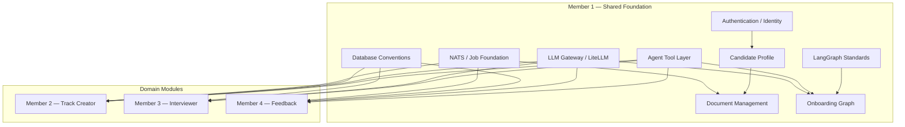
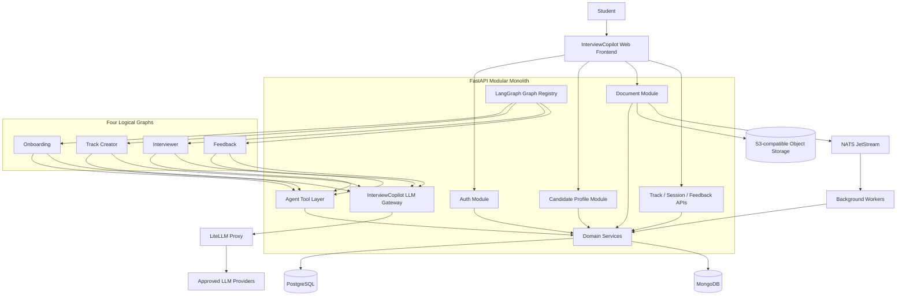
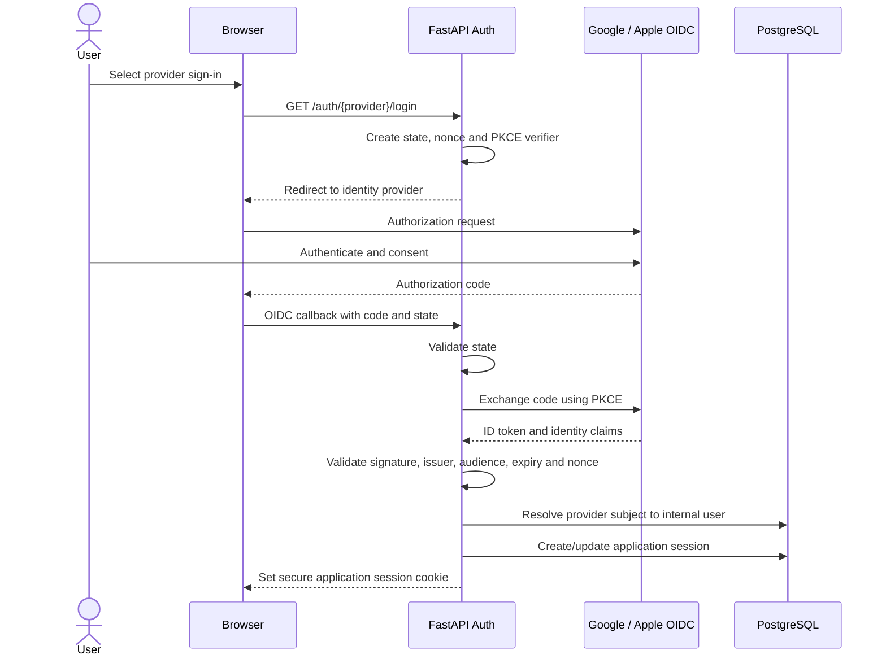
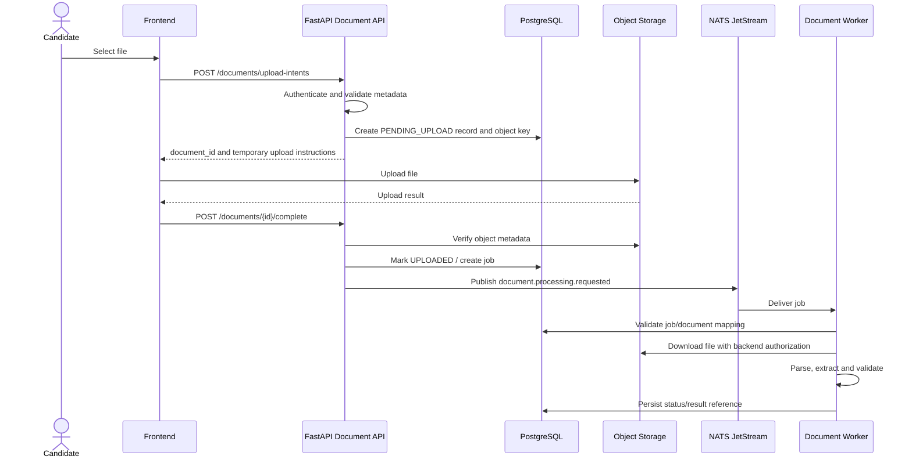
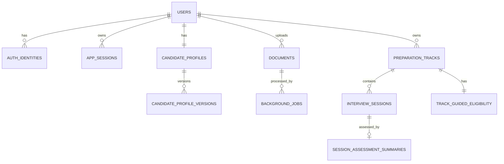
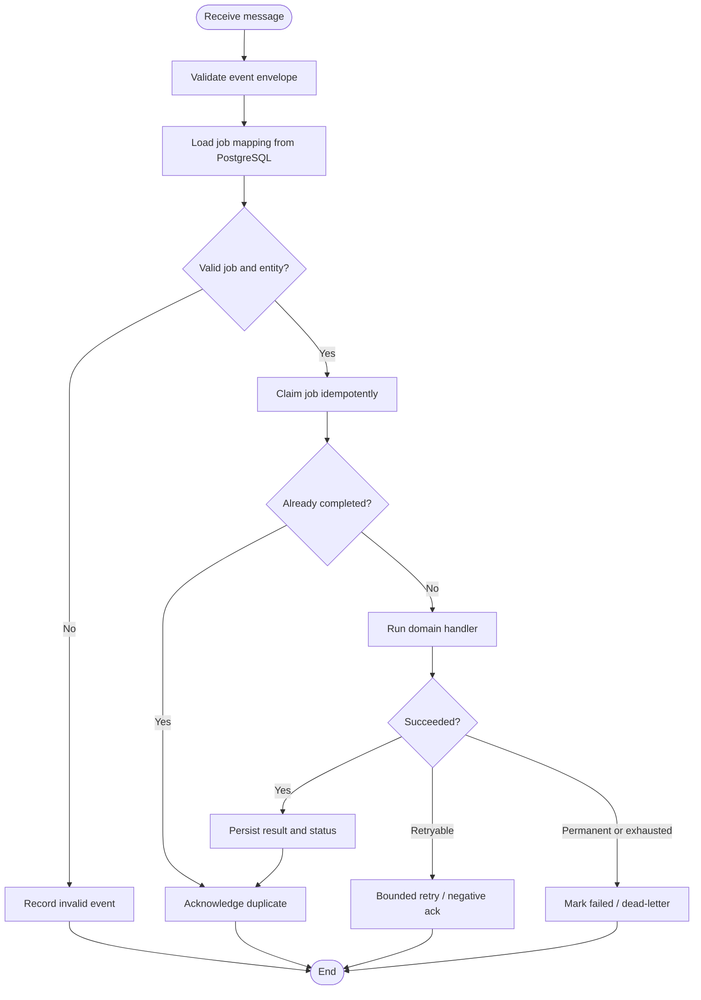
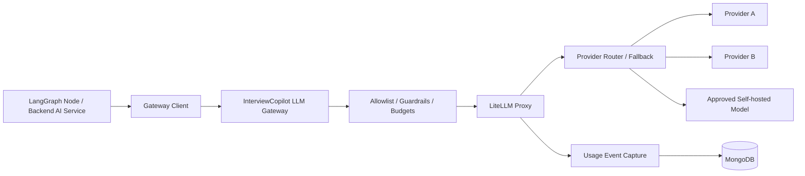
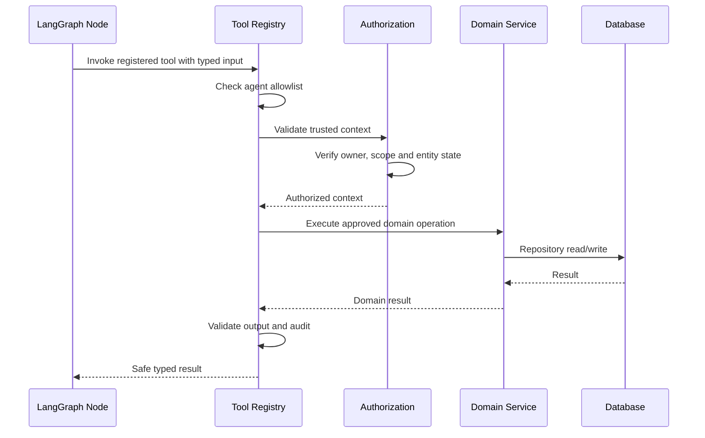
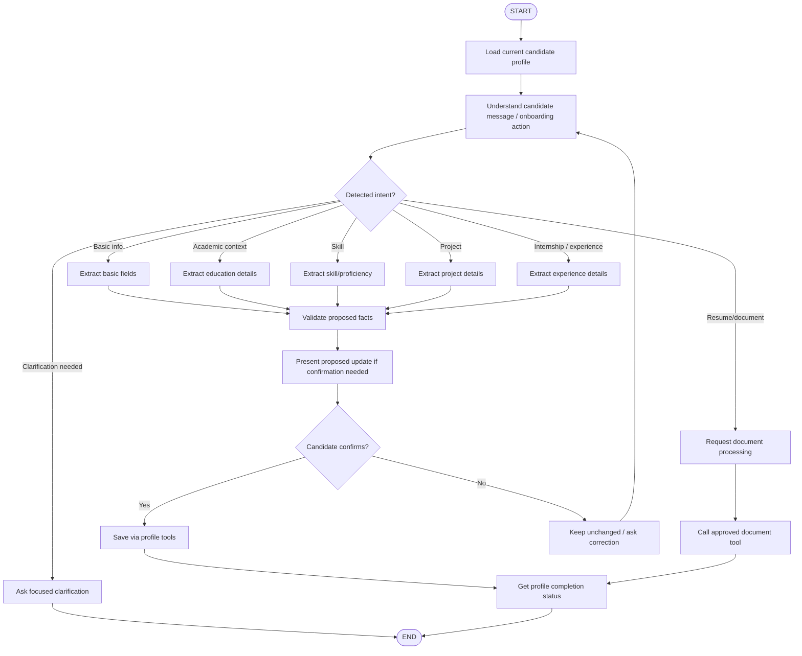
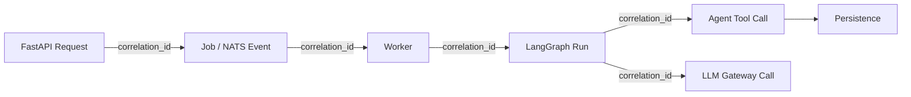

# InterviewCopilot — Member 1 Low-Level Design
## Platform, Data Foundation, LangGraph Standards & Onboarding Agent

**Document type:** Low-Level Design (LLD)  
**Module owner:** Member 1  
**Architecture baseline:** InterviewCopilot HLD v0.2, dated 31 October 2026  
**Agent orchestration:** LangGraph  
**Backend:** FastAPI modular monolith  
**Data stores:** PostgreSQL, MongoDB and S3-compatible object storage  
**Messaging:** NATS JetStream  
**LLM gateway:** InterviewCopilot-owned gateway backed by LiteLLM Proxy  
**Status:** Detailed design proposal for team review

---

# 1. Purpose

This document defines the Low-Level Design for the shared platform foundation of InterviewCopilot. Member 1 owns the common backend and data conventions that every other module depends on, together with the Onboarding Agent.

The four logical agents remain:

1. **Onboarding Agent** — Member 1.
2. **Track Creator Agent** — Member 2.
3. **Interviewer Agent** — Member 3.
4. **Feedback Agent** — Member 4.

Member 1 is responsible for authentication and application identity, Candidate Profile and profile versioning, Document Management, shared PostgreSQL/MongoDB conventions, NATS JetStream conventions, the LLM Gateway and LiteLLM integration, the common Agent Tool Layer, common LangGraph integration standards, and the Onboarding Agent graph.

**This is the shared foundation LLD.** Members 2–4 should use the contracts established here. Member 1 should not independently redesign their detailed track, interview-session or assessment domain schemas.

# 2. Fixed architecture decisions and constraints

| Area | Selected design |
|---|---|
| Frontend | Web-first application |
| Backend | FastAPI modular monolith |
| Agent orchestration | **LangGraph** |
| LLM integration | LangChain components where useful |
| LLM gateway | InterviewCopilot-owned gateway backed by LiteLLM Proxy |
| Primary structured database | PostgreSQL |
| Conversations, memory, question history and detailed reports | MongoDB |
| Uploaded files | S3-compatible object storage |
| Background jobs/events | NATS JetStream |
| Phase 1 interview | Text |
| Phase 2 interview | Server-side streaming voice |
| Agent roles | Onboarding, Track Creator, Interviewer and Feedback |
| Agent data access | Controlled backend Agent Tool Layer |
| Deployment style | Modular monolith plus background workers |

## 2.1 Non-negotiable rules

1. PostgreSQL is authoritative for application identity, structured records, ownership, lifecycle and progression state.
2. MongoDB stores detailed conversational content: individual turns, summaries, track memory, question history, detailed feedback reports and LLM usage events.
3. Original files are stored in object storage. Databases store metadata and object keys, not file binaries.
4. Agents do not receive direct PostgreSQL, MongoDB, object-storage or model-provider credentials.
5. Sensitive reads/writes pass through backend-controlled tools or domain services.
6. All model calls pass through the InterviewCopilot LLM Gateway and LiteLLM Proxy.
7. LangGraph orchestrates workflows; it is not the application source of truth.
8. Backend derives authenticated identity. A model must never choose the user ID for an operation.
9. Backend services enforce permissions, ownership, state transitions and business rules.
10. NATS is for asynchronous work. Do not place every live text-interview turn on NATS.
11. Assume at-least-once message delivery; consumers and writes must be idempotent.
12. Keep a modular monolith in Phase 1. Do not create a microservice for every agent.
13. Do not add Redis, Nginx or a separate vector database in Phase 1 without a demonstrated requirement.
14. Do not store full prompts and responses in LLM analytics by default.
15. All modules use common IDs, timestamps, API response formats, error codes and correlation conventions.

# 3. Member 1 responsibilities and boundaries

| Component | Owner | Boundary |
|---|---|---|
| Authentication | Member 1 | Google/Apple OIDC and application sessions |
| Candidate Profile | Member 1 | Profile records and versioning foundation |
| Document Management | Member 1 | Upload, metadata, object storage and processing handoff |
| PostgreSQL conventions | Member 1/shared | Domain schemas remain with domain owners |
| MongoDB conventions | Member 1/shared | Fixed collection and document conventions |
| NATS foundation | Member 1/shared | Event envelope, publisher and consumer standards |
| LLM Gateway + LiteLLM | Member 1 | Common model access path |
| Agent Tool Layer | Member 1 | Identity, allowlists, validation and authorization |
| LangGraph integration standards | Member 1/shared | Registry, invocation, state, checkpoint and tracing conventions |
| Onboarding Agent | Member 1 | Full graph ownership |
| Track Creator | Member 2 | Member 1 supplies shared interfaces only |
| Interviewer | Member 3 | Member 1 supplies shared interfaces only |
| Feedback | Member 4 | Member 1 supplies shared interfaces only |



# 4. Shared system architecture



FastAPI exposes frontend APIs and coordinates domain services. LangGraph executes agent workflows. The Agent Tool Layer gives agents a restricted interface to backend operations. The LLM Gateway is the only approved path to models. Each data system retains its HLD responsibility.

# 5. FastAPI modular-monolith design

## 5.1 Proposed package structure

```text
backend/
├── app/
│   ├── main.py
│   ├── core/
│   │   ├── config.py
│   │   ├── logging.py
│   │   ├── errors.py
│   │   ├── security.py
│   │   ├── correlation.py
│   │   └── lifespan.py
│   ├── api/v1/
│   │   ├── router.py
│   │   ├── auth.py
│   │   ├── profile.py
│   │   ├── documents.py
│   │   └── health.py
│   ├── modules/
│   │   ├── auth/{router.py,service.py,repository.py,schemas.py,models.py}
│   │   ├── profile/{router.py,service.py,repository.py,schemas.py,models.py}
│   │   └── documents/{router.py,service.py,repository.py,storage.py,schemas.py,models.py}
│   ├── platform/
│   │   ├── database/{postgres.py,mongo.py,migrations/}
│   │   ├── messaging/{nats_client.py,publisher.py,event_schemas.py,consumers/}
│   │   ├── storage/object_storage.py
│   │   ├── llm_gateway/{client.py,schemas.py,routing.py,usage.py}
│   │   ├── agent_tools/{registry.py,context.py,authorization.py,schemas.py}
│   │   └── langgraph/{registry.py,base.py,checkpointing.py,tracing.py}
│   ├── agents/onboarding/{graph.py,state.py,nodes.py,prompts.py,routing.py,tools.py}
│   └── workers/{document_worker.py,worker_registry.py}
├── tests/
├── alembic/
├── pyproject.toml
└── README.md
```

This is a suggested logical structure. The team may change filenames, but should preserve module boundaries and avoid circular imports.

## 5.2 Layer responsibilities

| Layer | Responsibility |
|---|---|
| Router/API | Parse request, authenticate, validate and return response |
| Domain/application service | Business workflow and transaction coordination |
| Repository | Database access |
| Platform adapter | PostgreSQL, MongoDB, NATS, object storage or LLM connectivity |
| Agent Tool | Narrow typed operations exposed to a specific agent |
| LangGraph node | Workflow decision or transformation |
| Worker | Asynchronous processing of NATS jobs |

Routers and graph nodes should not contain raw SQL or direct database connection logic. Transaction boundaries belong in domain services. Do not hold database transactions open while waiting for an LLM response or background job.

# 6. Authentication and application identity

## 6.1 Objective

Provide Google and Apple OIDC sign-in, establish an InterviewCopilot application session, and scope every API/tool call to the authenticated user. The identity provider proves external identity; InterviewCopilot maps that identity to an internal `user_id` and creates its own session.

## 6.2 Authentication sequence



## 6.3 Security requirements

- Use OIDC Authorization Code flow with PKCE.
- Generate and validate `state` and `nonce`.
- Validate token signature, issuer, audience and expiry.
- Identify an external identity using `(provider, provider_subject)` (OIDC `sub`), not email alone.
- Do not store provider access tokens unless a concrete feature requires them.
- Keep provider secrets server-side.
- Use HTTPS in deployed environments.
- If using cookies, use Secure, HttpOnly and an appropriately configured SameSite value; protect state-changing requests against CSRF.
- Revoke/invalidate the application session on logout.
- Exact cookie, refresh and expiry policy remains a deployment/security decision.

## 6.4 PostgreSQL tables

### `users`

| Column | Suggested type | Purpose |
|---|---|---|
| `id` | UUID | Internal primary key |
| `status` | VARCHAR/enum | Active, disabled or deleted |
| `created_at` | TIMESTAMPTZ | Creation time |
| `updated_at` | TIMESTAMPTZ | Last update |

### `auth_identities`

| Column | Suggested type | Purpose |
|---|---|---|
| `id` | UUID | Primary key |
| `user_id` | UUID | Internal user reference |
| `provider` | VARCHAR | `GOOGLE` or `APPLE` |
| `provider_subject` | VARCHAR | OIDC `sub` |
| `email_at_link_time` | VARCHAR nullable | Informational claim |
| `email_verified` | BOOLEAN | Provider claim |
| `created_at` | TIMESTAMPTZ | Link timestamp |
| `last_login_at` | TIMESTAMPTZ nullable | Last successful login |

Constraints: unique `(provider, provider_subject)` and foreign key to `users`.

### `app_sessions`

| Column | Suggested type | Purpose |
|---|---|---|
| `id` | UUID | Internal session ID |
| `user_id` | UUID | Session owner |
| `session_token_hash` | VARCHAR | Hash of opaque token; never raw token |
| `status` | VARCHAR/enum | Active, revoked, expired |
| `expires_at` | TIMESTAMPTZ | Expiry |
| `last_seen_at` | TIMESTAMPTZ nullable | Last activity |
| `created_at` | TIMESTAMPTZ | Creation |
| `revoked_at` | TIMESTAMPTZ nullable | Revocation time |

Recommended indexes: unique `session_token_hash`, `(user_id, status)` and `expires_at`.

## 6.5 Trusted authentication context

For every authenticated request, middleware resolves the application session and attaches a trusted context:

```json
{
  "user_id": "internal-user-uuid",
  "app_session_id": "app-session-uuid",
  "auth_method": "GOOGLE_OIDC",
  "roles": ["CANDIDATE"],
  "correlation_id": "correlation-uuid"
}
```

This context is created by backend code. A request body or model-generated value must not override `user_id`.

## 6.6 Authentication API proposals

| Method | Endpoint | Purpose |
|---|---|---|
| `GET` | `/api/v1/auth/{provider}/login` | Start OIDC login |
| `GET` | `/api/v1/auth/{provider}/callback` | Handle provider callback |
| `GET` | `/api/v1/auth/me` | Get current user |
| `POST` | `/api/v1/auth/logout` | Revoke session |
| `POST` | `/api/v1/auth/refresh` | Refresh/rotate session if selected strategy requires it |

# 7. Candidate Profile foundation

## 7.1 Objective and principles

Maintain a shared Candidate Context Vault. Candidate information is reusable across tracks, while each interview session stores the exact profile version/snapshot it used.

- One current profile per candidate.
- Profile data is shared across tracks.
- Important changes create a new profile version.
- Historical sessions retain their original profile version.
- Candidate can review and edit extracted/enriched information.
- Agent proposals are validated before being saved.
- Do not overwrite the entire profile from an unvalidated LLM response.

## 7.2 Logical PostgreSQL schema

### `candidate_profiles`

| Column | Suggested type | Purpose |
|---|---|---|
| `id` | UUID | Profile primary key |
| `user_id` | UUID | Unique profile owner |
| `current_version_id` | UUID nullable | Current version |
| `completion_status` | VARCHAR | Completion indicator |
| `created_at` | TIMESTAMPTZ | Creation |
| `updated_at` | TIMESTAMPTZ | Last change |

### `candidate_profile_versions`

| Column | Suggested type | Purpose |
|---|---|---|
| `id` | UUID | Version ID |
| `profile_id` | UUID | Parent profile |
| `version_number` | INTEGER | Monotonic version |
| `summary` | TEXT nullable | Candidate summary |
| `education_data` | JSONB | Education snapshot |
| `skills_data` | JSONB | Skills snapshot |
| `projects_data` | JSONB | Project snapshot/references |
| `experience_data` | JSONB | Experience snapshot/references |
| `certifications_data` | JSONB | Certification snapshot |
| `source_metadata` | JSONB | Manual, document extraction, onboarding, etc. |
| `created_at` | TIMESTAMPTZ | Version timestamp |
| `created_by` | UUID nullable | Candidate/system actor |

Unique `(profile_id, version_number)`. Frequently queried child records may be normalized into `candidate_education`, `candidate_skills`, `candidate_projects`, `candidate_experiences`, `candidate_internships` and `candidate_certifications`. Decide normalization based on query/update requirements. Do not store arbitrary unvalidated LLM JSON as source of truth.

## 7.3 Versioning transaction

1. Read current profile version.
2. Validate candidate- or agent-proposed changes.
3. Apply changes in a transaction.
4. Create the next version.
5. Update `candidate_profiles.current_version_id`.
6. Preserve older versions.
7. Return the new version reference.

Use `expected_version` or equivalent optimistic concurrency control. If the profile changed since it was read, return a conflict and require a reload/review.

## 7.4 Profile APIs

| Method | Endpoint | Purpose |
|---|---|---|
| `GET` | `/api/v1/profile` | Get current profile |
| `PATCH` | `/api/v1/profile` | Update permitted fields |
| `GET` | `/api/v1/profile/versions` | List versions |
| `GET` | `/api/v1/profile/versions/{version_id}` | Read a specific version |
| `GET` | `/api/v1/profile/completion` | Read completion status |

Do not accept a target user ID for ordinary candidate profile access; derive the owner from authentication context.

# 8. Document Management and object storage

## 8.1 Objective

Allow candidates to upload resumes and supporting documents. Store original files in object storage, metadata in PostgreSQL, and dispatch processing asynchronously through NATS JetStream.

Initial categories may include resume/CV, project report, academic certificate/transcript, job description and other supporting document. Supported formats and file limits are configuration decisions.

## 8.2 Recommended upload workflow

1. Candidate requests an upload slot from FastAPI.
2. Backend authenticates the candidate and validates category, filename, size and declared content type.
3. Backend creates a document metadata record with `PENDING_UPLOAD`.
4. Backend generates a short-lived, scoped upload URL or uses an authenticated upload stream.
5. Browser uploads to private object storage.
6. Backend receives upload completion and verifies object existence, size and checksum where supported.
7. Document status becomes `UPLOADED`.
8. Backend creates a processing job and publishes a NATS event.
9. Worker retrieves the file using backend-authorized access and processes it.
10. Validated extraction results are persisted through backend services.
11. Candidate reviews/edits extracted information before profile changes are committed where confirmation is required.

A presigned URL is a temporary file-transfer capability, not an application authorization token. Restrict it to one object key, one operation and a short expiry.

## 8.3 Sequence diagram



## 8.4 `documents` table

| Column | Suggested type | Meaning |
|---|---|---|
| `id` | UUID | Document ID |
| `user_id` | UUID | Owner |
| `document_type` | VARCHAR | Resume, project report, JD, etc. |
| `original_filename` | VARCHAR | Sanitized display name |
| `storage_provider` | VARCHAR | Object-store provider |
| `storage_bucket` | VARCHAR | Bucket/container |
| `storage_key` | VARCHAR | Opaque object key |
| `mime_type` | VARCHAR | Verified/declared type |
| `size_bytes` | BIGINT | Actual file size |
| `checksum` | VARCHAR nullable | Integrity checksum |
| `status` | VARCHAR/enum | Upload and processing state |
| `processing_job_id` | UUID nullable | Associated job |
| `extraction_version` | VARCHAR nullable | Parser version |
| `extraction_result_ref` | VARCHAR nullable | Result reference |
| `created_at` | TIMESTAMPTZ | Creation |
| `updated_at` | TIMESTAMPTZ | Update |
| `deleted_at` | TIMESTAMPTZ nullable | Logical deletion if policy requires |

Recommended indexes: `(user_id, created_at DESC)`, `(status, updated_at)`, `(processing_job_id)` and unique storage key within provider/bucket.

## 8.5 Object key and security

Suggested key pattern:

```text
users/{user_id}/documents/{document_id}/original/{safe_filename}
```

- Generate object keys on the backend; never use a raw user path.
- Keep buckets private; no public listing or access.
- Do not expose bucket credentials to the browser.
- Validate file type using file inspection, not only extension.
- Apply size limits and scan uploads according to policy.
- Prevent uploaded documents from executing as code.
- Prevent cross-user object retrieval.
- Define retention and deletion behavior.
- Keep original documents in object storage, not PostgreSQL/MongoDB.

# 9. PostgreSQL platform design

PostgreSQL is authoritative for users/auth identities/application sessions, candidate profiles and versions, document metadata and processing state, and the structured lifecycle/assessment/eligibility records owned by Members 2–4.

## 9.1 Common conventions

- UUID primary keys for application entities.
- UTC timestamps using `TIMESTAMPTZ`.
- Foreign keys for relational ownership.
- Explicit enum/check constraints for lifecycle values.
- Unique constraints for idempotency and natural keys.
- Index owner, track, session, status and time-based query paths.
- Use optimistic concurrency/version columns where concurrent updates are possible.
- Version-control schema migrations.
- Document transaction boundaries by service.
- Never hold a database transaction open during an LLM call or long-running job.

## 9.2 Common audit fields

Where useful, use `created_at`, `updated_at`, `created_by`, `updated_by`, `deleted_at` (only when soft deletion is required) and a `version` field for optimistic concurrency. Do not add redundant audit columns to every join table without a reason.

## 9.3 Logical ER diagram



Track/session/assessment entities shown are integration references; their detailed schema ownership remains with Members 2–4.

## 9.4 Connection and transaction management

- Initialize shared connection pools at application startup/lifespan.
- Use request-scoped database sessions where suitable.
- Put transaction boundaries in application/domain services.
- Use repositories/adapters for data access.
- Keep transactions short.
- Use stable IDs and idempotent operations across PostgreSQL, MongoDB, object storage and NATS.

# 10. MongoDB platform design

## 10.1 Responsibilities and collection inventory

| Collection | Purpose | Main owner |
|---|---|---|
| `conversation_turns` | Individual ordered turns | Member 3/shared conversation service |
| `session_summaries` | Compact session summaries | Member 4 |
| `track_memories` | Track-specific evolving memory | Member 4 with Members 2/3 |
| `track_question_history` | Asked questions and fingerprints | Member 4 / Member 3 integration |
| `profile_conversations` | Optional onboarding/profile conversation history | Member 1 |
| `session_feedback_reports` | Detailed feedback report and evidence | Member 4 |
| `llm_usage_events` | One event per model call | Member 1 |
| `llm_usage_rollups` | Aggregated usage/cost records | Member 1 |

Use fixed shared collections. Do not create one collection per user, subject, track or session.

## 10.2 Common document envelope

```json
{
  "_id": "document-or-turn-id",
  "user_id": "internal-user-uuid",
  "track_id": "track-uuid",
  "session_id": "session-uuid",
  "correlation_id": "correlation-uuid",
  "schema_version": 1,
  "created_at": "2026-11-02T12:00:00Z",
  "updated_at": "2026-11-02T12:00:00Z"
}
```

Include only identifiers relevant to the document. Do not add meaningless null IDs.

## 10.3 Index and document-size rules

- Index `user_id`, `track_id`, `session_id` according to actual queries.
- Use compound indexes for ordered conversation reads.
- Add unique indexes for stable IDs and idempotency keys.
- Avoid unbounded arrays; store each conversation turn as an individual document.
- Keep original files/audio in object storage.
- Keep report documents bounded and link to source turn IDs rather than duplicating the full transcript.
- Define retention and cleanup policies.

## 10.4 Cross-database consistency

PostgreSQL and MongoDB do not share one transaction. Use stable IDs, idempotent writes, explicit persistence order, retries and reconciliation. Each record must have one clearly documented authoritative owner.

# 11. NATS JetStream platform design

## 11.1 Purpose

Use NATS JetStream for asynchronous background work. JetStream streams persist messages and consumers track delivery/acknowledgement progress. Design consumers for at-least-once delivery and idempotent processing. Reference: https://docs.nats.io/concepts/jetstream.

## 11.2 Initial job categories

- Document processing.
- Profile enrichment.
- Track preparation.
- Company research.
- Session feedback.
- Track memory update.

The job receives a backend-created `job_id` and a correlation ID. `job_id` is a correlation handle, not an authorization token.

## 11.3 Proposed subjects

| Subject | Publisher | Consumer |
|---|---|---|
| `document.processing.requested` | Document Service | Document Worker |
| `profile.enrichment.requested` | Profile Service | Enrichment Worker |
| `track.preparation.requested` | Track Service | Preparation Worker |
| `company.research.requested` | Track Service | Research Worker |
| `session.feedback.requested` | Session Completion Service | Feedback Worker |
| `track.memory.update.requested` | Feedback/Session Service | Memory Worker if separated |

Final names should follow the project-wide naming convention. Do not create separate worker services unnecessarily if one process with independent handlers is adequate for Phase 1.

## 11.4 Common event envelope

```json
{
  "event_id": "event-uuid",
  "event_type": "document.processing.requested",
  "event_version": 1,
  "job_id": "backend-generated-job-uuid",
  "correlation_id": "correlation-uuid",
  "occurred_at": "2026-11-02T12:00:00Z",
  "payload": {
    "document_id": "document-uuid"
  }
}
```

Keep events minimal. Do not put full resumes, profile data, secrets or authorization claims into the broker message. Workers resolve the job to its authorized entity through PostgreSQL.

## 11.5 Common job record

Proposed logical table `background_jobs`:

| Column | Suggested type | Meaning |
|---|---|---|
| `id` | UUID | Backend job ID |
| `job_type` | VARCHAR | Document, preparation, feedback, etc. |
| `entity_type` | VARCHAR | Document, track, session, profile |
| `entity_id` | UUID | Target entity |
| `user_id` | UUID | Owner attribution |
| `status` | VARCHAR/enum | Job lifecycle |
| `attempt_count` | INTEGER | Attempts so far |
| `max_attempts` | INTEGER | Configured limit |
| `correlation_id` | UUID/VARCHAR | Trace correlation |
| `last_error_code` | VARCHAR nullable | Safe error code |
| `created_at` | TIMESTAMPTZ | Creation |
| `updated_at` | TIMESTAMPTZ | Update |
| `completed_at` | TIMESTAMPTZ nullable | Completion |

Domain teams may own specialized tables (for example, Member 4's feedback jobs). Reuse common conventions instead of forcing unrelated workflows into one overly generic schema.

## 11.6 Stream and consumer proposal

Proposed Phase 1 starting direction:

- Persistent file-backed stream for durable background jobs.
- Explicit acknowledgement.
- Durable consumers with subject filtering or one consumer per job category.
- Pull-based worker consumption for backpressure and controlled concurrency.
- Bounded maximum delivery count.
- Retry/backoff configuration.
- Dead-letter handling after retry exhaustion.
- Queue depth and pending/unacknowledged monitoring.
- Retention policy appropriate to replay and audit needs.

The exact stream name, replicas, limits, `AckWait`, `MaxDeliver`, backoff and retention require expected workload and deployment sizing; do not invent production values in this LLD.

## 11.7 Worker lifecycle



## 11.8 Reliability rules

- Validate each job against PostgreSQL before data access.
- Assume duplicate delivery.
- Make handlers idempotent.
- Acknowledge only after required durable writes succeed, or use an explicitly documented safe acknowledgment strategy.
- Use progress acknowledgements for long-running jobs where supported and appropriate.
- Apply bounded retry/backoff.
- Distinguish transient provider/network/storage failures from permanent validation errors.
- Reconcile database job records with published/consumed messages.
- Do not hold an HTTP request open for background work.

JetStream supports durable consumers and redelivery when acknowledgement is not received; exact settings must be tested with the selected NATS client/server versions. Reference: https://docs.nats.io/nats-concepts/jetstream/consumers.

## 11.9 Transactional outbox recommendation

There is a dual-write risk if a PostgreSQL job record commits but NATS publishing fails. Recommended direction: write an outbox row in the same PostgreSQL transaction as the job/business update; a publisher retries pending outbox entries and marks them published. Confirm this with the team and use it where durable publication is required; it is a design recommendation, not a fixed HLD decision.

# 12. InterviewCopilot LLM Gateway and LiteLLM

## 12.1 Objective

Create one controlled model-access path for all agents and backend AI operations. InterviewCopilot owns the gateway interface and application-level policy; LiteLLM Proxy sits underneath for provider routing and common API behavior.

No agent or backend module should call an external LLM provider directly.

## 12.2 Gateway responsibilities

- Agent/service authentication.
- Model aliases and provider routing.
- Approved model allowlists by operation.
- Request/response schema checks.
- Input/output guardrails.
- Timeout, retry and controlled fallback behavior.
- Token usage capture.
- Cost estimation and pricing-version capture.
- Latency and error tracking.
- Correlation by user, track, session, agent and operation.
- Privacy-aware logging and redaction.
- Configured budgets/rate limits where required.

## 12.3 Gateway diagram



## 12.4 Operation-based aliases

Agents must not choose arbitrary provider/model names. Use logical aliases managed centrally.

| Operation | Example alias | Requirements |
|---|---|---|
| `onboarding.extract_profile` | `profile-extraction` | Structured output and factual conservatism |
| `onboarding.conversation` | `onboarding-dialogue` | Conversational quality |
| `track.create_brief` | `track-preparation` | Structured output and coverage |
| `interview.generate_turn` | `interviewer-turn` | Low latency and instruction adherence |
| `feedback.extract_evidence` | `feedback-assessment` | Evidence-grounded structured output |
| `feedback.compose_report` | `feedback-report` | Coherent report generation |

These are logical names only. Actual model/provider mapping remains open and centrally managed.

## 12.5 Request contract proposal

```json
{
  "operation": "interview.generate_turn",
  "model_alias": "interviewer-turn",
  "agent_name": "interviewer",
  "track_id": "track-id",
  "session_id": "session-id",
  "correlation_id": "correlation-id",
  "input": {"messages": []},
  "response_format": {
    "type": "json_schema",
    "schema_name": "interviewer_turn"
  },
  "metadata": {
    "graph_run_id": "graph-run-id",
    "graph_version": "v1"
  }
}
```

Trusted user attribution must come from authenticated backend/service context, not a model-generated or arbitrary client-supplied field.

## 12.6 Response contract proposal

```json
{
  "llm_call_id": "llm-call-uuid",
  "provider_call_id": "provider-call-id",
  "model_alias": "interviewer-turn",
  "actual_model": "resolved-model-name",
  "status": "SUCCEEDED",
  "output": {},
  "usage": {
    "input_tokens": 1200,
    "output_tokens": 250,
    "cached_tokens": null,
    "reasoning_tokens": null,
    "total_tokens": 1450
  },
  "latency_ms": 1800,
  "estimated_cost": null,
  "currency": null
}
```

Unavailable usage fields should be `null`, not invented or silently interpreted as zero.

## 12.7 LLM usage event

One event per model call, including failures/timeouts/retries where available. Suggested fields:

- `llm_call_id`, `provider_call_id`
- `user_id`, `track_id`, `session_id`, `job_id`
- `agent_name`, `operation`
- `provider`, `model_alias`, `actual_model`
- `input_tokens`, `output_tokens`, `cached_tokens`, `reasoning_tokens`, `total_tokens`
- `latency_ms`, `estimated_cost`, `currency`, `pricing_version`
- `status`, `error_code`, `retry_number`
- `correlation_id`, `created_at`

MongoDB indexes: unique `llm_call_id`, `(user_id, created_at)`, `(track_id, created_at)`, `(session_id, created_at)`, `(agent_name, created_at)` and `(operation, created_at)`.

Do not store full prompts/responses in usage analytics by default. Diagnostic capture requires a separate access, redaction and retention policy.

## 12.8 LiteLLM integration notes

- Keep provider API keys only in gateway/LiteLLM secret configuration.
- Authenticate internal callers with service credentials or approved virtual keys.
- Restrict allowed aliases and provider routes.
- Configure retries/fallback centrally.
- Capture LiteLLM call IDs and link them to InterviewCopilot correlation IDs.
- Keep proxy administration private; never expose it to the public frontend.
- Agents use the InterviewCopilot Gateway, not the LiteLLM endpoint directly.

References: https://docs.litellm.ai/docs/proxy/architecture and https://docs.litellm.ai/docs/proxy/logging. Verify exact configuration against the deployed version.

# 13. Agent Tool Layer

## 13.1 Purpose

The Agent Tool Layer is the only approved way for LangGraph nodes to request sensitive backend operations. It is a capability/security boundary, not merely a collection of utility functions.

## 13.2 Responsibilities

- Register tools by agent role.
- Expose typed input/output schemas.
- Derive identity from trusted backend execution context.
- Validate user/track/session/document ownership.
- Check business-state preconditions.
- Validate arguments and returned values.
- Apply idempotency to writes.
- Record audit events for sensitive operations.
- Return safe, stable error codes.
- Prevent arbitrary SQL, MongoDB queries or object-storage operations.

## 13.3 Tool invocation flow



## 13.4 Tool allowlist starting point

| Tool family | Onboarding | Track Creator | Interviewer | Feedback |
|---|---:|---:|---:|---:|
| Candidate profile read | Yes | Yes | Snapshot only | Snapshot only |
| Candidate profile write | Yes | No | No | No |
| Document processing request | Yes | As permitted | No | No |
| Track create/update | No | Yes | No | No |
| Interview Brief write | No | Yes | No | No |
| Active session context read | No | No | Yes | Completed session only |
| Track memory read | No | Yes | Yes | For update context |
| Question history read | No | No | Yes | Yes |
| Interview turn write | No | No | Through session service | No |
| Feedback report write | No | No | No | Yes |
| Progression decision | No | No | No | Request backend policy evaluation; no direct state write |

This is a starting allowlist; final tools should be as narrow as possible.

## 13.5 Tool contract template

Every tool must document: stable name, owning module, allowed agents, purpose, typed input/output, authorization checks, state preconditions, database/event side effects, idempotency, stable errors and audit requirements.

## 13.6 Trusted tool context example

```python
from dataclasses import dataclass
from typing import Optional

@dataclass(frozen=True)
class AgentExecutionContext:
    agent_name: str
    operation: str
    user_id: str
    correlation_id: str
    track_id: Optional[str] = None
    session_id: Optional[str] = None
    job_id: Optional[str] = None
    graph_run_id: Optional[str] = None
    graph_version: Optional[str] = None
```

Create this context in trusted backend code. The model cannot construct or override it.

# 14. LangGraph integration standards

## 14.1 Graph registry

| Agent | Graph name | Owner |
|---|---|---|
| Onboarding | `onboarding_graph` | Member 1 |
| Track Creator | `track_creator_graph` | Member 2 |
| Interviewer | `interviewer_graph` | Member 3 |
| Feedback | `feedback_graph` | Member 4 |

The registry resolves graph names to compiled graph instances and approved versions. The frontend must not select arbitrary internal graph names or node names.

## 14.2 Common graph specification

Every graph must document:

- Name, version, purpose and owner.
- Typed state schema.
- Input and output schemas.
- Nodes and responsibilities.
- Normal and conditional edges.
- Approved tools and allowlists.
- LLM Gateway operations.
- Checkpoint behavior.
- Retry/failure paths.
- Correlation/tracing fields.
- Privacy and state retention.

## 14.3 Invocation contract

```json
{
  "agent_name": "onboarding",
  "graph_version": "v1",
  "operation": "profile_enrichment",
  "correlation_id": "correlation-uuid",
  "execution_context": {
    "user_id": "trusted-internal-user-id"
  },
  "input": {
    "conversation_id": "conversation-uuid",
    "message": "I completed a project involving..."
  }
}
```

The backend builds execution context. Validate input against the graph schema. Graph names/versions are allowlisted. Return a structured result, not hidden prompts, private graph state or model reasoning.

## 14.4 Output contract

```json
{
  "agent_name": "onboarding",
  "graph_version": "v1",
  "status": "SUCCEEDED",
  "correlation_id": "correlation-uuid",
  "result": {
    "assistant_message": "Thanks. Could you explain your contribution to the project?"
  },
  "artifacts": [],
  "errors": []
}
```

Graph output is a proposal/result. Backend services validate and persist application changes.

## 14.5 State and node conventions

- Use typed schemas (`TypedDict`, Pydantic or the project's agreed standard).
- Separate immutable input context from mutable intermediate state.
- Keep state bounded; store identifiers rather than unrelated full records.
- Do not place secrets or credentials in graph state.
- Avoid unbounded transcript arrays.
- Include trusted IDs, graph version and correlation ID where relevant.
- Node performs one clear operation, returns only fields it owns, uses approved tools, calls models only through the gateway, and is independently testable.
- A node must not hide database writes or other undeclared side effects.

## 14.6 Checkpointing

LangGraph checkpointers persist graph execution state organized by thread. Use them for workflow continuity/recovery where useful, not as a replacement for application persistence.

Proposed direction for Phase 1:

- Evaluate a PostgreSQL-backed LangGraph checkpointer to reuse existing infrastructure.
- Use a separate schema/table namespace and restricted database role for checkpoint records.
- Use a stable `thread_id` suited to each workflow: onboarding conversation, interview session or feedback job.
- Include graph version/correlation metadata.
- Define retention and cleanup.
- Do not treat checkpoints as authorization or as the source of session status, Guided eligibility or report completion.
- Do not store unnecessary personal data or secrets in checkpoints.

The HLD does not finalize the checkpointer or retention policy. Confirm package/version compatibility and operational impact in a technical spike. Reference: https://docs.langchain.com/oss/python/langgraph/persistence.

## 14.7 Common graph error categories

- `INVALID_GRAPH_INPUT`
- `TOOL_NOT_ALLOWED`
- `TOOL_VALIDATION_FAILED`
- `RESOURCE_NOT_OWNED`
- `RESOURCE_STATE_CONFLICT`
- `LLM_GATEWAY_TIMEOUT`
- `LLM_PROVIDER_ERROR`
- `LLM_OUTPUT_INVALID`
- `CHECKPOINT_LOAD_FAILED`
- `CHECKPOINT_SAVE_FAILED`
- `GRAPH_EXECUTION_FAILED`

Retry only transient errors. A retry must not duplicate a durable write.

# 15. Onboarding Agent — LangGraph LLD

## 15.1 Purpose

The optional Onboarding Agent builds and enriches the Candidate Profile through conversation and optional document processing. Its outputs are reviewable/editable. Profile changes are saved to PostgreSQL through backend tools. The backend—not the LLM—derives the authenticated user ID.

## 15.2 Allowed tools from the HLD

- `get_candidate_profile`
- `save_basic_profile_info`
- `add_academic_context`
- `add_skill`
- `add_project`
- `add_internship`
- `add_experience`
- `request_document_processing`
- `get_profile_completion_status`

Member 1 must define detailed input/output schemas for each tool and align them with the Candidate Profile API.

## 15.3 Workflow diagram



The exact UX may allow saving low-risk, clearly stated information directly or require confirmation for consequential fields. Define which fields require explicit candidate confirmation.

## 15.4 Onboarding state schema

```python
from typing import TypedDict, NotRequired, Any

class OnboardingState(TypedDict):
    user_id: str
    correlation_id: str
    graph_version: str
    conversation_id: str
    current_profile: dict[str, Any]
    profile_version_id: str
    profile_completion_status: str
    latest_user_message: str
    detected_intent: str
    extracted_proposal: NotRequired[dict[str, Any]]
    clarification_question: NotRequired[str]
    confirmation_required: bool
    candidate_confirmed: NotRequired[bool]
    tool_result: NotRequired[dict[str, Any]]
    assistant_response: NotRequired[str]
    retry_count: int
    error_code: NotRequired[str]
```

Keep state bounded. Use conversation ID and a bounded context window rather than copying the entire conversation into every checkpoint.

## 15.5 Proposed graph nodes

| Node | Responsibility |
|---|---|
| `load_profile` | Retrieve profile using backend context |
| `classify_message` | Determine onboarding intent |
| `extract_profile_proposal` | Extract candidate-provided information |
| `validate_proposal` | Check fields, types and contradictions |
| `decide_confirmation` | Decide if confirmation is required |
| `ask_clarification` | Ask one focused question if needed |
| `request_document_processing` | Call document-processing tool |
| `save_profile_update` | Save through profile tool |
| `get_completion_status` | Retrieve completion status |
| `compose_response` | Return conversational response |
| `handle_error` | Safe retry or failure response |

## 15.6 Tool schema examples

### `get_candidate_profile`

Input:

```json
{"include_sections": ["education", "skills", "projects"]}
```

Output:

```json
{
  "profile_id": "profile-uuid",
  "profile_version_id": "profile-version-uuid",
  "profile": {"education": [], "skills": [], "projects": []}
}
```

### `save_basic_profile_info`

Input:

```json
{
  "expected_profile_version": 4,
  "fields": {
    "summary": "Candidate-provided summary",
    "preferred_role": "Data Analyst"
  },
  "source": "ONBOARDING_AGENT"
}
```

Output:

```json
{
  "profile_version_id": "profile-version-uuid",
  "version_number": 5,
  "status": "SAVED"
}
```

### `add_skill`

```json
{
  "expected_profile_version": 5,
  "skill": {
    "name": "Python",
    "candidate_stated_level": "INTERMEDIATE",
    "evidence_source": "CANDIDATE_CONFIRMED"
  }
}
```

### `add_project`

```json
{
  "expected_profile_version": 5,
  "project": {
    "title": "Personal Knowledge Bank",
    "description": "Candidate-confirmed project description",
    "technologies": ["Python", "MySQL"],
    "candidate_contribution": "Candidate-provided contribution"
  }
}
```

### `request_document_processing`

Input:

```json
{
  "document_id": "document-uuid",
  "processing_purpose": "PROFILE_EXTRACTION"
}
```

Output:

```json
{"job_id": "job-uuid", "status": "QUEUED"}
```

### `get_profile_completion_status`

```json
{
  "profile_version_id": "profile-version-uuid",
  "completion_status": "IN_PROGRESS",
  "missing_sections": ["projects", "experience"],
  "last_updated_at": "2026-11-02T12:00:00Z"
}
```

Schemas are illustrative and must be standardized with the Profile API and common tool contracts.

## 15.7 Onboarding safety rules

- Do not invent qualifications, skills, experience or achievements.
- Distinguish candidate-stated facts from document-extracted facts.
- Do not upgrade skill proficiency without confirmation or explicit evidence.
- Ask a focused clarification when materially ambiguous.
- Candidate can review and edit extracted data.
- Do not overwrite existing profile content using vague/incomplete responses.
- Use optimistic concurrency/version checks.
- Save only through backend tools.
- Treat resume/document text as untrusted data, not instructions.
- Onboarding can be skipped; profile remains editable later.

## 15.8 Onboarding APIs

| Method | Endpoint | Purpose |
|---|---|---|
| `POST` | `/api/v1/onboarding/conversations` | Start/resume onboarding conversation |
| `POST` | `/api/v1/onboarding/conversations/{id}/messages` | Submit candidate message |
| `GET` | `/api/v1/onboarding/conversations/{id}` | Retrieve conversation/status |
| `POST` | `/api/v1/onboarding/conversations/{id}/confirm` | Confirm proposed structured update |
| `GET` | `/api/v1/profile/completion` | Read profile completion |

Conversation persistence must align with the shared MongoDB `profile_conversations` and `conversation_turns` conventions.

# 16. Common API conventions

## 16.1 Versioning

Use one project-wide prefix such as `/api/v1/...`. All modules must follow the same versioning strategy.

## 16.2 Success response

```json
{
  "data": {},
  "meta": {"correlation_id": "correlation-uuid"}
}
```

For pagination, select one common cursor or page-number approach and use it consistently.

## 16.3 Error response

```json
{
  "error": {
    "code": "VALIDATION_ERROR",
    "message": "The request contains invalid fields.",
    "retryable": false,
    "details": [
      {"field": "document_type", "reason": "Unsupported document type."}
    ],
    "correlation_id": "correlation-uuid"
  }
}
```

Never return raw stack traces, database errors, provider responses, secrets or hidden prompts.

## 16.4 Suggested HTTP status conventions

| Status | Meaning |
|---|---|
| `200` | Successful read/update |
| `201` | Resource created |
| `202` | Background job accepted |
| `400` | Invalid request structure/parameters |
| `401` | Missing/invalid authentication |
| `403` | Authenticated but operation not permitted |
| `404` | Resource unavailable/not found under safe ownership policy |
| `409` | State or version conflict |
| `413` | File/request too large |
| `422` | Schema/semantic validation error |
| `429` | Rate limit exceeded |
| `500` | Unexpected server failure |
| `503` | Dependency temporarily unavailable |

Final conventions should be agreed by all four members.

# 17. Observability and correlation

Propagate identifiers where applicable: `user_id`, `track_id`, `session_id`, `document_id`, `job_id`, `turn_id`, `correlation_id`, `graph_run_id`, `graph_version`, `llm_call_id`, `profile_version_id` and `interview_brief_version_id`.



Capture request/job/graph status, latency, retries, safe error category, correlation IDs, model alias/provider metadata, token/cost metadata where available, queue wait time and persistence outcomes. Do not log full resumes, transcripts, prompts, secrets or raw authentication tokens by default.

# 18. Security and privacy design

## 18.1 Trust boundaries

- Frontend is an untrusted client.
- Uploaded files and external research are untrusted data.
- LLM output is untrusted until schema/policy validation.
- LangGraph state is execution state, not authorization.
- NATS messages are delivery envelopes, not authorization.
- Object keys are references, not proof of ownership.
- PostgreSQL-backed services enforce ownership and lifecycle.

## 18.2 Required controls

- OIDC state, nonce and PKCE validation.
- Secure application session handling and CSRF protection where cookie auth is used.
- Per-user resource ownership checks.
- Role-specific tool allowlists.
- Typed tool input/output schemas.
- File type/size validation and scanning.
- Private object-storage buckets and short-lived signed URLs.
- Secret management for providers and databases.
- Model-provider egress only through the approved gateway.
- Prompt-injection defenses and untrusted-content separation.
- Audit events for sensitive operations.
- Privacy-aware logs and LLM analytics.
- Data retention/deletion policy.

## 18.3 Prompt-injection handling

Resumes, candidate messages, JDs and external research may include instructions that attempt to reveal prompts or misuse tools. Treat this text as data, not instructions. Keep system/developer instructions separate, restrict each graph to its fixed tool allowlist, validate all tool inputs/outputs, and deny direct database/network access from graph nodes. Record suspected violations in security telemetry; do not automatically classify them as academic misconduct or low competency. Guardrails reduce risk but cannot guarantee every attack is detected.

# 19. Error handling and recovery

| Category | Example | Default behavior |
|---|---|---|
| Authentication | Expired session | Re-authenticate |
| Authorization | Resource not owned | Safe denial |
| Validation | Invalid tool arguments | Reject without side effect |
| Concurrency | Profile version conflict | Return conflict/reload |
| Storage | Upload verification failure | Retry or mark upload failed |
| NATS | Publish unavailable | Retain durable job/outbox and retry |
| Worker | Transient processing error | Bounded retry |
| LLM Gateway | Timeout/provider failure | Controlled retry/fallback |
| Graph | Invalid state/output | Stop or bounded repair |
| Database | Temporary connectivity failure | Retry safe transaction |
| Cross-store | Partial PostgreSQL/Mongo write | Reconcile idempotently |

Retry transient failures only. Apply bounded retries and backoff. Every write path must be idempotent or protected by a deduplication key. Do not blindly retry a model-generated write if the first write may have succeeded. Record safe error codes and correlation IDs.

# 20. Testing strategy

## 20.1 Authentication tests

- Valid Google and Apple callbacks.
- Invalid state/nonce/signature/audience/issuer.
- Expired identity token.
- Same provider subject resolves to same internal user.
- Different provider subject cannot access another account.
- Session expiration and logout revocation.
- CSRF protection for state-changing requests.
- Cross-user API access is rejected.

## 20.2 Profile tests

- Create and retrieve profile.
- Update creates a new profile version.
- Stale expected version is rejected.
- Previous versions remain accessible.
- Candidate sees only their own profile.
- Agent cannot update unapproved fields.
- Extracted information can be reviewed/corrected.
- Historical session references remain unchanged.

## 20.3 Document tests

- Valid upload.
- Unsupported or spoofed file type.
- Oversized file.
- Expired upload URL.
- Cross-user object access denied.
- Missing object after upload completion.
- Duplicate processing event.
- Worker crash/redelivery.
- Retention/deletion behavior.

## 20.4 NATS tests

- Durable event delivered to worker.
- Acknowledgement after durable success.
- Redelivery on worker failure.
- Duplicate event is idempotent.
- Retry/backoff and dead-letter path work.
- Publisher recovers after interruption.
- Correlation IDs survive full workflow.

## 20.5 LLM Gateway tests

- Approved alias succeeds.
- Unapproved alias is rejected.
- Provider timeout maps to safe error.
- Fallback occurs only when configured.
- Usage metadata is captured.
- Missing token values remain null.
- Call ID links to correlation ID.
- Full prompt/response is not stored by default.
- Provider credentials never appear in frontend or graph state.

## 20.6 Agent Tool Layer tests

- Allowed agent can invoke approved tool.
- Wrong agent cannot invoke tool.
- Cross-user resource access is denied.
- Invalid input/output schemas are rejected.
- Duplicate writes are idempotent.
- Sensitive operations are audited.
- Agent cannot run arbitrary SQL or direct database queries.

## 20.7 Onboarding graph tests

- Candidate adds a skill/project/experience.
- Ambiguous information triggers clarification.
- Agent does not invent proficiency or achievements.
- Document processing is requested correctly.
- Candidate can reject a proposed update.
- Profile version conflict is handled.
- Onboarding can be skipped.
- Prompt injection in resume is treated as data.
- Graph failure does not leave an untracked partial profile update.

# 21. Suggested repository structure

```text
LLD/
└── 01_Platform_Data_Onboarding/
    ├── README.md
    ├── module_overview.md
    ├── authentication.md
    ├── candidate_profile.md
    ├── document_management.md
    ├── postgres_design.md
    ├── mongodb_design.md
    ├── object_storage.md
    ├── nats_jetstream.md
    ├── llm_gateway_litellm.md
    ├── agent_tool_layer.md
    ├── langgraph_standards.md
    ├── onboarding_agent.md
    ├── common_api_conventions.md
    ├── security_privacy.md
    ├── observability.md
    ├── testing_strategy.md
    ├── diagrams/
    └── schemas/
```

# 22. Cross-member integration checklist

## With Member 2 — Track Management

- [ ] Candidate context retrieval contract is agreed.
- [ ] Profile version reference format is agreed.
- [ ] Track creation uses shared identity/authorization conventions.
- [ ] Interview Brief version references are stable.
- [ ] JD processing jobs use the common NATS envelope.
- [ ] Research content is treated as untrusted input.

## With Member 3 — Interview Engine

- [ ] Session creation receives trusted user context.
- [ ] Session captures candidate profile version.
- [ ] Session uses shared turn/correlation ID conventions.
- [ ] Interviewer tools use the common Agent Tool Layer.
- [ ] Model calls use the LLM Gateway.
- [ ] LangGraph checkpoint conventions are consistent.
- [ ] Interviewer cannot override backend session state or Guided eligibility.

## With Member 4 — Assessment and Feedback

- [ ] Feedback job uses the common `job_id` and event envelope.
- [ ] NATS delivery/retry conventions are shared.
- [ ] Feedback worker resolves jobs through PostgreSQL.
- [ ] Detailed report is in MongoDB and structured summary in PostgreSQL.
- [ ] LLM usage metadata links user/track/session/agent/operation.
- [ ] Progression is a backend domain operation.
- [ ] Memory updates and reconciliation follow common conventions.

## Shared standards

- [ ] Common IDs and UTC timestamp formats.
- [ ] Common API response/error envelope.
- [ ] Common authentication context.
- [ ] Common tool validation and allowlists.
- [ ] Common graph invocation envelope.
- [ ] Common LangGraph state/checkpoint conventions.
- [ ] Common LLM Gateway interface.
- [ ] Common NATS event/job envelope.
- [ ] Common correlation/tracing fields.

# 23. Open decisions register

| Decision | Proposed direction | Status |
|---|---|---|
| OIDC client/library | Select maintained library compatible with FastAPI/Starlette | Open |
| App session strategy | Opaque server-side session with hashed token and secure cookie | Proposed |
| Cookie lifetime/rotation | Define security and UX policy | Open |
| Account linking | Require explicit secure linking policy for multiple providers | Open |
| Profile normalization | Normalize high-query child records; use versioned snapshots | Proposed |
| Document parser/OCR | Benchmark parser/OCR option for expected inputs | Open |
| Object-storage provider | Use S3-compatible adapter; select provider | Open |
| NATS stream configuration | Define streams, subjects, replicas, retention, ack and retry settings | Open |
| Outbox pattern | Recommended where dual-write risk exists | Proposed |
| NATS client library | Select and verify against deployed server/client versions | Open |
| LiteLLM deployment | Central proxy with internal service auth and model allowlists | Direction selected; config open |
| Initial LLM providers/models | Use aliases; benchmark operations | Open |
| Usage-cost reconciliation | Compare estimates with provider billing where possible | Open |
| LangGraph checkpointer | Evaluate PostgreSQL-backed checkpointer in isolated schema | Proposed |
| Checkpoint retention | Define by graph type and privacy need | Open |
| LangGraph version | Pin tested version after prototype | Open |
| Profile completion rules | Product decision; keep editable/extensible | Open |
| Document retention/deletion | Define user-visible policy and storage lifecycle | Open |
| Deployment, backup and DR | Define after scale/availability targets | Open |

# 24. Implementation sequence

| Step | Work | Deliverable |
|---|---|---|
| 1 | Agree common IDs, API/error conventions and module boundaries | `common_conventions.md` |
| 2 | Set up FastAPI modular monolith and configuration | Backend skeleton |
| 3 | Establish PostgreSQL, migrations and shared models | DB foundation |
| 4 | Establish MongoDB connection and collection conventions | Conversation/data foundation |
| 5 | Implement OIDC and application sessions | Authentication APIs |
| 6 | Implement Candidate Profile and versioning | Profile APIs/schema |
| 7 | Implement object-storage adapter and document metadata | Document upload foundation |
| 8 | Set up NATS publisher, stream and worker conventions | Async job foundation |
| 9 | Implement LLM Gateway around LiteLLM | Central model access |
| 10 | Implement Agent Tool Layer and trusted identity context | Shared tool boundary |
| 11 | Confirm LangGraph registry, state and checkpoint standards | Shared graph runtime |
| 12 | Implement Onboarding Agent graph | Onboarding workflow |
| 13 | Add observability, security and tests | Platform readiness |
| 14 | Run integration tests with Members 2–4 | Foundation sign-off |

Publish draft interfaces early so other members can work in parallel. Mark unresolved fields explicitly and version contract changes.

# 25. Final design summary

Member 1 delivers the common platform foundation for InterviewCopilot and owns the Onboarding Agent.

FastAPI remains a modular monolith. Google and Apple OIDC authenticate the candidate; the backend maps external identity to an internal user ID and creates an InterviewCopilot application session. PostgreSQL is the source of truth for identity, profiles, document metadata and application state. MongoDB stores detailed conversations, track memory, question history, feedback reports and LLM usage events. Original uploaded files live in private object storage.

NATS JetStream transports asynchronous document, enrichment, preparation, research, feedback and memory-update jobs. Each job uses a backend-created ID and is validated against PostgreSQL by its worker. Consumers assume at-least-once delivery and implement idempotency, retry and dead-letter handling.

All four LangGraph agents use a common backend-controlled Agent Tool Layer and InterviewCopilot LLM Gateway. LiteLLM Proxy handles centralized model routing beneath the gateway. Agents cannot access databases, storage or provider credentials directly. LangGraph checkpointing supports workflow continuity but does not replace authoritative application records.

The optional Onboarding Agent enriches the Candidate Profile through conversation and document-processing requests. Proposed changes are validated and saved through backend tools, and the candidate can review and edit the resulting profile.

**The outcome for Member 1 is a reusable, secure foundation: Members 2, 3 and 4 can build their domain graphs without independently reinventing authentication, data access, tool security, model routing, messaging, persistence and operational conventions.**

---

## Reference links

- HLD and project design documents supplied by the team.
- LangGraph persistence: https://docs.langchain.com/oss/python/langgraph/persistence
- NATS JetStream concepts: https://docs.nats.io/concepts/jetstream
- NATS JetStream consumers: https://docs.nats.io/nats-concepts/jetstream/consumers
- LiteLLM proxy architecture: https://docs.litellm.ai/docs/proxy/architecture
- LiteLLM logging: https://docs.litellm.ai/docs/proxy/logging
