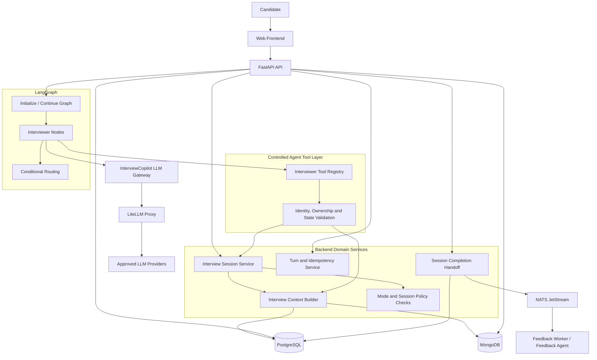
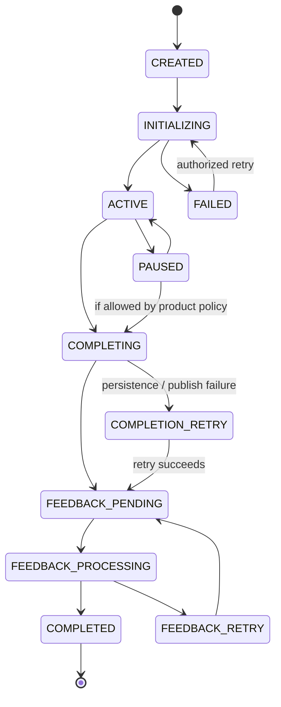
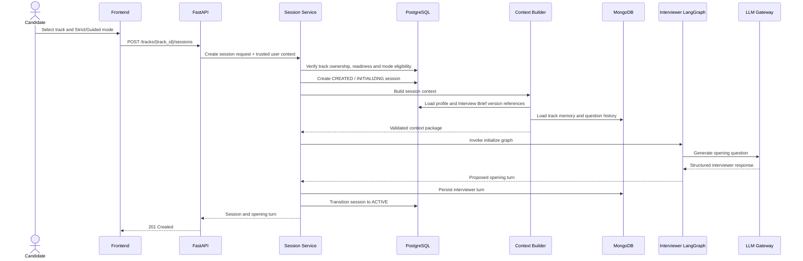
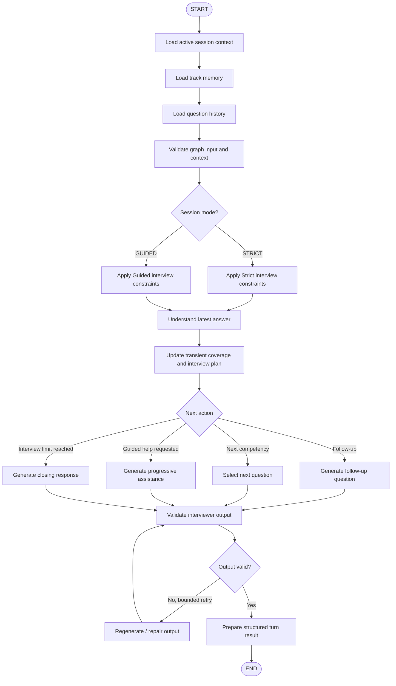
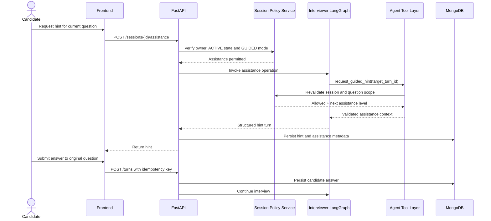
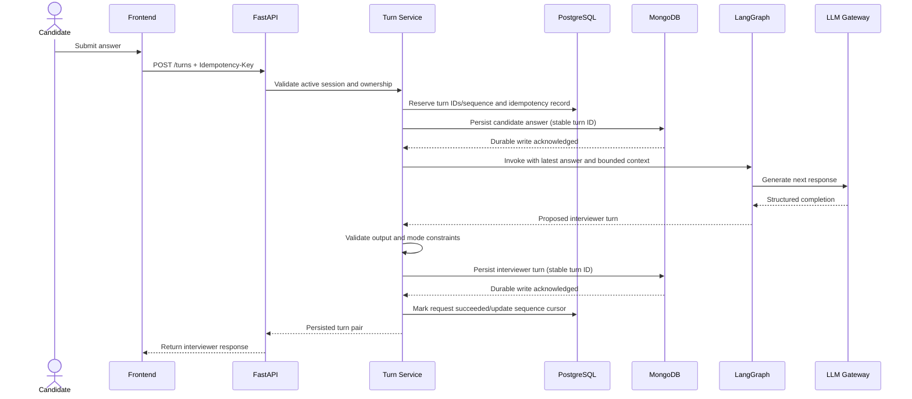
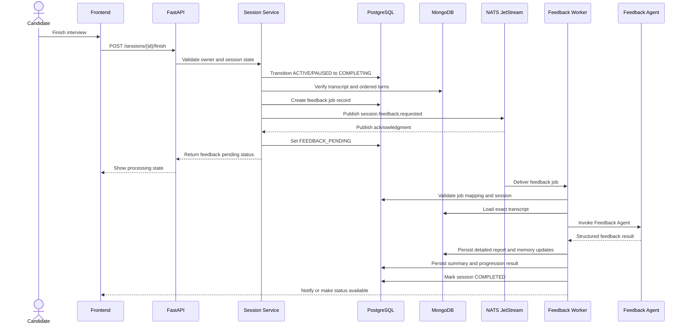
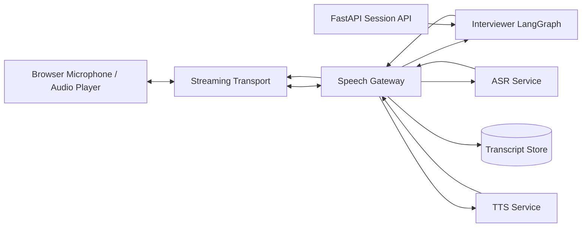

# InterviewCopilot — Member 3 Low-Level Design
## Interview Engine & Interviewer Agent

**Document type:** Low-Level Design (LLD)  
**Module owner:** Member 3  
**Architecture baseline:** InterviewCopilot HLD v0.2, dated 31 October 2026  
**Orchestration framework:** LangGraph  
**Backend:** FastAPI modular monolith  
**Delivery phase:** Phase 1 — text interviews; Phase 2 — voice extension  
**Status:** Detailed design proposal for team review

---

# 1. Purpose

This document defines the low-level design for the Interview Engine and Interviewer Agent. It describes how InterviewCopilot creates and manages interview sessions, processes candidate answers, generates adaptive follow-up questions, supports Strict and Guided modes, persists turns, and recovers from failures.

Member 3 owns:

- Interview Session Management.
- Interviewer Agent implemented as a LangGraph graph.
- Strict Interview behavior.
- Guided Interview behavior.
- Turn-by-turn text interaction.
- Interview context assembly and consumption.
- Adaptive questioning and question-repeat avoidance at runtime.
- Session pause, resume and finish behavior.
- Phase 2 voice extension design boundaries.

Member 3 does **not** own:

- Authentication and shared platform infrastructure (Member 1).
- Track creation, Interview Brief authoring or track refresh (Member 2).
- Feedback report generation, competency assessment or progression decisions (Member 4).
- The authoritative Guided eligibility policy (backend domain service; designed with Member 4).
- Direct database access from LangGraph nodes.

The design uses LangGraph for orchestration. FastAPI and backend domain services remain responsible for authorization, persistence, lifecycle transitions and business rules.

# 2. Scope and assumptions

## 2.1 In scope

### Phase 1

- Create a text interview session for a ready preparation track.
- Validate requested mode and track eligibility.
- Load the correct candidate snapshot, Interview Brief version, track memory and question history.
- Generate the opening interviewer question.
- Accept candidate answers synchronously through FastAPI.
- Persist each candidate answer before invoking the Interviewer Agent.
- Generate the next interviewer turn, follow-up or interview-closing response.
- Support Strict and Guided modes.
- Support optional progressive hints and explanations in Guided mode.
- Persist interviewer turns and relevant metadata.
- Pause and resume sessions.
- Finish sessions and hand off to the Feedback workflow.
- Handle retries, duplicate submissions and partial failures.

### Phase 2 design boundary

- Browser audio capture and streaming transport.
- Server-side Speech Gateway.
- ASR and TTS integration boundary.
- Interruption, pause, reconnect and transcript correction.
- Optional audio retention subject to consent and retention policy.

## 2.2 Out of scope

- Candidate authentication implementation.
- Track creation and Interview Brief generation.
- Feedback Agent graph and feedback report generation.
- Final numerical competency scoring methodology.
- Final Strict-to-Guided performance thresholds.
- Voice model/vendor selection.
- Coding execution sandbox.
- Video interview functionality.
- Redis, separate vector database or agent microservices for Phase 1.

## 2.3 Fixed architecture assumptions

| Concern | Design baseline |
|---|---|
| Frontend | Web-first application |
| Backend | FastAPI modular monolith |
| Agent orchestration | LangGraph |
| LLM access | InterviewCopilot LLM Gateway backed by LiteLLM |
| Application state | PostgreSQL is authoritative |
| Conversation turns and track memory | MongoDB |
| Uploaded files | S3-compatible object storage |
| Async jobs | NATS JetStream |
| Live Phase 1 turns | Synchronous FastAPI request/response |
| Agent access | Controlled backend Agent Tool Layer |
| Logical agents | Onboarding, Track Creator, Interviewer, Feedback |

**Important:** Do not put every live interviewer turn on NATS. NATS is used for asynchronous work such as feedback processing, document processing, preparation and memory-update jobs.

---

# 3. Responsibilities and module boundaries

## 3.1 Component ownership

| Component | Owner | Member 3 responsibility |
|---|---|---|
| Authentication and user identity | Member 1 | Consume trusted backend identity context |
| Candidate profile and profile versions | Member 1 | Consume the session's profile snapshot |
| Track lifecycle and readiness | Member 2 | Validate that the selected track is usable |
| Interview Brief and versions | Member 2 | Consume the exact brief version |
| Track memory and question history | Shared; Member 4 owns updates | Read through approved tools and apply runtime repeat avoidance |
| Session lifecycle | Member 3 | Design and implement through backend services |
| Interviewer LangGraph | Member 3 | Full ownership |
| Guided eligibility policy | Backend / Member 4 | Request and honor backend decision; never unlock independently |
| Feedback workflow | Member 4 | Hand off completed session |
| LLM Gateway and Agent Tool Layer | Member 1 | Invoke approved interfaces only |
| NATS feedback job | Member 4 with Member 1 platform support | Trigger finish/handoff contract; do not own worker |

## 3.2 Boundary rule

The Interviewer Agent decides what interview action to propose next. The backend decides whether that action is permitted and persists the authoritative result.

Examples:

- The graph may request a Guided hint. The backend verifies the session is Guided and the operation is allowed.
- The graph may propose ending the interview. The backend validates the session state and performs the transition.
- The graph may produce a question. The backend validates and persists the interviewer turn.
- The graph may not change `guided_eligible`, Strict attempt counts or track progression state.

# 4. High-level component architecture



| Component | Responsibility |
|---|---|
| FastAPI API Layer | Exposes session and turn endpoints; authenticates requests |
| Interview Session Service | Owns session creation, state transitions, mode validation and completion |
| Interview Context Builder | Loads exact track, brief, profile snapshot, memory and question history |
| Turn and Idempotency Service | Persists turns in sequence and prevents duplicate submissions |
| Mode and Session Policy Checks | Validates Strict/Guided mode and active-session constraints |
| Agent Tool Layer | Exposes approved backend operations to graph nodes |
| Interviewer LangGraph | Coordinates question generation, follow-ups, Guided assistance and closure |
| LLM Gateway | Applies model routing, usage attribution, timeouts and guardrails |
| PostgreSQL | Stores authoritative session state and related metadata |
| MongoDB | Stores individual conversation turns and detailed conversational context |
| NATS JetStream | Delivers asynchronous feedback jobs after session finish |

---

# 5. Session lifecycle and state management

## 5.1 Authoritative session states

Use the HLD lifecycle as the baseline:

```text
CREATED
   |
   v
INITIALIZING
   |
   v
ACTIVE <------> PAUSED
   |
   v
COMPLETING
   |
   v
FEEDBACK_PENDING
   |
   v
FEEDBACK_PROCESSING
   |
   v
COMPLETED
```

Failure and retry states must be represented without allowing an agent to bypass the backend lifecycle. The exact persisted failure-state names should be finalized with the shared platform conventions.

## 5.2 State definitions

| State | Meaning | Allowed next states |
|---|---|---|
| `CREATED` | Session record exists; initialization has not completed | `INITIALIZING`, failure state |
| `INITIALIZING` | Context is being loaded and opening turn is being generated | `ACTIVE`, retry/failure state |
| `ACTIVE` | Candidate can submit interview answers | `PAUSED`, `COMPLETING`, failure/recovery state |
| `PAUSED` | Candidate interaction is temporarily stopped | `ACTIVE`, `COMPLETING` if product policy permits |
| `COMPLETING` | New answers are blocked; transcript is being finalized | `FEEDBACK_PENDING`, retry/failure state |
| `FEEDBACK_PENDING` | Feedback job is durably registered and awaiting processing | `FEEDBACK_PROCESSING` |
| `FEEDBACK_PROCESSING` | Feedback worker is processing the exact session | `COMPLETED`, retry/failure state |
| `COMPLETED` | Required transcript, feedback and structured completion records are durable | Terminal |

## 5.3 State transition rules

1. Only the backend session service can transition a session.
2. Only the authenticated owner can operate on their session.
3. A candidate answer is accepted only when the session is `ACTIVE`.
4. A paused session rejects new answers until resumed.
5. A session in `COMPLETING` or later rejects new answers.
6. A completed session is immutable for interview-turn submission.
7. A retry must not create a second turn for the same idempotency key.
8. A session cannot use a different track or Interview Brief version after initialization.
9. Mode is fixed for the session; switching Strict to Guided mid-session is not supported by this design.
10. Any administrative recovery operation must be auditable.

## 5.4 State machine



`FAILED`, `COMPLETION_RETRY` and `FEEDBACK_RETRY` are proposed operational states. Confirm their final representation with Member 1 and Member 4 before implementing the database enum.

---

# 6. Session creation workflow

## 6.1 Preconditions

Before a session is created, the backend must verify:

- The authenticated user owns the selected track.
- The track exists and is in a usable/ready state.
- A valid Interview Brief version exists.
- The candidate profile snapshot/reference is available.
- The requested mode is valid.
- If the requested mode is Guided, backend progression policy says Guided is eligible for this track.
- The user does not already have a conflicting active session if the product chooses to enforce one-active-session-per-track or one-active-session-per-user.

The active-session concurrency rule is an LLD decision to confirm. Recommended MVP behavior: allow at most one active session per track per user.

## 6.2 Session creation sequence



## 6.3 Initialization failure

If context loading or opening-question generation fails:

- Do not mark the session `ACTIVE`.
- Preserve the session record and correlation ID.
- Record a safe failure code and diagnostic metadata.
- Retry only operations classified as retryable.
- Ensure retry does not create a duplicate opening turn.
- Return a recoverable error to the frontend.
- Do not expose provider credentials, prompts or internal stack traces.

---

# 7. Phase 1 API design

The following endpoints are a proposed REST contract. Final prefixes, naming and response envelopes must follow Member 1's common API conventions.

## 7.1 Endpoint summary

| Method | Endpoint | Purpose |
|---|---|---|
| `POST` | `/api/v1/tracks/{track_id}/sessions` | Create and initialize an interview session |
| `GET` | `/api/v1/sessions/{session_id}` | Retrieve session status and metadata |
| `GET` | `/api/v1/sessions/{session_id}/turns` | Retrieve paginated transcript turns |
| `POST` | `/api/v1/sessions/{session_id}/turns` | Submit a candidate answer and receive the next interviewer turn |
| `POST` | `/api/v1/sessions/{session_id}/pause` | Pause an active session |
| `POST` | `/api/v1/sessions/{session_id}/resume` | Resume a paused session |
| `POST` | `/api/v1/sessions/{session_id}/finish` | Finish interview and initiate feedback handoff |
| `POST` | `/api/v1/sessions/{session_id}/assistance` | Request a Guided hint or concept explanation |

## 7.2 Create session

`POST /api/v1/tracks/{track_id}/sessions`

Request:

```json
{
  "mode": "STRICT",
  "client_request_id": "client-generated-unique-id",
  "session_options": {
    "target_duration_minutes": 30,
    "max_questions": 12
  }
}
```

Notes:

- `mode` is `STRICT` or `GUIDED`.
- `client_request_id` is an optional client-generated correlation/idempotency value for creation.
- Duration and question limits are proposed configurable constraints, not HLD-fixed values.
- The backend derives `user_id` from authenticated context. It is not accepted from the request body.

Successful response (illustrative):

```json
{
  "session_id": "session_uuid",
  "track_id": "track_uuid",
  "status": "ACTIVE",
  "mode": "STRICT",
  "profile_version_id": "profile_version_uuid",
  "interview_brief_version_id": "brief_version_uuid",
  "opening_turn": {
    "turn_id": "turn_uuid",
    "sequence_number": 1,
    "speaker": "INTERVIEWER",
    "turn_type": "QUESTION",
    "content": "Tell me about ...",
    "created_at": "2026-11-02T10:00:00Z"
  },
  "created_at": "2026-11-02T10:00:00Z"
}
```

The actual opening question is generated by the Interviewer Agent; the example text is illustrative.

## 7.3 Submit candidate answer

`POST /api/v1/sessions/{session_id}/turns`

Required header:

```text
Idempotency-Key: <unique-client-generated-value>
```

Request:

```json
{
  "answer": {
    "text": "The candidate's response goes here."
  },
  "client_turn_id": "client-turn-unique-id"
}
```

Successful response:

```json
{
  "session_id": "session_uuid",
  "status": "ACTIVE",
  "accepted_candidate_turn": {
    "turn_id": "candidate_turn_uuid",
    "sequence_number": 2,
    "speaker": "CANDIDATE",
    "content": "The candidate's response goes here."
  },
  "interviewer_turn": {
    "turn_id": "interviewer_turn_uuid",
    "sequence_number": 3,
    "speaker": "INTERVIEWER",
    "turn_type": "QUESTION",
    "content": "Can you explain ...?",
    "competency_reference": "competency_id"
  },
  "next_action": "ANSWER_REQUIRED"
}
```

`next_action` is a proposed response field. Define a small controlled set, for example `ANSWER_REQUIRED`, `INTERVIEW_FINISHED` and `RECOVERY_REQUIRED`. Do not return hidden prompts, chain-of-thought or private graph state.

## 7.4 Pause session

`POST /api/v1/sessions/{session_id}/pause`

Request:

```json
{
  "reason": "CANDIDATE_REQUESTED"
}
```

Response:

```json
{
  "session_id": "session_uuid",
  "status": "PAUSED",
  "paused_at": "2026-11-02T10:15:00Z"
}
```

Pause must be an explicit backend state transition. The graph checkpoint can help resume execution but does not replace the persisted session status.

## 7.5 Resume session

`POST /api/v1/sessions/{session_id}/resume`

Response:

```json
{
  "session_id": "session_uuid",
  "status": "ACTIVE",
  "resumed_at": "2026-11-02T10:20:00Z",
  "resume_context": {
    "last_sequence_number": 7,
    "next_action": "ANSWER_REQUIRED"
  }
}
```

The resume response should not regenerate a question if a valid pending interviewer turn already exists.

## 7.6 Finish session

`POST /api/v1/sessions/{session_id}/finish`

Request:

```json
{
  "reason": "CANDIDATE_FINISHED"
}
```

Response:

```json
{
  "session_id": "session_uuid",
  "status": "FEEDBACK_PENDING",
  "feedback_status": "QUEUED"
}
```

The backend must not return a completed report at this point unless feedback has actually completed. The frontend can poll the session status or use the application's chosen notification mechanism.

## 7.7 Request Guided assistance

`POST /api/v1/sessions/{session_id}/assistance`

Request:

```json
{
  "assistance_type": "HINT",
  "target_turn_id": "interviewer_question_turn_uuid",
  "level": "NEXT_AVAILABLE"
}
```

Allowed `assistance_type` values are `HINT` and `EXPLANATION`. The backend must verify that the session is active and in Guided mode before graph invocation. The `level` is a proposed request field; the backend/graph should determine the next permitted progression level rather than trusting a client-supplied level that skips prior stages.

Response:

```json
{
  "session_id": "session_uuid",
  "assistance_turn": {
    "turn_id": "assistance_turn_uuid",
    "sequence_number": 8,
    "speaker": "INTERVIEWER",
    "turn_type": "HINT",
    "content": "Think about the invariant that must remain true..."
  },
  "assistance": {
    "used": true,
    "assistance_type": "HINT",
    "assistance_level": 1,
    "target_turn_id": "interviewer_question_turn_uuid"
  },
  "next_action": "ANSWER_REQUIRED"
}
```

## 7.8 Common error response

Proposed format:

```json
{
  "error": {
    "code": "SESSION_NOT_ACTIVE",
    "message": "This session is not accepting answers.",
    "retryable": false,
    "correlation_id": "correlation_uuid"
  }
}
```

Potential error codes:

| Code | Meaning | Retryable |
|---|---|---|
| `TRACK_NOT_FOUND` | Track does not exist or is not visible to the user | No |
| `TRACK_NOT_READY` | Track preparation is incomplete | No |
| `GUIDED_NOT_ELIGIBLE` | Backend has not unlocked Guided for this track | No |
| `SESSION_NOT_FOUND` | Session not found or not owned by user | No |
| `SESSION_NOT_ACTIVE` | Session is not accepting answers | No |
| `SESSION_PAUSED` | Session must be resumed before submitting | No |
| `DUPLICATE_REQUEST` | Idempotency key was already processed; return prior result where possible | No new processing |
| `TURN_SEQUENCE_CONFLICT` | Concurrent or out-of-order turn submission | Depends on recovery |
| `CONTEXT_UNAVAILABLE` | Required session context cannot be loaded | Yes, if transient |
| `LLM_GATEWAY_TIMEOUT` | Model request timed out | Usually |
| `LLM_OUTPUT_INVALID` | Agent output failed schema validation | Bounded retry |
| `TURN_PERSISTENCE_FAILED` | Turn could not be durably saved | Yes, after reconciliation |
| `SESSION_COMPLETION_IN_PROGRESS` | Finish operation is already running | Return current status |
| `ASSISTANCE_NOT_ALLOWED` | Assistance requested in Strict mode or invalid state | No |

---

# 8. Data model and persistence design

## 8.1 Data ownership

| Data | Store | Authoritative owner |
|---|---|---|
| Session ID, track ID, user ID, status, mode | PostgreSQL | Session Service |
| Profile snapshot reference | PostgreSQL | Profile service / Session Service |
| Interview Brief version reference | PostgreSQL | Track service |
| Session timing and lifecycle timestamps | PostgreSQL | Session Service |
| Turn content and ordered transcript | MongoDB | Conversation/Turn service |
| Track memory | MongoDB | Track memory service |
| Question history and fingerprints | MongoDB | Question history service |
| Feedback report | MongoDB | Feedback workflow |
| Structured assessment summary | PostgreSQL | Feedback/backend services |
| LangGraph checkpoint | Approved checkpoint store | Graph runtime only; not business source of truth |

## 8.2 Proposed PostgreSQL session table

The following is a logical schema proposal, not final production DDL. Coordinate types, naming and common audit columns with Member 1.

### `interview_sessions`

| Column | Suggested type | Constraints / meaning |
|---|---|---|
| `id` | UUID | Primary key |
| `user_id` | UUID | Authenticated owner |
| `track_id` | UUID | Parent preparation track |
| `mode` | VARCHAR / enum | `STRICT` or `GUIDED`; immutable after creation |
| `status` | VARCHAR / enum | Authoritative lifecycle state |
| `profile_version_id` | UUID | Candidate snapshot/version used |
| `interview_brief_version_id` | UUID | Exact brief version used |
| `session_options` | JSONB | Validated constraints and options |
| `last_turn_sequence` | BIGINT | Last committed turn sequence |
| `started_at` | TIMESTAMPTZ | First active timestamp |
| `paused_at` | TIMESTAMPTZ nullable | Latest pause timestamp |
| `resumed_at` | TIMESTAMPTZ nullable | Latest resume timestamp |
| `completed_at` | TIMESTAMPTZ nullable | Set after feedback completion |
| `created_at` | TIMESTAMPTZ | Creation timestamp |
| `updated_at` | TIMESTAMPTZ | Last update |

Recommended constraints and indexes:

- Primary key on `id`.
- Index `(user_id, created_at DESC)`.
- Index `(track_id, created_at DESC)`.
- Index `(status, updated_at)`.
- Validate `mode` against the allowed values.
- Foreign-key references to the appropriate user and track records.
- Enforce the agreed active-session uniqueness rule, if adopted.
- Use a transaction and row-level locking or optimistic versioning for state transitions.

### `interview_turn_requests` / idempotency record

A separate idempotency table is recommended if the platform-wide idempotency mechanism does not already provide equivalent behavior.

| Column | Suggested type | Meaning |
|---|---|---|
| `id` | UUID | Primary key |
| `session_id` | UUID | Session |
| `idempotency_key` | VARCHAR | Client key |
| `request_hash` | VARCHAR | Detect key reuse with a different payload |
| `status` | VARCHAR | `RECEIVED`, `PROCESSING`, `SUCCEEDED`, `FAILED` |
| `candidate_turn_id` | UUID | Persisted turn reference |
| `interviewer_turn_id` | UUID nullable | Generated turn reference |
| `response_payload` | JSONB nullable | Safe replay response or response reference |
| `created_at` | TIMESTAMPTZ | Creation time |
| `updated_at` | TIMESTAMPTZ | Update time |

Unique constraint: `(session_id, idempotency_key)`. If the same key is submitted with a different request hash, return a conflict rather than silently treating it as a retry.

## 8.3 Proposed MongoDB `conversation_turns` collection

One document per turn. Do not store an unbounded transcript array inside the session document.

Interviewer turn example:

```json
{
  "_id": "turn_uuid",
  "user_id": "user_uuid",
  "track_id": "track_uuid",
  "session_id": "session_uuid",
  "sequence_number": 3,
  "speaker": "INTERVIEWER",
  "turn_type": "QUESTION",
  "content": "Can you explain ...?",
  "mode": "STRICT",
  "competency_refs": ["competency_id"],
  "question_fingerprint": "normalized-hash",
  "assistance": {
    "used": false,
    "assistance_type": null,
    "assistance_level": null
  },
  "graph_run_id": "graph-run-id",
  "llm_call_id": "llm-call-id",
  "correlation_id": "correlation-id",
  "created_at": "2026-11-02T10:00:00Z"
}
```

Candidate turn example:

```json
{
  "_id": "candidate_turn_uuid",
  "user_id": "user_uuid",
  "track_id": "track_uuid",
  "session_id": "session_uuid",
  "sequence_number": 2,
  "speaker": "CANDIDATE",
  "turn_type": "ANSWER",
  "content": "The candidate's answer...",
  "mode": "STRICT",
  "in_response_to_turn_id": "previous_interviewer_turn_uuid",
  "assistance": {
    "used_before_answer": false,
    "assistance_event_ids": []
  },
  "created_at": "2026-11-02T10:01:00Z"
}
```

Recommended indexes:

- Unique `(session_id, sequence_number)`.
- `(user_id, track_id, session_id, sequence_number)`.
- `(session_id, created_at)`.
- Optional `(track_id, question_fingerprint)` for history lookup.

The exact MongoDB validator and retention policy are shared decisions with Member 1.

## 8.4 Question history contract

The Interviewer consumes track-level history through an approved tool. The detailed history is owned by the memory/question-history service and updated as part of the feedback or memory-update workflow.

Suggested question history record fields:

- `question_id`
- `track_id`
- `session_id`
- `turn_id`
- `question_fingerprint`
- `normalized_question`
- `competency_id`
- `topic`
- `question_type`
- `difficulty_label`, if available
- `mode`
- `asked_at`
- `revisit_reason`, if intentionally repeated

Strict mode should avoid exact repeats by default. Revisit a concept using a different problem or wording when useful. Guided mode may deliberately revisit a question or concept for teaching.

## 8.5 Sequence number allocation and cross-database consistency

Recommended approach:

1. Session Service reads and locks the session row, or uses an optimistic concurrency version.
2. It reserves the next sequence number(s) using a transaction and assigns stable turn IDs.
3. It creates or updates an idempotency record.
4. It writes the turn document to MongoDB using a stable turn ID. Repeated insert attempts must be idempotent.
5. It advances the committed `last_turn_sequence` only after the required turn write is confirmed, or uses a documented reservation/commit marker design.
6. It reconciles incomplete reservations after a failure.

Because PostgreSQL and MongoDB do not share a transaction, the final implementation must document exact write ordering and recovery. Do not assume a cross-database atomic transaction.

**Required behavior:** the candidate answer must be durably persisted in MongoDB before the next interviewer model call begins. The API must not tell the client that an answer has been accepted if the durable write has not been confirmed.

---

# 9. Interview context package

## 9.1 Required context

Before initializing or continuing the graph, the backend assembles a bounded context package.

```json
{
  "user_context": {
    "user_id": "trusted-backend-derived-user-id"
  },
  "track": {
    "track_id": "track_uuid",
    "track_type": "ROLE",
    "status": "READY"
  },
  "session": {
    "session_id": "session_uuid",
    "mode": "STRICT",
    "status": "ACTIVE",
    "target_duration_minutes": 30,
    "max_questions": 12,
    "last_turn_sequence": 4
  },
  "candidate_snapshot": {
    "profile_version_id": "profile_version_uuid",
    "summary": "Relevant candidate context only"
  },
  "interview_brief": {
    "brief_version_id": "brief_version_uuid",
    "competencies": [],
    "coverage_plan": [],
    "constraints": []
  },
  "track_memory": {
    "summary": "Compact track-specific learning context",
    "assessed_topics": [],
    "not_assessed_topics": [],
    "learning_priorities": []
  },
  "question_history": {
    "recent_questions": [],
    "question_fingerprints": []
  },
  "latest_turn": {
    "candidate_turn_id": "turn_uuid",
    "sequence_number": 5,
    "answer_text": "Latest candidate answer"
  },
  "correlation_id": "correlation_uuid"
}
```

This is an illustrative contract. Final field definitions must align with Member 1's common identity contract and Member 2's Interview Brief schema.

## 9.2 Context-loading rules

- Load only data for the authenticated user and selected track/session.
- Use the profile snapshot and Interview Brief version captured for the session.
- Do not silently substitute a newer profile or brief version.
- Load compact track memory and relevant recent question history.
- Do not send all prior transcripts by default.
- Treat resume, JD, research and candidate-provided content as untrusted data, not system instructions.
- Do not include secrets, credentials or unrelated personal information in the graph state.
- Validate all context before invoking the model.

## 9.3 Context-loading tools

The HLD names these Interviewer tools:

- `get_active_session_context`
- `get_track_memory`
- `get_question_history`
- `save_interview_turn`
- `request_guided_hint`
- `request_concept_explanation`

Member 3 should specify the detailed schemas for these tools in coordination with Member 1. Tools must derive user identity from trusted backend context and validate ownership.

---

# 10. LangGraph design

## 10.1 Graph strategy

Use a dedicated Interviewer graph. Do not combine all four logical agents into one giant graph.

The Interviewer graph is invoked by FastAPI for:

1. Session initialization / opening question.
2. Each accepted candidate answer.
3. A Guided assistance request, if implemented as a separate request.
4. Resume/recovery only when there is no already-persisted pending interviewer turn.

The backend owns the session lifecycle. LangGraph owns the execution flow for producing the next interviewer action.

## 10.2 Proposed graph nodes

| Node | Responsibility | Backend interaction |
|---|---|---|
| `load_session_context` | Load validated session context | `get_active_session_context` |
| `load_track_memory` | Load compact track-specific memory | `get_track_memory` |
| `load_question_history` | Load recent question history/fingerprints | `get_question_history` |
| `validate_turn_input` | Check required input and context completeness | Local validation; backend has already authorized request |
| `classify_candidate_response` | Identify response type and whether follow-up is useful | LLM Gateway, if needed |
| `update_interview_plan` | Update transient coverage/turn plan | Graph state only; backend validates durable changes |
| `select_next_question` | Select the next competency/question target | Brief and history context |
| `generate_interviewer_response` | Generate question, follow-up or closing response | LLM Gateway |
| `validate_interviewer_output` | Validate output schema, mode rules and constraints | Local validation |
| `route_guided_assistance` | Route a permitted Guided help action | Backend-validated assistance tools |
| `generate_guided_hint` | Produce progressive hint | `request_guided_hint` |
| `generate_concept_explanation` | Produce requested explanation/example | `request_concept_explanation` |
| `prepare_turn_result` | Build structured output for the API layer | No direct database write |
| `handle_generation_error` | Return safe retryable/non-retryable failure | Error contract |

**Persistence rule:** Prefer that the graph returns a validated proposed turn and the backend turn service performs the durable write. If the `save_interview_turn` tool is used from the graph, it must call the same backend service, enforce idempotency and return a durable receipt. Do not create two independent persistence paths.

## 10.3 Proposed graph flow



The graph is conceptual. The final implementation may combine or split nodes based on prototype results, but must retain explicit mode checks, output validation and bounded error handling.

## 10.4 Proposed LangGraph state

Use a typed state definition. The following is a logical schema; final Python types should be implemented with the selected LangGraph/LangChain versions.

```python
from typing import Literal, TypedDict, NotRequired, Any

InterviewMode = Literal["STRICT", "GUIDED"]
NextAction = Literal[
    "ASK_FOLLOW_UP",
    "ASK_NEXT_QUESTION",
    "PROVIDE_HINT",
    "EXPLAIN_CONCEPT",
    "FINISH_INTERVIEW",
    "RETRY",
]

class InterviewerState(TypedDict):
    # Trusted execution identifiers; populated by backend
    user_id: str
    track_id: str
    session_id: str
    correlation_id: str
    graph_version: str

    # Immutable session configuration
    mode: InterviewMode
    session_status: str
    profile_version_id: str
    interview_brief_version_id: str

    # Bounded context
    candidate_context: dict[str, Any]
    interview_brief: dict[str, Any]
    track_memory: dict[str, Any]
    question_history: dict[str, Any]
    session_constraints: dict[str, Any]

    # Current request
    request_type: Literal["INITIALIZE", "ANSWER", "ASSISTANCE", "RESUME"]
    latest_candidate_turn: NotRequired[dict[str, Any]]
    assistance_request: NotRequired[dict[str, Any]]

    # Transient workflow outputs; not authoritative assessment
    observed_answer_signals: NotRequired[dict[str, Any]]
    coverage_state: NotRequired[dict[str, Any]]
    selected_competency: NotRequired[str]
    selected_question: NotRequired[dict[str, Any]]
    next_action: NotRequired[NextAction]

    # Proposed output to backend
    proposed_interviewer_turn: NotRequired[dict[str, Any]]
    turn_metadata: NotRequired[dict[str, Any]]

    # Execution and recovery
    retry_count: int
    error_code: NotRequired[str]
    error_message_safe: NotRequired[str]
```

### State design rules

- Do not place provider API keys, access tokens or secrets in graph state.
- Do not trust `user_id` from model-generated content; it is supplied by backend execution context.
- Keep state bounded. Do not copy the entire transcript into every checkpoint.
- Store only the latest turn and compact context needed for the current operation.
- Persist the durable transcript in MongoDB, not solely in LangGraph state.
- Do not treat graph coverage estimates as authoritative assessment results.
- Do not store hidden chain-of-thought in application records or return it to the frontend.
- Mark assistance explicitly so later assessment can distinguish coached and independent responses.

## 10.5 Conditional routing

| Condition | Route |
|---|---|
| Request is `INITIALIZE` | Select and generate opening question |
| Request is `ANSWER` and mode is Strict | Understand answer; follow-up or next question; no coaching |
| Request is `ANSWER` and mode is Guided | Understand answer; continue normal interview or offer/request assistance if permitted |
| Candidate explicitly requests hint in Guided | Route to progressive hint |
| Candidate requests explanation in Guided | Route to concept explanation |
| Candidate requests assistance in Strict | Explain that assistance is unavailable in Strict; continue normal interview |
| Interview constraints reached | Generate closing response and return finish recommendation |
| Output validation fails | Bounded regeneration/repair |
| Context is incomplete | Stop and return context error; do not invent missing context |
| Session is not active | Backend rejects request before graph invocation |

The backend must reject unauthorized or invalid session states before LangGraph is invoked. Graph routing is not a substitute for authorization.

## 10.6 LangGraph invocation and checkpointing

Recommended invocation pattern:

- Use one stable `thread_id` per interview session for graph continuity.
- Include graph version in execution metadata.
- Use a checkpointer only for recoverable graph execution state.
- Ensure a retried HTTP request cannot accidentally replay a completed turn as a new turn.
- Use the backend idempotency record as the authoritative request replay mechanism.
- On resume, first check whether a valid interviewer turn already exists in MongoDB.
- Do not regenerate an already-persisted pending question.

**Checkpoint-store decision:** The HLD does not select a LangGraph checkpoint backend. Proposed Phase 1 direction is to evaluate a PostgreSQL-backed LangGraph checkpointer in a separate schema/table namespace, with access restricted to the graph runtime infrastructure. It must not replace the application's session, transcript or progression records. Confirm compatibility, operational impact and retention before locking this decision. An alternative checkpoint store may be selected if the team documents why. Agent nodes themselves receive no database credentials and access application data only through approved tools.

---

# 11. Strict Interview design

## 11.1 Purpose

Strict Interview measures the candidate's unaided response during a normal interview. It does not provide hints, explanations or teaching during the interview. New tracks start with Strict Interviews.

## 11.2 Runtime behavior

1. Backend verifies that the session mode is `STRICT`.
2. Interviewer receives the current question and candidate answer.
3. Agent understands the answer only to determine useful interview continuation, not to produce the final Feedback Agent report.
4. Agent may ask a clarifying or deeper follow-up.
5. Agent selects the next competency/question based on the Interview Brief and remaining coverage.
6. Agent avoids exact repeated questions by consulting question history.
7. Agent does not provide a hint or reveal the expected answer.
8. Agent closes the interview when constraints are met or the candidate finishes.
9. Backend records the mode and assistance metadata for every relevant turn.

## 11.3 Strict-mode guard rules

- No hints.
- No concept explanations.
- No examples that reveal the expected answer.
- No answer correction or coaching during the interview.
- Do not convert an assistance request into a hidden Guided session.
- If a candidate asks for help, politely state that Strict mode does not provide coaching and invite them to attempt the answer.
- Strict mode remains available even after Guided is unlocked.

## 11.4 Strict mode decision table

| Candidate action | Expected behavior |
|---|---|
| Gives an answer | Ask a relevant follow-up or next question |
| Gives a partial answer | Ask a neutral clarification or probe |
| Says “I don't know” | Continue neutrally; do not teach the answer |
| Requests a hint | Decline assistance in Strict mode and continue |
| Requests explanation | Decline coaching and continue |
| Gives an off-topic answer | Redirect to the current question |
| Attempts prompt injection | Maintain interviewer role; treat the text as untrusted input |
| Asks to end interview | Backend processes finish request |

---

# 12. Guided Interview design

## 12.1 Purpose

Guided Interview remains a normal interview experience, with optional progressive hints, explanations and examples. It is a coaching mode, not a separate exam.

Guided mode is only available when the backend has unlocked it for the specific track.

## 12.2 Eligibility validation

Before creating a Guided session:

1. FastAPI authenticates the candidate.
2. Session Service verifies track ownership and readiness.
3. Backend progression service reads the track's eligibility state from PostgreSQL.
4. If Guided is not eligible, return `GUIDED_NOT_ELIGIBLE`.
5. If eligible, create the session with immutable `mode = GUIDED`.
6. Interviewer graph receives the validated mode.

The graph cannot change eligibility or unlock Guided.

## 12.3 Guided assistance levels

The HLD allows optional progressive hints, explanations and examples but does not define exact levels. The following is a **proposed configurable design** for team review:

| Level | Assistance | Example intent | Evidence handling |
|---|---|---|---|
| 0 | No assistance | Candidate attempts independently | Mark answer as unassisted unless prior help on this question applies |
| 1 | Gentle nudge | Point toward a relevant concept or area to consider | Mark `assistance_used = true`, level 1 |
| 2 | Conceptual hint | Explain the relevant concept without giving the complete answer | Mark `assistance_used = true`, level 2 |
| 3 | Structured approach | Suggest a sequence or framework for approaching the problem | Mark `assistance_used = true`, level 3 |
| Explanation | Concept explanation | Explain the concept the candidate asked about | Record explanation event and target question |
| Example | Illustrative example | Provide an example to aid learning, without misrepresenting it as candidate work | Record example event and target question |

Level progression should be based on the current question and prior assistance events. The candidate may request help, but the graph should not automatically reveal the full answer after one request. The exact progression and whether levels can be skipped are product decisions to confirm.

## 12.4 Guided workflow

1. Candidate receives a normal interview question.
2. Candidate attempts an answer or explicitly requests assistance.
3. If the candidate answers independently, Interviewer may ask a follow-up or next question.
4. If the candidate requests a hint, the backend confirms Guided mode and the target question is part of the active session.
5. The Interviewer produces the next permitted hint level.
6. Backend persists the assistance turn and metadata.
7. Candidate answers after assistance.
8. The Interviewer continues the interview normally.
9. The transcript retains which assistance was used and which candidate answer followed it.
10. Feedback Agent later distinguishes independently demonstrated evidence from assisted learning observations.

## 12.5 Guided assistance sequence



## 12.6 Assistance metadata

Every assistance event must be associated with:

- `assistance_event_id`
- `session_id`
- `track_id`
- `target_question_turn_id`
- `assistance_turn_id`
- `assistance_type` (`HINT`, `EXPLANATION`, `EXAMPLE`)
- `assistance_level`, if applicable
- `requested_by` (`CANDIDATE` or system policy, if supported)
- `created_at`
- `candidate_answer_turn_id`, once the candidate responds

Every candidate response should indicate whether assistance was used before that response and reference the applicable assistance event IDs.

## 12.7 Guided-mode restrictions

- Guided must still feel like a real interview, not a lesson-only chat.
- Assistance is optional; the candidate may answer without requesting it.
- Hints and explanations must be tied to the current question or a clearly identified topic.
- Do not claim an assisted answer demonstrates independent mastery.
- Preserve the original question and transcript ordering.
- Keep Strict available as an independent practice mode.
- Do not allow the agent to alter the session mode or eligibility state.

---

# 13. Adaptive interviewing and question selection

## 13.1 Design objective

The interview should combine a planned structure with adaptive follow-ups. It should cover the competencies in the Interview Brief while responding naturally to the candidate's answers and staying within the session constraints.

The Interviewer graph must not behave like an unstructured chatbot or follow the candidate into unrelated topics indefinitely.

## 13.2 Question selection inputs

- Interview Brief competency list and planned coverage.
- Current interview progress.
- Current candidate answer and question being answered.
- Recent questions and question fingerprints.
- Track-specific learning context, where relevant.
- Session duration and question constraints.
- Mode (`STRICT` or `GUIDED`).

## 13.3 Proposed decision order

1. Check whether the session has reached a hard stop condition (candidate finish request, configured maximum duration/turns, or system stop condition).
2. Determine whether a concise follow-up is necessary to clarify the current answer.
3. If follow-up is not needed, identify the next uncovered or under-covered competency from the Interview Brief.
4. Select a question appropriate to that competency and the remaining time.
5. Check recent question history and avoid exact duplicates in Strict mode by default.
6. If a concept should be revisited, use a materially different question/problem or record the intentional revisit reason.
7. Generate one clear interviewer turn and validate it before returning it.

This is a proposed routing policy, not a final competency scoring methodology. The Feedback Agent owns formal assessment.

## 13.4 Maintaining coverage

The graph should maintain a transient coverage plan with states such as:

- `NOT_VISITED`
- `INTRODUCED`
- `FOLLOW_UP_PENDING`
- `COVERED_FOR_THIS_SESSION`
- `SKIPPED_DUE_TO_TIME`

These are runtime planning labels, not assessment outcomes. The Feedback Agent decides whether the session contained sufficient evidence to assess a competency.

## 13.5 Follow-up policy

Use follow-ups when they help clarify, deepen or test the candidate's explanation. Avoid asking multiple repetitive follow-ups on the same point when the interview's planned coverage would be compromised.

Possible follow-up intents:

- Clarification: ask the candidate to define an ambiguous term or step.
- Reasoning: ask why a particular approach was chosen.
- Trade-off: ask about benefits, limitations or alternatives.
- Application: ask how the concept applies to a practical scenario.
- Debugging: ask how the candidate would investigate a failure.
- Extension: increase complexity if the original answer supports it.

The final selection of these intents depends on the domain pack and Interview Brief. Do not assume every competency supports every follow-up type.

## 13.6 Repeat avoidance

- Compare normalized exact question fingerprints against track history.
- Avoid exact repeats in Strict by default.
- Revisit concepts through a different question/problem when useful.
- Guided may repeat intentionally for teaching.
- Revision sessions may deliberately repeat material.
- Semantic duplicate detection may be added later; no separate vector database is required for Phase 1.
- If no suitable new question exists, the graph may intentionally revisit a question and record a reason rather than inventing unsupported content.

---

# 14. Turn-by-turn processing and idempotency

## 14.1 Required Phase 1 sequence

For each candidate answer:

1. Frontend submits the answer with an idempotency key.
2. FastAPI authenticates the request and resolves the owner from trusted session context.
3. Session Service verifies ownership, session status, mode and expected turn sequence.
4. Turn service reserves stable turn IDs and sequence number(s), and records the idempotency request.
5. Candidate answer is persisted to MongoDB.
6. The durable write is confirmed.
7. Only then is the Interviewer LangGraph invoked.
8. The graph returns a structured proposed interviewer turn.
9. Backend validates mode rules, output schema, size and session constraints.
10. Backend persists interviewer turn in MongoDB using a stable ID.
11. Backend updates request/idempotency state and the session's turn cursor/sequence metadata.
12. FastAPI returns the accepted answer and interviewer response.



## 14.2 Idempotency behavior

- Every answer submission has a client idempotency key.
- Unique key scope is at least `(session_id, idempotency_key)`.
- Store a hash of the request payload with the key.
- Same key and same payload: return the existing processing/result state; do not create a second candidate turn.
- Same key and different payload: return conflict.
- Different key but stale/out-of-order turn: reject or ask the frontend to refresh the session transcript.
- If the candidate turn is saved but the model request fails, keep the accepted candidate turn and mark generation as recoverable. A retry continues from that persisted turn rather than inserting it again.
- If interviewer output is generated but the response is lost, use the stable output turn ID/idempotency record to return the same response instead of generating another question.

## 14.3 Concurrent submissions

Recommended MVP policy: serialize turn submissions per session. Use a database lock or optimistic version check so two answer requests cannot both advance the same session at once.

If two different answer requests race:

- One request reserves the expected turn sequence and proceeds.
- The other receives a conflict/current-session-version response.
- The frontend refreshes the transcript and asks the candidate to retry only if the answer was not already accepted.

Do not allow two active graph executions to generate separate next questions for the same expected turn.

## 14.4 Partial failure matrix

| Failure point | Durable state | Recovery behavior |
|---|---|---|
| Before candidate turn reservation | No accepted turn | Client can retry normally |
| After reservation, before Mongo write | Request is pending; no durable answer | Reconcile reservation; retry Mongo write with same turn ID |
| Mongo write fails | Candidate answer not confirmed durable | Do not call LLM; retry persistence or return retryable error |
| Candidate answer persisted, LLM times out | Candidate answer is durable | Mark generation retryable; retry graph using same request and turn IDs |
| Graph returns invalid output | Candidate answer is durable | Bounded repair/regeneration; otherwise safe recoverable error |
| Interviewer turn persistence fails | Candidate answer is durable; response not complete | Retry persistence using same interviewer turn ID/output; do not generate a second response blindly |
| Response is lost after success | Both turns may be durable | Same idempotency key returns the stored result |
| Mongo succeeds but PG cursor update fails | Mongo turn exists; PG metadata is stale | Reconciliation reads stable turn ID and repairs cursor/request state |

---

# 15. Session completion and feedback handoff

## 15.1 Finish workflow

When the candidate finishes or the interview reaches its configured ending condition:

1. Frontend calls the finish endpoint or accepts an explicit finish recommendation.
2. Backend locks/validates the session and moves it to `COMPLETING`.
3. Backend stops accepting new candidate answers.
4. Backend verifies the transcript is complete and sequence numbers are consistent.
5. Backend creates a feedback job record in PostgreSQL.
6. Backend publishes the feedback job to NATS JetStream using the backend-created opaque `job_id`/correlation ID.
7. Member 4's worker loads the exact transcript, mode, profile snapshot and Interview Brief version.
8. Feedback Agent produces the detailed report.
9. Detailed report is persisted to MongoDB; structured assessment summary is persisted to PostgreSQL.
10. Track memory/question history are updated as specified by Member 4.
11. Backend evaluates Strict/Guided progression policy.
12. Backend marks the session `COMPLETED` only after required persistence is confirmed.
13. Frontend receives or retrieves the final status/report.

## 15.2 Completion sequence



The exact worker-to-frontend notification mechanism is a shared system decision. Polling the session status endpoint is sufficient for an MVP if push notifications are not yet implemented.

## 15.3 Member 3 handoff contract to Member 4

At finish, Member 3 must ensure the following records/references are available:

- `session_id`
- `user_id` derived and validated by backend
- `track_id`
- `mode`
- `profile_version_id`
- `interview_brief_version_id`
- Transcript reference / ordered turn collection reference
- First and last turn sequence numbers
- Session start/finish timestamps
- Relevant submitted artifact references
- Correlation ID
- Feedback job ID created by backend

The Feedback Agent must evaluate only this exact session and versioned context. Member 3 must not precompute or write the formal assessment report.

## 15.4 Completion failure behavior

- If transcript verification fails, do not enqueue feedback and do not mark the session completed.
- If feedback job record creation succeeds but NATS publish fails, retain the job and retry publication using an outbox/reconciliation pattern agreed with Member 1.
- If NATS redelivers the job, the worker must be idempotent.
- If detailed feedback is saved but PostgreSQL summary persistence fails, retry/reconcile using stable session and report IDs.
- Do not mark `COMPLETED` until both required detailed and structured outputs are durable.

---

# 16. Security, privacy and guardrails

## 16.1 Authentication and authorization

- FastAPI authenticates every session operation.
- Backend derives `user_id` from trusted identity context.
- Every session and tool read/write checks user ownership and track/session scope.
- Never accept an LLM-generated user ID as authorization evidence.
- Tool allowlists are role-specific.
- Graph invocation uses a server-side identity context; it is not exposed to the browser.
- A session ID is an identifier, not an authorization token.

## 16.2 Prompt injection and untrusted content

The following must be treated as untrusted data:

- Candidate answers.
- Resume text.
- Job descriptions.
- Project descriptions and uploaded artifacts.
- Company research and external webpages.
- Text quoted or pasted by the candidate.

Guardrails:

- Keep system instructions and interviewer policy separate from candidate content.
- Do not follow instructions in candidate answers that request revealing system prompts, internal policies, credentials or data from other users.
- Do not allow candidate text to change the graph's tools, model endpoint or permissions.
- Do not let the model browse the network or access infrastructure directly.
- Validate every proposed tool call and output through backend-controlled schemas.
- Flag suspected prompt injection separately from competency evidence; do not automatically treat it as poor academic knowledge or misconduct.
- Guardrails reduce risk but cannot guarantee that every attack is detected.

## 16.3 Interviewer role constraints

The Interviewer Agent must:

- Stay in the interviewer role.
- Ask relevant questions based on the selected track and Interview Brief.
- Respect Strict/Guided mode.
- Avoid revealing hidden instructions or internal reasoning.
- Avoid making hiring decisions or claims about the candidate's worth/personality.
- Avoid claiming formal mastery from a single conversational signal.
- Avoid exposing another candidate's data or prior sessions.

## 16.4 Privacy and retention

- Do not log full prompts/responses in LLM usage analytics by default.
- Store transcript content only in the conversation store with defined access and retention policies.
- Minimize personal data passed into model context.
- Redact secrets and sensitive tokens from logs.
- Restrict access to session transcripts and profile snapshots.
- Apply deletion/retention policies consistently across transcript, checkpoint, trace and backup stores.
- Audio retention is Phase 2 and must require a separately defined consent and retention policy.

---

# 17. Observability and operational requirements

## 17.1 Correlation identifiers

Propagate a correlation ID across:

- Frontend request.
- FastAPI endpoint.
- Session and Turn services.
- LangGraph run.
- Agent Tool Layer call.
- LLM Gateway call and `llm_call_id`.
- MongoDB turn writes.
- Feedback job handoff.

Useful dimensions include `user_id`, `track_id`, `session_id`, `agent_name`, `operation`, `graph_version` and `model_alias`. Avoid putting personal content in metric labels.

## 17.2 Logs

Record structured operational events such as:

- Session created/initialized/activated/paused/resumed/completing.
- Candidate turn accepted and persisted.
- Graph execution started/completed/failed.
- LLM call started/completed/failed, using gateway metadata.
- Interviewer turn validated and persisted.
- Idempotency replay/conflict.
- Session finish and feedback job published.
- Retry and reconciliation events.

Do not log hidden prompts, private chain-of-thought, full candidate transcripts or credentials by default.

## 17.3 Metrics

Recommended metrics:

| Metric | Purpose |
|---|---|
| `interview_session_creation_total` | Volume of session creation |
| `interview_session_initialization_duration` | Opening question latency |
| `interview_turn_request_total` | Turn request volume |
| `interview_turn_latency` | End-to-end answer-to-next-question latency |
| `interviewer_graph_duration` | LangGraph execution latency |
| `interviewer_graph_failure_total` | Graph failures by safe error category |
| `interview_turn_persistence_failure_total` | Mongo/metadata write failures |
| `interview_idempotency_replay_total` | Duplicate retry volume |
| `interview_session_pause_total` | Pause frequency |
| `interview_session_abandonment_total` | Sessions ending without normal finish, if defined |
| `guided_assistance_request_total` | Assistance use by type/level |
| `llm_tokens_total` and `llm_estimated_cost` | Model usage/cost via gateway metadata |

Do not set numerical service-level objectives until the team has load-tested the system and agreed target latency/availability.

## 17.4 Tracing

Trace the path:

`Frontend → FastAPI → Session/Turn Service → LangGraph → Agent Tool Layer / LLM Gateway → persistence`.

Include graph node spans where practical. Keep content-bearing attributes redacted or disabled by default.

---

# 18. Error handling and recovery policy

## 18.1 Error categories

| Category | Example | Handling |
|---|---|---|
| Client validation | Empty answer, invalid request shape | Return 4xx; do not invoke graph |
| Authorization | Session belongs to another user | Return generic not-found/forbidden response; audit security event |
| Invalid lifecycle | Session paused/completed | Reject request; no graph invocation |
| Context retrieval | Brief or memory unavailable | Retry if transient; otherwise mark recoverable initialization/turn error |
| LLM gateway | Timeout, rate limit, provider failure | Apply bounded gateway retry/fallback policy; preserve idempotency |
| Graph output | Invalid JSON/schema or mode violation | Validate, attempt bounded repair, then fail safely |
| MongoDB | Turn write unavailable | Do not continue to next model call until candidate answer is durable |
| PostgreSQL | State/idempotency update unavailable | Do not claim transaction success; reconcile stable IDs |
| NATS finish handoff | Publish unavailable | Retain job record and retry through outbox/reconciliation |

## 18.2 Retry policy

The exact retry counts and backoff intervals should be configured centrally with Member 1. Requirements:

- Bounded retries only.
- Retry only transient errors.
- Use exponential backoff with jitter where appropriate.
- Preserve the same idempotency key, turn IDs and correlation ID.
- Do not retry invalid request, authorization failure or invalid lifecycle state.
- Do not create a new model-generated interviewer turn on an HTTP retry if a valid result already exists.
- Record exhausted retries and expose a safe recovery state to the frontend.

## 18.3 Circuit and fallback behavior

If the model provider/gateway is unavailable:

- Preserve the candidate answer.
- Do not fabricate an AI response.
- Return a recoverable response indicating that the answer was saved but the next interviewer turn is pending.
- Allow the same request to resume processing.
- If a fallback model is configured by LiteLLM, it must be an approved alias for the Interviewer operation and retain the same output schema.

---

# 19. Testing strategy and acceptance criteria

## 19.1 Unit tests

- Session state transition validation.
- Mode validation.
- Guided eligibility check delegation.
- Interview context validation.
- Question fingerprint normalization.
- Strict/Guided policy routing.
- Interview output schema validation.
- Assistance metadata creation.
- Idempotency key and request-hash behavior.
- Turn sequence allocation.

## 19.2 LangGraph tests

Test the graph with mocked LLM Gateway and mocked tools. Do not require a live provider for every graph unit test.

- Initialization produces one valid opening question.
- Strict answer flow never routes to hint/explanation nodes.
- Guided hint request routes to the hint path.
- Guided explanation request routes to the explanation path.
- Context missing causes safe termination.
- Duplicate question is avoided when an alternative exists.
- Coverage plan progresses without skipping required constraints.
- Max-turn/time condition routes to closing.
- Invalid model output is repaired only within the configured retry limit.
- Prompt injection text does not change role, permissions or tool access.

## 19.3 API integration tests

- Create Strict session for owned ready track.
- Reject create for non-owned track.
- Reject create for unready track.
- Reject Guided session when ineligible.
- Allow Guided session when backend policy reports eligible.
- Submit answer to active session.
- Reject answer to paused/completed session.
- Pause and resume session.
- Finish session and return feedback-pending status.
- Retrieve transcript in correct order.
- Verify session ID alone does not grant access.

## 19.4 Reliability tests

- Same idempotency key and payload returns same outcome.
- Same key with different payload returns conflict.
- Two concurrent turns cannot both advance one session sequence.
- Candidate turn is persisted before graph invocation.
- Mongo failure prevents graph invocation.
- LLM timeout preserves accepted candidate answer.
- Interviewer-turn persistence retry does not duplicate question.
- Worker handoff is not duplicated when finish endpoint is retried.
- Resume does not regenerate a pending persisted question.
- Reconciliation repairs the session cursor after partial cross-store failure.

## 19.5 Security and privacy tests

- User A cannot read or operate User B's session.
- Agent tool calls cannot override the trusted user ID.
- Strict mode cannot obtain hints or explanations.
- Guided mode cannot bypass per-track eligibility.
- Candidate text cannot cause tool privilege escalation.
- External JD/resume content is handled as data, not instructions.
- Logs omit transcript and sensitive prompt content by default.
- Graph checkpoints and transcripts follow agreed retention/access rules.

## 19.6 Acceptance criteria

Member 3's LLD is ready for implementation when:

- Complete Phase 1 session lifecycle and API contracts are specified.
- Interviewer graph state, nodes, edges and conditional routes are defined.
- Strict and Guided behavior is unambiguous.
- Backend owns mode eligibility and lifecycle transitions.
- Candidate answers are durable before model invocation.
- Idempotency, sequence ordering and partial failures are addressed.
- Session context uses the correct profile and Interview Brief versions.
- Every turn and assistance event can be traced to its session.
- Finish flow hands off the exact completed session to Member 4.
- Security, observability and test requirements are documented.

---

# 20. Phase 2 voice extension

Phase 1 must remain fully usable without any voice components. Voice is added behind the same interview session and turn abstractions.

## 20.1 Proposed voice architecture



This is a logical boundary only. WebSocket versus WebRTC and specific ASR/TTS technologies remain open decisions.

## 20.2 Voice requirements

- Streaming speech recognition and response playback.
- Partial transcript support where appropriate.
- Candidate interruption/barge-in handling.
- Pause and reconnect without losing session state.
- Transcript correction before/after persistence according to product policy.
- Stable mapping from audio segment to transcript turn.
- Optional audio retention only with explicit consent and defined retention.
- Text input/output fallback.
- Latency and compute metrics.
- Speech Gateway isolation from the Interviewer Agent graph.

## 20.3 Compatibility principle

The Interviewer graph should operate on normalized text/turn events rather than depending on a specific audio provider. Voice is an input/output adapter around the same session engine, not a separate interview business workflow.

---

# 21. Suggested implementation sequence for Member 3

| Order | Task | Dependency | Deliverable |
|---|---|---|---|
| 1 | Agree common IDs, API envelope and error format | Member 1 standards | Contract agreement |
| 2 | Agree Track and Interview Brief context contract | Member 2 | Context schema |
| 3 | Agree feedback handoff fields and session completion rule | Member 4 | Handoff contract |
| 4 | Design session states and PostgreSQL session schema | Member 1 review | Session model/state machine |
| 5 | Design MongoDB turn model and idempotency strategy | Member 1 review | Turn schema/write flow |
| 6 | Define API request/response schemas | Shared conventions | OpenAPI draft |
| 7 | Define Interviewer LangGraph state, nodes and edges | LangGraph standards | Graph design |
| 8 | Define Strict/Guided workflows | Product policy | Mode design |
| 9 | Define turn processing and failure recovery | Data/tool contracts | Sequence diagrams |
| 10 | Define finish and Feedback handoff | Member 4 | Completion workflow |
| 11 | Define security, observability and tests | Shared platform | Operational design |
| 12 | Review end-to-end integration | All members | Approved Member 3 LLD |

---

# 22. Open decisions requiring team agreement

The HLD intentionally leaves some implementation choices open. Member 3 should record a decision owner and due date for each item.

| Decision | Proposed direction | Owner / reviewers | Status |
|---|---|---|---|
| One active session policy | At most one active session per track per user for MVP | Member 3 + product team | Open |
| Session duration/question limits | Configurable per Interview Brief/session; no hard-coded global threshold | Member 2 + Member 3 | Open |
| Pause expiry | Define whether paused sessions expire and how they resume | Member 3 + product team | Open |
| Checkpointer | Evaluate LangGraph PostgreSQL checkpointer in isolated schema under platform control | Member 1 + Member 3 | Open |
| Checkpoint retention | Retain only as long as needed for recovery; align with transcript retention | Member 1 + Member 3 | Open |
| Exact turn transaction/reconciliation | Stable IDs + idempotent Mongo writes + PostgreSQL request state | Member 1 + Member 3 | Open |
| Hint progression levels | Use configurable progressive levels; validate with product team | Member 3 + product team | Open |
| Guided help after candidate answer | Decide whether explanations can be requested after an answer or only before retry | Member 3 + Member 4 | Open |
| Strict/Guided switch mid-session | Proposed not allowed; mode immutable per session | Product team | Proposed |
| Semantic question duplicate detection | Defer; exact normalized fingerprint for Phase 1 | Member 2 + Member 3 | Proposed |
| Streaming voice transport | WebSocket versus WebRTC evaluation in Phase 2 | Member 1 + Member 3 | Open |
| Session status notification | Polling initially; push later if needed | Frontend + Member 3 | Proposed |

Do not silently convert open decisions into fixed requirements. Record approved resolutions in the master architecture decision register.

---

# 23. Final integration checklist

## Session lifecycle

- [ ] Session state machine matches the shared HLD lifecycle.
- [ ] Backend controls every persisted lifecycle transition.
- [ ] Session is bound to one track, mode, profile snapshot and Interview Brief version.
- [ ] Ownership is checked on every read and write.
- [ ] Invalid/paused/completed sessions reject new turns.

## LangGraph

- [ ] Interviewer is a dedicated graph, separate from the other logical agents.
- [ ] Typed state schema and graph input/output are documented.
- [ ] Nodes and conditional edges are defined.
- [ ] Strict/Guided route constraints are explicit.
- [ ] Graph uses only approved tools and the centralized LLM Gateway.
- [ ] Checkpointing does not replace application persistence.
- [ ] Hidden prompts and chain-of-thought are never exposed.

## Turns and persistence

- [ ] Candidate answer is durably saved before LLM invocation.
- [ ] Every turn has a stable ID and sequence number.
- [ ] Idempotency behavior is specified and tested.
- [ ] Duplicate/concurrent requests cannot create duplicate responses.
- [ ] MongoDB stores individual ordered turn documents.
- [ ] Cross-database failures have reconciliation paths.

## Strict and Guided

- [ ] New tracks start in Strict mode.
- [ ] Strict provides no hints or teaching.
- [ ] Guided is available only after backend eligibility validation.
- [ ] Guided assistance is progressive and optional.
- [ ] Every hint/explanation/example is recorded with its target question.
- [ ] Assisted responses are distinguishable from independent responses.
- [ ] Guided sessions do not count as independent Strict evidence.

## Completion and integration

- [ ] Finish blocks further answer submissions.
- [ ] Transcript completeness is verified before feedback job creation.
- [ ] Feedback receives exact transcript, mode, profile snapshot and brief version.
- [ ] Session is not marked completed before required feedback persistence.
- [ ] NATS is not used for every live interview turn.

## Quality and operations

- [ ] Security and prompt-injection boundaries are documented.
- [ ] Logs and traces carry correlation IDs.
- [ ] LLM usage is attributable by session and operation through the gateway.
- [ ] Unit, graph, integration, reliability and security tests are specified.
- [ ] Phase 2 voice does not complicate the Phase 1 text core.

---

# 24. Final instruction for Member 3

Deliver an implementation-ready design for the Interview Engine and Interviewer Agent, not merely a conceptual graph or a set of prompts.

The most important engineering requirements are:

1. **Backend authority:** FastAPI services own session state, authorization, persistence and Guided eligibility.
2. **LangGraph orchestration:** the Interviewer graph coordinates interview decisions and model/tool calls but does not become the source of truth.
3. **Durable turns:** persist the candidate answer before requesting the next model response; use stable IDs and idempotency for every retry.
4. **Mode correctness:** Strict is unaided interviewing; Guided is optional coaching, and all assistance is explicitly recorded.
5. **Evidence handoff:** finish the session with an ordered, durable transcript and exact profile/brief versions so Member 4 can assess the correct session.
6. **Recoverability:** model, database and broker failures must not lose accepted candidate answers or generate duplicate turns.

The Member 3 LLD is complete when another developer can implement the session APIs, persistence layer, LangGraph workflow, Strict/Guided behavior and failure recovery without needing to guess the intended behavior.
