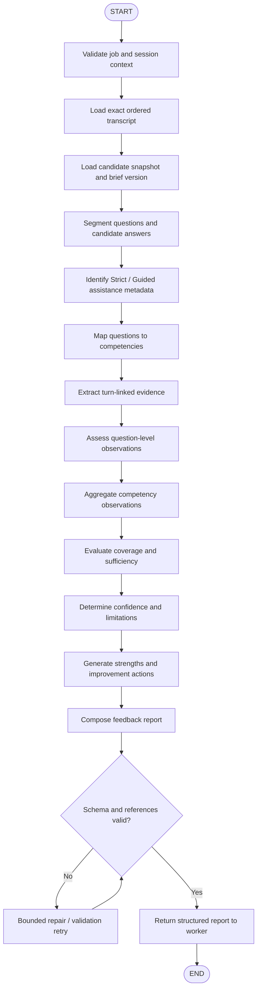

# Feedback Agent — LangGraph Design

## 1. Agent Purpose

The Feedback Agent evaluates one exact completed session. It produces:

- Detailed feedback report.
- Question-level evidence.
- Competency observations.
- Strengths.
- Improvement areas.
- Unassessed areas.
- Confidence and evidence limitations.
- Actionable improvement recommendations.

The agent must work from the session's exact transcript, mode, candidate snapshot, Interview Brief version and submitted artifacts.

## 2. Graph Invocation Boundary

The Feedback Worker invokes the compiled LangGraph graph after it has validated the job and assembled the authorized context package.

The graph:
- Does not authenticate end users.
- Does not select a different session.
- Does not query databases directly.
- Does not write directly to MongoDB or PostgreSQL.
- Does not mark a session completed.
- Does not unlock Guided.
- Does not make hiring predictions.

It returns a validated structured evaluation. Backend services persist it and make policy decisions.

## 3. Proposed Graph Nodes

| Node | Responsibility |
|------|----------------|
| `validate_job_context` | Validate job/session identifiers and expected input |
| `load_completed_session` | Retrieve exact completed session metadata |
| `load_transcript` | Retrieve ordered turns and transcript completeness metadata |
| `load_candidate_snapshot` | Retrieve exact profile snapshot reference |
| `load_interview_brief` | Retrieve exact brief version used |
| `load_session_artifacts` | Retrieve only artifacts relevant to this session |
| `segment_questions_answers` | Pair interviewer questions with candidate response turns |
| `classify_assistance` | Identify assistance events and assisted response boundaries |
| `map_competencies` | Map questions to Interview Brief competencies |
| `extract_evidence` | Extract concise answer-linked evidence observations |
| `assess_question_responses` | Generate question-level assessment observations |
| `aggregate_competencies` | Aggregate sufficient evidence by competency |
| `evaluate_coverage` | Determine assessed, partially assessed and unassessed areas |
| `calculate_confidence` | Apply the agreed evidence/confidence rubric |
| `generate_strengths` | Summarize demonstrated strengths with evidence references |
| `generate_improvements` | Generate specific improvement recommendations |
| `compose_report` | Build complete report object |
| `validate_report_schema` | Enforce output schema and evidence-reference integrity |
| `prepare_persistence_result` | Return report and structured summary to worker/backend |
| `handle_graph_error` | Produce safe error and retry classification |

## 4. LangGraph Workflow



## 5. Conditional Routing

| Condition | Behavior |
|-----------|----------|
| Job invalid or session not eligible for feedback | Stop; return non-retryable validation error |
| Transcript incomplete | Stop or retry after transcript reconciliation; do not assess partial data as complete |
| No candidate answer exists for a question | Mark that question's response evidence unavailable; do not invent an answer |
| Question cannot be mapped confidently to a competency | Preserve question-level observation and mark competency mapping uncertain |
| Evidence is insufficient for a competency | Return `NOT_ASSESSED` or an explicitly defined insufficient-evidence state |
| Guided assistance was used | Preserve assistance metadata and separate independent versus assisted evidence |
| Report fails schema validation | Bounded repair/validation retry |
| LLM Gateway transient failure | Retry according to worker/graph policy |
| Permanent model/content validation failure | Fail safely and route to retry/manual inspection policy |
| Persistence fails | Worker retries persistence idempotently; graph need not regenerate a completed report |

## 6. Feedback Graph State Schema

Use a typed state structure. The following is a logical design; the exact Python types depend on the selected LangGraph version and shared project conventions.

```python
from typing import TypedDict, Literal, NotRequired, Any

class FeedbackState(TypedDict):
    # Trusted job/execution context
    job_id: str
    correlation_id: str
    graph_version: str

    # Exact source entities
    user_id: str
    track_id: str
    session_id: str
    session_mode: Literal["STRICT", "GUIDED"]
    session_status: str

    # Immutable source version references
    profile_version_id: str
    interview_brief_version_id: str

    # Loaded source content (bounded to this session)
    transcript_turns: list[dict[str, Any]]
    candidate_snapshot: dict[str, Any]
    interview_brief: dict[str, Any]
    session_artifacts: list[dict[str, Any]]

    # Intermediate graph outputs
    question_answer_segments: NotRequired[list[dict[str, Any]]]
    assistance_events: NotRequired[list[dict[str, Any]]]
    competency_map: NotRequired[list[dict[str, Any]]]
    evidence_items: NotRequired[list[dict[str, Any]]]
    question_assessments: NotRequired[list[dict[str, Any]]]
    competency_assessments: NotRequired[list[dict[str, Any]]]
    coverage_summary: NotRequired[dict[str, Any]]
    confidence_summary: NotRequired[dict[str, Any]]
    recommendations: NotRequired[list[dict[str, Any]]]

    # Final outputs
    detailed_feedback_report: NotRequired[dict[str, Any]]
    structured_assessment_summary: NotRequired[dict[str, Any]]

    # Execution / validation
    validation_errors: NotRequired[list[str]]
    retry_count: int
    error_code: NotRequired[str]
    error_message_safe: NotRequired[str]
```

### State Rules

- Load only the session identified by the validated job.
- Never append unrelated sessions or other tracks to the state.
- Retain source turn IDs and sequence numbers through every transformation.
- Keep the complete transcript in its durable source store; graph state should contain only the bounded input required for this job.
- Do not store secrets or credentials in graph state.
- Do not expose hidden model reasoning.
- Any report claim about candidate performance must be traceable to source turn IDs.
- Persist the final result through backend services, not direct graph database connections.
