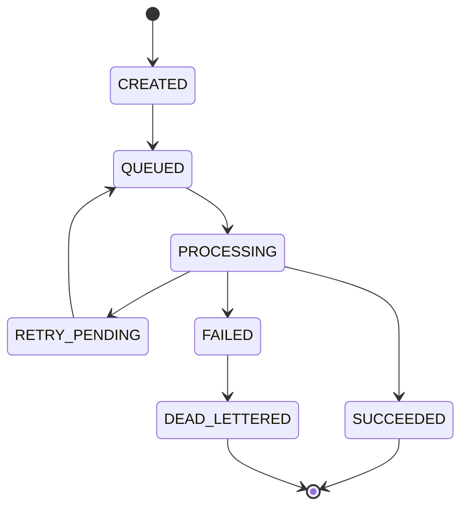

# Feedback Processing Workflow

## 1. Normal Workflow

```mermaid
sequenceDiagram
    actor Candidate
    participant API as FastAPI / Session Service
    participant PG as PostgreSQL
    participant NATS as NATS JetStream
    participant W as Feedback Worker
    participant M as MongoDB
    participant G as Feedback LangGraph
    participant GW as LLM Gateway
    participant P as Progression Policy
    participant UI as Frontend

    Candidate->>API: Finish interview
    API->>PG: ACTIVE -> COMPLETING; reject new turns
    API->>M: Verify complete transcript is durable
    API->>PG: Create feedback job (idempotent)
    API->>NATS: Publish session.feedback.requested
    API-->>UI: FEEDBACK_PENDING

    NATS->>W: Deliver job
    W->>PG: Validate job and session
    W->>M: Load exact transcript and artifacts
    W->>PG: Load session metadata and version references
    W->>G: Invoke Feedback graph
    G->>GW: Evidence extraction / assessment / report calls
    GW-->>G: Structured model responses
    G-->>W: Validated feedback result

    W->>M: Persist detailed report and evidence
    W->>PG: Persist structured assessment summary
    W->>M: Apply track memory and question-history updates
    W->>P: Evaluate Strict/Guided policy
    P->>PG: Persist eligibility decision and audit
    W->>PG: Mark session COMPLETED
    W-->>UI: Report ready notification/status
```

## 2. Required Processing Order

1. Backend moves the session to `COMPLETING`.
2. Backend rejects any new candidate answers.
3. Backend verifies the complete ordered transcript is durable in MongoDB.
4. Backend creates one feedback job record in PostgreSQL.
5. Backend publishes `session.feedback.requested` to NATS JetStream.
6. Worker validates the job and session through PostgreSQL.
7. Worker loads only the exact session transcript, metadata, profile snapshot, Interview Brief version and relevant artifacts.
8. Worker invokes the Feedback Agent through LangGraph.
9. Feedback Agent produces a validated detailed report and structured assessment output.
10. Detailed report/evidence is persisted in MongoDB.
11. Structured assessment summary is persisted in PostgreSQL.
12. Track memory and question history are updated idempotently.
13. Backend evaluates Strict/Guided eligibility using completed Strict attempts for that track.
14. Completion coordinator verifies the required writes.
15. Session transitions to `COMPLETED`.
16. Frontend is notified or can retrieve the completed report.

The order is intentional. A report should not be visible as complete before all required durable data and the progression outcome are confirmed.

## 3. Session Completion Definition

A session is considered fully completed only when:

- The transcript has been verified as complete and ordered.
- The detailed feedback report exists in MongoDB.
- The structured assessment summary exists in PostgreSQL.
- The track memory/question-history update has succeeded or has reached an explicitly documented recoverable state.
- The progression policy has been evaluated where applicable.
- The session completion transition has been committed in PostgreSQL.

The team must decide whether memory update is a hard prerequisite for `COMPLETED` or a separately tracked post-completion job. The HLD places memory update before final completion; the recommended MVP behavior is to keep it in the required completion workflow but make the update idempotent and recoverable.

---

## 4. NATS JetStream Feedback Job Design

### 4.1 Subject and Event

Proposed subject (must align with Member 1's NATS standards):

```
session.feedback.requested
```

Example event:

```json
{
  "event_id": "event_uuid",
  "event_type": "session.feedback.requested",
  "event_version": 1,
  "job_id": "backend_generated_job_uuid",
  "correlation_id": "correlation_uuid",
  "occurred_at": "2026-11-02T10:30:00Z",
  "payload": {
    "session_id": "session_uuid",
    "track_id": "track_uuid"
  }
}
```

Do not place transcript contents, private candidate profile data or authorization claims directly in the message. The event carries identifiers; the worker retrieves authorized records through backend services.

The `job_id` is a correlation handle, not an authorization token. The worker validates it against PostgreSQL.

### 4.2 PostgreSQL Feedback Job Record

Proposed logical table: `feedback_jobs`.

| Column | Suggested Type | Meaning |
|--------|----------------|---------|
| `id` | UUID | Primary key / backend-generated job ID |
| `session_id` | UUID | Session being evaluated |
| `track_id` | UUID | Track scope |
| `user_id` | UUID | Owner attribution |
| `status` | VARCHAR/enum | Job lifecycle |
| `attempt_count` | INTEGER | Processing attempts |
| `max_attempts` | INTEGER | Configured retry limit |
| `correlation_id` | UUID/VARCHAR | Cross-service trace correlation |
| `last_error_code` | VARCHAR nullable | Safe failure code |
| `last_error_at` | TIMESTAMPTZ nullable | Last failure |
| `published_at` | TIMESTAMPTZ nullable | Event publish timestamp |
| `started_at` | TIMESTAMPTZ nullable | Processing start |
| `completed_at` | TIMESTAMPTZ nullable | Processing completion |
| `created_at` | TIMESTAMPTZ | Creation |
| `updated_at` | TIMESTAMPTZ | Last update |

Recommended constraints:
- Unique feedback job per session for the standard completion flow, or an explicit unique `(session_id, job_generation)` if re-assessment is later supported.
- Foreign key to session and track.
- Index `(status, created_at)`.
- Index `(session_id)`.
- Index `(correlation_id)`.
- Use a transaction to create the job and durable outbox entry where the team's publication design supports an outbox pattern.

### 4.3 Job Lifecycle



The exact status names should align with Member 1's shared job lifecycle conventions.

### 4.4 Worker Processing Rules

- Use a durable JetStream consumer.
- Assume at-least-once delivery.
- Acknowledge only after the message's required durable processing is complete, or use an explicitly designed acknowledgment strategy with safe redelivery.
- Validate `job_id` in PostgreSQL before doing work.
- Validate session status and ownership mapping.
- Process only the referenced `session_id`.
- Use `job_id` and `session_id` as idempotency keys for persistence operations.
- Prevent concurrent duplicate processing for the same job.
- Retry transient provider, storage and network failures with bounded backoff.
- Do not retry permanent validation or authorization failures indefinitely.
- Send exhausted jobs to a dead-letter path and expose a recoverable status.
- Record error codes and correlation IDs; do not log transcript text or prompt contents by default.

### 4.5 Duplicate Message Behavior

| Job state in PostgreSQL | Worker behavior |
|-------------------------|-----------------|
| `SUCCEEDED` | Acknowledge duplicate; do not regenerate report |
| `PROCESSING` with valid lease/claim | Do not run a second concurrent evaluation |
| `QUEUED` | Claim and process |
| `RETRY_PENDING` | Process according to retry policy |
| `FAILED` / `DEAD_LETTERED` | Follow approved manual/retry policy |
| Unknown job ID | Reject/acknowledge according to security and poison-message policy; record event |

A duplicate delivery must not create duplicate reports, duplicate assessment summaries or increment Strict attempts twice.
