# Strict/Guided Progression Policy

## 1. Product Rule

Every new Preparation Track starts with Guided mode locked and Strict Interviews available.

After three completed Strict sessions in that same track, evaluate the combined evidence. Guided becomes available only if the candidate is consistently struggling and the combined evidence indicates insufficient performance under a configurable policy.

The decision must consider:
- Competency coverage.
- Question difficulty.
- Quality and sufficiency of evidence.
- Consistency across the three sessions.
- Whether evidence was independent.
- Whether the session was actually completed.

A single weak session does not automatically unlock Guided.

## 2. Policy Invariants

1. Count only completed Strict sessions.
2. Count sessions for the current track only.
3. Do not count Guided sessions toward the initial three-Strict baseline.
4. Do not count cancelled, abandoned or incomplete sessions unless a later product rule explicitly defines otherwise.
5. Evaluate aggregate evidence, not just the latest report.
6. If evidence is insufficient, keep eligibility pending and collect more evidence; do not label the candidate weak.
7. If evidence indicates satisfactory performance, Guided remains locked.
8. Once Guided is unlocked for a track, it remains available for that track.
9. Strict remains available after Guided unlock.
10. A different track has its own independent attempt count and eligibility.
11. The Feedback Agent does not own the final state transition.
12. Numerical thresholds and calibration are not fixed in the HLD.

## 3. Eligibility States

Proposed per-track values:

| State | Meaning |
|-------|---------|
| `LOCKED` | Track is new or has fewer than three completed Strict attempts |
| `PENDING_EVIDENCE` | Three attempts exist, but evidence is insufficient for a defensible decision |
| `LOCKED_SUFFICIENT` | Evidence is sufficient and does not meet the configured insufficient-performance condition |
| `UNLOCKED` | Evidence is sufficient and meets the configured condition for Guided access |

`UNLOCKED` is permanent for that track under the current product rule.

The final status names may be changed to match the product's existing enum conventions, but behavior must remain equivalent.

## 4. Eligibility State Diagram

```mermaid
stateDiagram-v2
    [*] --> LOCKED
    LOCKED --> LOCKED: Strict completed count < 3
    LOCKED --> PENDING_EVIDENCE: 3 Strict sessions; evidence insufficient
    LOCKED --> LOCKED_SUFFICIENT: 3 Strict sessions; sufficient evidence / performance not insufficient
    LOCKED --> UNLOCKED: 3 Strict sessions; consistently insufficient evidence
    PENDING_EVIDENCE --> PENDING_EVIDENCE: more evidence still insufficient
    PENDING_EVIDENCE --> LOCKED_SUFFICIENT: sufficient evidence; unlock condition not met
    PENDING_EVIDENCE --> UNLOCKED: sufficient evidence; unlock condition met
    LOCKED_SUFFICIENT --> LOCKED_SUFFICIENT: later evidence does not change policy outcome
    UNLOCKED --> UNLOCKED: permanent for this track
```



This is a logical policy diagram. The exact reevaluation behavior after additional Strict sessions must be specified. Recommended behavior: allow reevaluation while locked/pending as new completed Strict evidence accumulates; never relock an unlocked track.

## 5. Proposed Backend Evaluation Algorithm

```text
function evaluate_guided_eligibility(track_id):

    eligibility = load_track_eligibility(track_id)

    if eligibility.status == UNLOCKED:
        return UNLOCKED

    strict_sessions = load_completed_strict_sessions(track_id)
    strict_sessions = exclude_cancelled_and_incomplete(strict_sessions)

    if count(strict_sessions) < 3:
        persist LOCKED with current count
        return LOCKED

    summaries = load_assessment_summaries(strict_sessions)

    aggregate = aggregate_evidence(
        summaries,
        dimensions = [
            competency_coverage,
            evidence_sufficiency,
            question_difficulty,
            confidence,
            consistency,
            independent_evidence
        ]
    )

    if aggregate.is_insufficient_to_decide:
        persist PENDING_EVIDENCE with reason
        return PENDING_EVIDENCE

    decision = apply_configured_progression_policy(aggregate)

    if decision == GUIDED_REQUIRED:
        persist UNLOCKED with policy version and audit
        return UNLOCKED

    persist LOCKED_SUFFICIENT with policy version and audit
    return LOCKED_SUFFICIENT
```

The function above is backend pseudocode. The Feedback Agent supplies evidence summaries; deterministic backend code loads the authoritative sessions and performs the policy operation.

## 6. Thresholds and Calibration

The HLD explicitly leaves the exact performance threshold and calibration method open.

Member 4 must not choose a final number merely to complete the LLD. Instead, define a configurable policy interface and record:

- Policy version.
- Rubric version.
- Required minimum number of completed Strict sessions.
- Competency coverage requirement.
- Evidence sufficiency requirement.
- Consistency rule.
- Insufficient-performance condition.
- Treatment of mixed or conflicting evidence.
- Treatment of domains with different competency structures.
- Audit explanation.

The first implementation may use a reviewed qualitative rule before introducing numeric thresholds. Calibration should be based on representative examples and team review.

## 7. Proposed PostgreSQL Eligibility Table

Logical schema proposal: `track_guided_eligibility`.

| Column | Suggested Type | Meaning |
|--------|----------------|---------|
| `track_id` | UUID | Primary key / one eligibility record per track |
| `status` | VARCHAR/enum | `LOCKED`, `PENDING_EVIDENCE`, `LOCKED_SUFFICIENT`, `UNLOCKED` |
| `completed_strict_count` | INTEGER | Number of completed Strict sessions |
| `last_evaluated_at` | TIMESTAMPTZ nullable | Last policy evaluation |
| `policy_version` | VARCHAR | Policy used |
| `rubric_version` | VARCHAR | Assessment rubric used |
| `evidence_summary` | JSONB | Compact aggregate references/coverage |
| `decision_reason_code` | VARCHAR nullable | Machine-readable reason |
| `decision_explanation` | TEXT nullable | Concise user-safe rationale |
| `unlocked_at` | TIMESTAMPTZ nullable | Unlock timestamp |
| `created_at` | TIMESTAMPTZ | Creation |
| `updated_at` | TIMESTAMPTZ | Last update |

Recommended constraints:
- One eligibility record per track.
- Non-negative attempt count.
- `UNLOCKED` requires a non-null `unlocked_at`.
- Do not permit transition from `UNLOCKED` back to a locked state.
- All transitions must be audited.

## 8. Progression Audit Record

Proposed table: `progression_decision_events`.

Fields:
- `id`
- `track_id`
- `user_id`
- `previous_status`
- `new_status`
- `completed_strict_count`
- `source_session_ids`
- `policy_version`
- `rubric_version`
- `evidence_summary_reference`
- `reason_code`
- `safe_explanation`
- `created_at`
- `correlation_id`

Audit records explain why the policy changed. They must not contain hidden model reasoning or unnecessary transcript content.