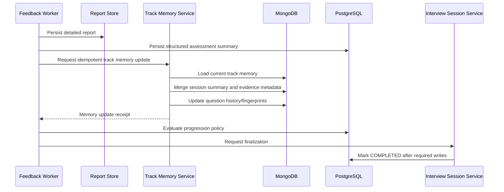

# Track Memory and Question History Updates

## 1. Purpose

After feedback is created, update the selected track's memory so future sessions can use relevant context without reading every historical transcript.

Track memory is track-specific. It must not leak evidence across different preparation tracks.

## 2. Memory Update Content

Suggested memory sections:
- `session_summaries`
- `assessed_topics`
- `not_assessed_topics`
- `competency_evidence_summary`
- `learning_priorities`
- `question_history`
- `question_fingerprints`
- `recent_assistance_topics`
- `current_interview_brief_version`

The memory update must preserve distinctions between Strict independent evidence and Guided assisted learning observations.

## 3. Update Flow

## 4. Merge Rules

- Use `session_id` as the idempotency key for a session memory update.
- Do not append the same session summary twice.
- Do not overwrite stronger historical evidence with a single contradictory observation; retain session-level evidence and update summaries with traceability.
- Keep evidence tied to its source session and turn IDs.
- Preserve the difference between assessed and not assessed.
- A new Interview Brief version must not silently rewrite historical reports or assessments.
- Strict sessions contribute independent evidence.
- Guided sessions contribute learning observations and assisted evidence, not the initial Strict baseline.
- Question history should store normalized fingerprints and competency/topic metadata.
- Avoid exact question repeats in Strict mode by default, while allowing concept revisits through a different wording/problem when useful.
- Guided sessions may deliberately revisit questions/concepts for teaching.

## 5. Proposed MongoDB Collections

Member 4 should coordinate these with Member 1's shared MongoDB conventions:

| Collection | Purpose |
|------------|---------|
| `session_feedback_reports` | Detailed report and evidence |
| `session_summaries` | Compact per-session summary |
| `track_memories` | Track-specific evolving memory |
| `track_question_history` | Asked questions and fingerprints |

Conversation turns remain in the shared `conversation_turns` collection. Do not create a collection per user, track or subject.
